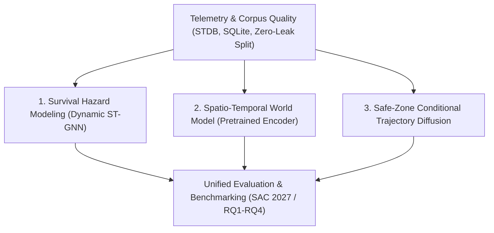

# PUBG Lab: Spatio-Temporal Graph Neural Networks & World Models for Battle Royale Dynamics

[](versions/releases/2026.10.26-r5/manifest.json)
[](pyproject.toml)
[](configs/environments/research.txt)
[](docs/guidelines/PUBG_APPLICATION.md)
[](tests/architecture/)

> **Language Navigation / 언어 바로가기**:  
> [English Overview](#english-overview) | [Core Research Pillars](#core-research-pillars) | [Repository Architecture](#repository-architecture) | [Quickstart & CLI](#quickstart--cli-usage) | [한국어 요약 (Korean Summary)](#korean-summary-한국어-안내)

---

## English Overview

**PUBG Lab** is a modular research monorepo investigating multi-agent spatial interactions, individual-team dynamics, survival hazard modeling, and macro-strategy in Battle Royale matches using fine-grained telemetry data from *PlayerUnknown's Battlegrounds (PUBG)*.

### Primary Research Target
- **Primary Goal**: Coursework Thesis &rarr; **FDG 2027** (*Foundations of Digital Games 2027*).
- **Subsequent Extension**: IEEE Transactions on Games (ToG).
- **Current Repository Release**: `2026.10.26-r5` (Refactored role-based research monorepo architecture).

---

## Core Research Pillars

The laboratory investigates four foundational pillars in spatial-temporal game AI:



### 1. Dynamic Spatio-Temporal Graph Neural Networks (ST-GNN)
- **Phase-level Survival Hazard Prediction (C-Process)**: Predicts next-phase elimination hazards ($k \to k+1$) with joint auxiliary tasks (normalized final placement rank, Top-5/Top-10 survival logits).
- **Strict Causality (A3 Causality)**: Causal 1D temporal gated convolutions with GLU activations ensure predictions at phase $t$ strictly observe information up to $t \le t_0$.
- **Multi-Relational Heterogeneous Graphs**: Dense per-phase spatial convolutions capturing geographical proximity, combat engagements, and sightlines across up to 128 team nodes.
- **Hierarchical Multi-Resolution (MR-STGNN)**: Bridges 10-second micro-tactical snapshot graphs with multi-minute macro-phase progressions through masked pooling and deep supervision.
- *Key Implementations*: [`dyn_stgnn.py`](src/pubg_lab/survival/models/dyn_stgnn.py), [`mr_stgnn.py`](src/pubg_lab/survival/models/mr_stgnn.py), [`stgcn.py`](src/pubg_lab/survival/models/stgcn.py), [`snapshot_phase_survival.py`](src/pubg_lab/survival/models/snapshot_phase_survival.py).

### 2. Pretrained Spatio-Temporal World Models
- **Joint Entity-Set Latent Representation**: Unified latent space integrating individual player dynamics, equipment inventories, mobility modes, team formations, terrain grid cells, dynamic bluezone/whitezone circles, and global match progression.
- **Self-Supervised Pretraining Objectives**:
  - *P1 (GraphMAE)*: Masked health history reconstruction.
  - *P2 (Trajectory GMM)*: Joint Gaussian Mixture Model negative log-likelihood for future movement deltas.
  - *P3 (Transit Mode)*: Classification of locomotion states (on-foot, vehicles).
  - *Pair Distance*: Preservation of inter-agent Euclidean distances.
- *Key Implementations*: [`encoder.py`](src/pubg_lab/world_model/models/encoder.py), [`pretraining.py`](src/pubg_lab/world_model/training/pretraining.py).

### 3. Safe-Zone Conditional Trajectory Diffusion
- **Macro-Center & Relative-Formation Decomposition**: Decouples squad movement into team center displacement and member-relative formation offsets (preserving A1 symmetry).
- **Frozen-Mean Residual Diffusion**: Employs a deterministic regressor for baseline guidance and a DDIM/DDPM residual diffusion model to generate diverse, safe-zone-conditioned future paths without future parameter leakage.
- *Key Implementation*: [`model_v4.py`](src/pubg_lab/movement/models/model_v4.py).

### 4. Rigorous Experimental Discipline & Zero Leakage
- **Temporal Patch Splitting**: Strict partition boundary where models are fitted on an earlier patch and evaluated on the subsequent patch (`Patch 40.2 train` &rarr; `Patch 41.1 dev-val` &rarr; `Patch 41.2 holdout`).
- **Read-Only Source Database**: Source PostgreSQL database is strictly read-only; metadata is indexed locally via SQLite.
- **Corpus Quality Auditing**: Full validation against missing values, coordinate anomalies, and edge-sum invariants via the [Corpus Quality Index](docs/data_layer/CORPUS_QUALITY_INDEX.md).

---

## Repository Architecture

The monorepo enforces physical boundaries between reusable library components, executable projects, and user applications:

```text
PUBG_Lab/
├── src/pubg_lab/          # Reusable research library package
│   ├── survival/          # Survival hazard models, ST-GNNs, baselines, losses
│   ├── world_model/       # World model encoder, pretraining heads, dataset contracts
│   ├── movement/          # Trajectory diffusion models, formation regressors
│   ├── data/              # DB adapters, telemetry parsing, quality indices
│   ├── analysis/          # Statistical testing, metrics, network analysis
│   ├── common/            # Shared paths, logging, environment utilities
│   └── repository/        # Architecture validation, structure checks, release tools
├── projects/              # Executable standalone research pipelines
│   ├── battle_royale/     # SAC 2027 / RQ1-RQ4 benchmarks, model zoo, ablation studies
│   ├── world_model/       # World model G1-G4 CPU training and validation runs
│   ├── movement_diffusion/# Trajectory diffusion experiment pipelines
│   └── sac2027/           # Thesis/paper tables, figures, statistical reports
├── apps/                  # Presentation generators, visualization tools, interactive apps
├── configs/               # Locked dependency sets (research, dev, quality)
├── docs/                  # Documentation object model, guidelines, formalizations
├── tests/                 # Architecture boundary unit tests, synthetic tests
└── versions/              # Model registry, historical provenance, release manifests
```

---

## Quickstart & CLI Usage

### 1. Environment Setup

It is strongly recommended to use Python 3.11+ within a dedicated environment (e.g., `pyenv`):

```bash
# Clone the repository
git clone https://github.com/Lunecid/PUBG_Lab.git
cd PUBG_Lab

# Ensure dependencies are available (see configs/environments/research.txt)
pip install -e ".[dev]"
```

### 2. Discovering CLI Commands

All library utilities and project tasks are discoverable through the unified `pubg_lab` entry point:

```bash
# List available commands
PYTHONPATH=src:. python3 -m pubg_lab list

# Or via installed script
pubg-lab list
```

### 3. Architecture & Codebase Validation

Verify repository structural integrity and architectural boundaries:

```bash
# Check import boundaries and module dependencies
make structure

# Run architecture boundary unit tests
make test-architecture

# Verify codebase formatting and linting (requires ruff)
make format-check lint
```

### 4. Running a Specific Model Verification

```bash
# Smoke test for Dynamic STGNN
python3 src/pubg_lab/survival/models/dyn_stgnn.py

# Verify current repository release manifest
PYTHONPATH=src:. python3 -m pubg_lab run repository.repository-release verify --release 2026.10.26-r5
```

---

## Research Guidelines & Governance

All research and engineering in this repository adhere strictly to the following living documents:
- [AGENTS.md](AGENTS.md): Core operating instructions and developer guidelines.
- [Working Rules (`WORKING_RULES.md`)](docs/guidelines/WORKING_RULES.md): Laws of architectural design (A0–A10), procedural workflows (B1–B8), and output governance.
- [PUBG Application Guidelines](docs/guidelines/PUBG_APPLICATION.md): Authorized scopes, patch boundaries, and paper goals.
- [Codebase Standard](docs/repository/CODEBASE_STANDARD.md): Physical layout and import rules.

---

<br>

---

## Korean Summary (한국어 안내)

### 프로젝트 개요
**PUBG Lab**은 배틀그라운드(PUBG) 공식 텔레메트리 데이터를 바탕으로 경기 내 공간(Spatial), 개인(Individual), 팀(Team), 경기 전체(Match) 구조의 시공간적 역동성을 모델링하는 모노레포 연구 저장소입니다.

- **현재 목표**: 수업 학위 논문 &rarr; **FDG 2027** 투고 (후속 확장: IEEE Transactions on Games).
- **코드 릴리스**: `2026.10.26-r5` (역할별 물리적 모듈화 및 아키텍처 경계 분리 완료).

---

### 핵심 연구 3대 분야

1. **동적 시공간 그래프 신경망 (Dynamic ST-GNN)**:
   - 각 페이즈(Phase) 전환 시점($k \to k+1$)에서 팀 탈락 위험도(Hazard) 및 최종 순위 보조 예측.
   - 인과적 1D 시간 합성곱(GLU)을 통해 미래 정보 누설(Lookahead)을 엄격히 방지 (A3 인과 법칙).
   - 10초 스냅샷과 페이즈 단위를 계층적으로 결합한 다해상도 모델(MR-STGNN) 구축.
2. **사전학습 시공간 월드 모델 (Pretrained World Model)**:
   - 플레이어, 팀 대형, 지형 그리드 셀, 안전구역(자기장) 원형 기하학, 글로벌 게임 상태를 결합하는 HGT/GraphMAE 기반 통합 인코더.
   - 체력 마스킹 재구성(P1), GMM 이동 궤적 우도(P2), 이동 모드 분류(P3), 개체 간 상대 거리 보존 손실 최적화.
3. **안전구역 조건부 경로 디퓨전 (Trajectory Diffusion)**:
   - 팀 중심(Center) 궤적과 스쿼드 상대 대형(Relative Formation)의 명시적 분해.
   - 결정론적 회귀 모델의 기준 경로를 바탕으로 DDIM 잔차 역방향 디퓨전을 통해 확률적 미래 경로 생성.

---

### 디렉토리 구조 및 시작 방법

- `src/pubg_lab/`: 7대 핵심 도메인(`survival`, `world_model`, `movement`, `data`, `analysis`, `common`, `repository`)의 재사용 연구 라이브러리.
- `projects/`: 독립 실행 프로젝트 (`battle_royale`, `world_model`, `movement_diffusion`, `sac2027`).
- `tests/`: 아키텍처 의존성 경계 검사 및 단위 시험.

#### 필수 명령어

```bash
# 1. 사용 가능한 CLI 명령어 목록 조회
PYTHONPATH=src:. python3 -m pubg_lab list

# 2. 저장소 구조 및 아키텍처 불변식 검증
make structure
make test-architecture

# 3. 릴리스 매니페스트 무결성 검증
PYTHONPATH=src:. python3 -m pubg_lab run repository.repository-release verify --release 2026.10.26-r5
```

---

## Citation & License

- **Authors**: Seong-Eun Baek ([@Lunecid](https://github.com/Lunecid)), PUBG Lab Research Team.
- **License**: Core research components and telemetry adapters are governed by research use agreements. Third-party dependencies follow their respective original licenses.
