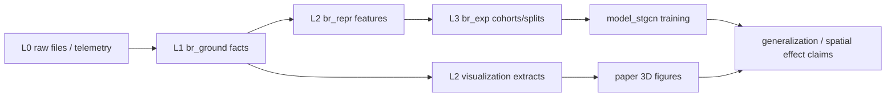

# BR Parallel Model And Visualization Roadmap

이 문서는 1차 DB 누적 이후 작업을 병렬로 진행하기 위한 마스터 설계다.

현재 상태:

- `pubg.*`는 PUBG normalized L1 ground layer다.
- `stdb.*`와 `model_stgcn/*`는 기존 PUBG 연구 표현/모델 레이어다.
- `br_raw/br_ground/br_repr/br_exp`는 PUBG와 Caldera를 함께 다루는 공통 BR layer다.
- Caldera는 endpoint, trajectory, environment prim catalog까지 들어왔다.

핵심 원칙:

```text
L1 ground는 바꾸지 않는다.
모델 feature와 figure용 데이터는 br_repr에서 파생한다.
논문 figure는 모델 claim과 같은 feature 축을 시각화한다.
```

## Parallel Tracks

| Track | Goal | Primary output | Owner scope |
| --- | --- | --- | --- |
| A. DB handling | `br_*` layer를 학습 가능한 dataset API로 연결 | BR adapter, feature manifest, cohort API | `br_ground`, `br_repr`, `br_exp`, loader |
| B. Feature design | spatial/generalization feature contract 정의 | cross-title feature manifest | docs + `br_repr` derived tables/views |
| C. Model design | observation mask 기반 PUBG/Caldera 공존 학습 | masked tensor, domain split, ablation matrix | `model_stgcn` adapters |
| D. 3D visualization | Warzone 공간 효과를 논문 figure로 보여줌 | HTML/PNG/figure scene artifacts | `reports/caldera_3d/*` |

이 네 트랙은 같은 축을 공유해야 한다:

```text
Environment Constraint -> Movement Response -> Competitive Exposure -> Survival Outcome
```

## Target Architecture



The important constraint is that model and figure must be coupled by feature
semantics, not by ad hoc plotting.  If the model uses a spatial constraint
feature, the figure should visualize the same spatial relation.

## DB Handling Layer

The next DB API should be additive:

- Read source facts from `br_ground`.
- Write derived features into `br_repr`.
- Write cohorts and splits into `br_exp`.
- Keep heavy tensors and rendered assets as files, with paths registered in DB.

Recommended adapter modules:

| Module | Responsibility |
| --- | --- |
| `br_dataset.sources` | list available sources, maps, match counts, observability |
| `br_dataset.features` | build feature matrix with value + mask per feature |
| `br_dataset.windows` | snapshot/phase/match observation windows |
| `br_dataset.cohorts` | balanced and domain-specific splits |
| `br_dataset.tensors` | convert features to model-ready arrays |
| `br_dataset.visualization` | sample scene data for figure generation |

The adapter should not replace `stdb.queries` immediately.  It should first
produce a compatible thin path:

```text
br_ground/br_repr -> br_dataset adapter -> existing model_stgcn loaders
```

The current PUBG learning path is still centered on `stdb.queries`, especially
phase tensor construction.  Therefore the first BR adapter should be a wrapper,
not a rewrite:

| Adapter | First responsibility |
| --- | --- |
| `PubgStdbAdapter` | call existing `stdb.queries`, attach `br_match_id = pubg:<match_id>`, `br_exp` split, and observation masks |
| `CalderaSpatialAdapter` | build low-observability spatial windows from `trajectory_samples`, `trajectory_summaries`, `endpoint_samples`, and `environment_prims` |
| `BrFeatureRowAdapter` | expose a row-level `br_repr.v_feature_rows`-like surface for tabular baselines and manifest importance |

Minimal API:

```text
list_br_eligible_match_ids(cohort_id, task, required_channels)
fetch_br_phase_tensors(cohort_id, split, feature_set_id, observation_policy)
fetch_br_snapshot_tensors(cohort_id, split, feature_set_id, observation_policy)
fetch_br_row_features(cohort_id, split, feature_set_id, observation_policy)
```

First compatibility check:

```text
PubgStdbAdapter(existing cohort) == current stdb tensor values
except for added masks and br_* metadata.
```

## Feature Contract

Every feature should carry four fields:

| Field | Meaning |
| --- | --- |
| `value` | numeric feature value |
| `observed_mask` | source exposes this feature |
| `valid_mask` | value is meaningful for this row/window |
| `family` | environment, movement, exposure, outcome, combat, loot, zone |

This avoids pretending PUBG and Caldera expose the same telemetry.

Manifest v3 should add:

| Field | Example |
| --- | --- |
| `source_availability` | `pubg_current_l1=observed`, `activision_caldera=structural_unavailable` |
| `observability_reason` | `not_released`, `not_applicable`, `missing_sample`, `censored`, `derived_proxy` |
| `default_fill` | `0`, `median`, `not_filled` |
| `mask_tensor` | `X_node_obs_mask`, `G_obs_mask`, `X_s_obs_mask`, `A_obs_mask` |
| `allowed_tasks` | `pubg_next_phase_hazard`, `caldera_endpoint_survival`, `trajectory_generalization` |
| `imputation_policy` | `zero_with_mask`, `median_with_mask`, `drop_if_missing` |

Initial cross-title feature families:

| Family | PUBG | Caldera | Use |
| --- | --- | --- | --- |
| movement | yes | yes | trajectory length, speed, displacement, sinuosity |
| endpoint/outcome | yes | yes | survival/end location proxy |
| proximity/exposure | yes | partial | trajectory density, nearest players, endpoint density |
| environment | partial | yes | bbox/terrain/building/cover proxy |
| zone pressure | yes | no | PUBG-rich only, masked for Caldera |
| combat | yes | no | PUBG-rich only, masked for Caldera |
| loot/readiness | yes | no | PUBG-rich only, masked for Caldera |

## Model Design

The first cross-title model experiment should not fine-tune Caldera as if it
were a PUBG clone.  It should test whether the shared primitive vocabulary holds
under lower observability.

Recommended experiment ladder:

1. PUBG-only rich DSACG baseline.
2. PUBG-only masked-to-Caldera feature subset.
3. Caldera-only spatial trajectory baseline.
4. Train on PUBG masked subset, evaluate Caldera-compatible spatial task.
5. Domain-held-out test: map/perspective/team for PUBG, title-held-out for Caldera.

The core metric should be stability under feature removal and domain shift, not
only absolute accuracy.

## 3D Visualization Design

The first scouting pipeline is practical and light:

- trajectory lines from `br_ground.trajectory_samples`
- endpoint density samples from `br_ground.endpoint_samples`
- environment bbox/centroid traces from `br_ground.environment_prims`
- camera presets for paper screenshots

The paper figure pipeline must not stop at bboxes.  For Caldera, the
publication-facing path is now asset mesh extraction from downloaded OpenUSD
visual prefabs, followed by DB trajectory projection onto that mesh:

```text
scripts/render_caldera_asset_snapshot.py
reports/caldera_3d/map_capital_visual_ground_agent_snapshot_1m_points.png
reports/caldera_3d/map_capital_visual_ground_agent_snapshot_closeup.png
```

This keeps the heavy visual layer as files, not PostgreSQL rows:

```text
L0 Caldera USD assets -> local mesh cache -> paper PNG
br_ground trajectory_samples -> same world-coordinate projection -> paper PNG
```

First figure candidates:

| Figure | What it proves | DB inputs |
| --- | --- | --- |
| trajectory over terrain scaffold | movement is constrained by map geometry | `trajectory_samples`, `environment_prims` |
| endpoint concentration around structures | outcome locations are spatially non-uniform | `endpoint_samples`, `environment_prims` |
| path efficiency vs spatial corridor | survival path is not just Euclidean distance | `trajectory_summaries`, `environment_prims` |

The figure script should output interactive HTML first, then static PNG/SVG
after camera angles are selected.

The first paper-safe spatial feature set should be:

```text
spatial_effect_caldera_postgis_v0
```

Scope:

- Caldera only;
- current PostGIS geometry, centroids, bboxes, buffers, bins;
- no full-mesh cover, exact line-of-sight, or interior/navigability claim;
- outputs in `br_repr.agent_spatial_effect_windows` and
  `br_repr.prim_spatial_effect_stats` once implemented.

## Immediate Work Order

1. Define `br_repr` spatial feature tables/views without mutating L1 ground.
2. Add a BR feature manifest format with observation masks.
3. Implement `PubgStdbAdapter` and prove parity with current `stdb.queries`.
4. Implement `CalderaSpatialAdapter` for `spatial_effect_caldera_postgis_v0`.
5. Connect one small Caldera spatial task and one masked-PUBG task to model
   entrypoints.

This order lets the paper story and the model code converge instead of drifting
apart: the visual evidence and model features come from the same spatial layer.

## Current Parallel Result

As of 2026-07-01, the first parallel pass produced:

| Output | Status |
| --- | --- |
| `docs/SPATIAL_EFFECT_FEATURE_DESIGN.md` | completed feature design |
| `scripts/visualize_caldera_3d.py` | completed Plotly HTML prototype |
| `docs/CALDERA_3D_VISUALIZATION_PLAN.md` | completed figure plan |
| `reports/caldera_3d/caldera_spatial_scene.html` | generated self-contained 3D scene, 5.2 MB |
| `reports/caldera_3d/caldera_spatial_snapshot.html` | generated paper-snapshot style scene, 5.1 MB |

The generated scene uses:

- 2 Caldera matches;
- 12 trajectory agents;
- 161 downsampled trajectory points;
- 2,000 endpoint samples;
- 300 environment prim bbox/centroid candidates.

The paper-snapshot scene uses:

- clay-style environment scaffold;
- 2 Caldera matches;
- 16 trajectory agents;
- 301 downsampled trajectory points;
- 2,000 endpoint samples;
- 500 environment prim bbox/centroid candidates;
- snapshot time `t=310.992s`.
