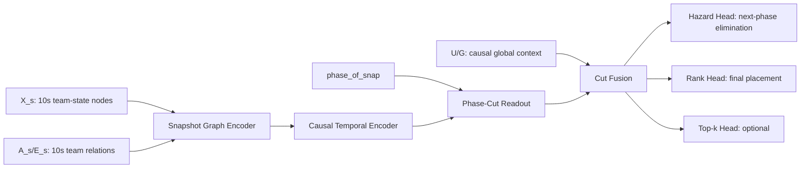

# Graph Data Modeling Foundation (2026-06-22)

## Purpose

이 문서는 Battle Royale survival prediction 연구의 graph modeling 기둥이다.

목적은 하나다.

> 그래프 데이터 모델링 관점에서 입력, 아키텍처, 출력, ablation 축을
> 먼저 고정한다. 그래야 이후 실험 결과가 흔들리지 않는다.

이 문서는 아래 문서들의 상위 기준으로 사용한다.

- `docs/BATTLE_ROYALE_GRAPH_FORMALISM_2026-06-22.md`
- `docs/PUBG_GRAPH_MODELING_RESEARCH_FRAME_2026-06-22.md`
- `docs/RELATED_WORK_FRAME_2026-06-22.md`
- `docs/DSACG_METHOD_SKELETON.md`
- `docs/PRE_EXPERIMENT_DESIGN_LOCK_2026-06-22.md`
- `docs/GENRE_PRIMITIVE_FEATURE_MANIFEST.csv`
- `docs/INPUT_MODEL_CHANNEL_CONTRACT_2026-06-22.md`
- `docs/FEATURE_CLOCK_CHANNEL_REDESIGN_2026-06-22.md`
- `docs/PUBG_DOMAIN_DESIGN_LAYER_2026-06-22.md`
- `docs/SNAPSHOT_FIRST_REDESIGN_AUDIT_2026-06-22.md`

## Core Decision

우리의 genre-level formalism은 다음이다.

```text
Dynamic Shrinking-Arena Competitive Graph (DSACG)
```

정확한 장르 수준 정의:

```text
A Battle Royale match is a dynamic shrinking-arena competitive graph in which
agents, spaces, resources, zones, and combat events form time-evolving
relational dependencies that determine survival hazard and final ranking.
```

PUBG에서의 empirical instantiation은 다음이다.

```text
Given a sequence of 10-second PUBG team-level graph projections observed up to
phase cut k, predict each at-risk team's probability of elimination before
phase k+1 and final placement strength.
```

핵심 고정점:

| Item | Decision |
| --- | --- |
| graph node | team |
| graph formalism | Battle Royale DSACG |
| empirical projection | PUBG team-level competitive survival graph |
| raw player telemetry | team node feature로 aggregate |
| graph edge | team-to-team relation |
| spatial meaning | team position + zone-relative state + team-to-team spatial/tactical relation |
| temporal input resolution | 10-second snapshot |
| output resolution | phase cut |
| main target | next-phase elimination hazard |
| canonical secondary target | final rank / final placement score |
| optional targets | top-5/top-10, calibration/survival curve |

Therefore:

> Phase는 입력을 뭉개는 단위가 아니라, 예측을 내는 cut point다.

Important positioning:

> PUBG is not the full claim. PUBG is the case study used to instantiate and
> evaluate the DSACG formalism as a team-level projection.

Legacy V3/MR results remain valid as:

```text
snapshot-informed pooled multi-resolution phase-head baseline
```

but the target design is:

```text
snapshot-first DSACG team-level projection model
```

## 0. Problem-Framing Stack

| Layer | Content |
| --- | --- |
| Domain problem | Battle Royale has shared mechanics, but genre-level computational modeling is underdeveloped |
| Representation problem | Survival, shrinking space, combat, resources, habitat, and rank must be represented together |
| Proposed formalism | Dynamic Shrinking-Arena Competitive Graph |
| Empirical instantiation | PUBG team-level multi-relational survival graph |
| Prediction tasks | phase-wise hazard and final rank |
| Validation | construct, predictive, mechanistic, and transfer validity |

The empirical PUBG research frame is:

```text
docs/PUBG_GRAPH_MODELING_RESEARCH_FRAME_2026-06-22.md
```

That document defines RQ1-RQ4, the spatial/combat/habitat edge taxonomy, the
representation ladder, and the role of homophily as a diagnostic rather than
the main thesis.

## 1. What A Graph Model Means

A graph sample is not only a feature matrix.

The minimal graph object is:

```text
G = (V, E, X, A, U, Y, M)
```

| Symbol | Meaning | PUBG interpretation |
| --- | --- | --- |
| `V` | nodes | teams |
| `E` | edges | team-to-team relations |
| `X` | node features | team state |
| `A` | adjacency / relation tensor | proximity, combat, co-pressure, relative advantage |
| `U` | graph/global context | phase, zone, alive population, map/mode |
| `Y` | labels | next-phase elimination, rank, top-k |
| `M` | masks | alive/valid team, valid phase, valid target |

For a dynamic graph:

```text
G_1, G_2, ..., G_T
```

In our case:

```text
G_t = 10-second team graph at snapshot t
```

The model should not silently collapse this sequence unless that collapse is the
explicit ablation being tested.

## 2. Node, Edge, Global, Target Are Different Objects

The first graph modeling rule:

> Node features, edge features, global features, and labels must not be mixed.

| Object | Example | Tensor owner | Can enter encoder? |
| --- | --- | --- | --- |
| node feature | team health, alive count, speed, zone distance | team `i` | yes |
| edge relation | team `i` near team `j`, team `i` damaged team `j` | pair `(i, j)` | yes, through message passing |
| edge feature | `z_i - z_j`, `alive_i - alive_j`, contact gate | pair `(i, j)` | yes, through edge-conditioned message |
| global context | phase index, zone radius, map, mode | match/phase | yes, through conditioning/fusion |
| label | eliminated before next phase | team `i`, phase `k` | no, supervision only |
| mask | valid alive team at cut | team `i`, phase `k` | no, loss/eval only |

This distinction is the foundation for stable ablation.

If an experiment changes node features and edge semantics at the same time, we
cannot tell whether the gain came from representation or topology.

## 3. PUBG Team-Level Projection Definition

The full Battle Royale graph may include agent, space, resource, zone, and
event nodes. In this project, we project that heterogeneous graph into a
team-level graph because the main prediction target is team survival/ranking and
the currently available telemetry supports team-level aggregation.

For each PUBG match, define a 10-second snapshot graph sequence.

### Snapshot Team Graph

```text
V_t = teams alive or known at snapshot t
X_s[t, i, :] = team-state features for team i at snapshot t
A_s[t, r, i, j] = relation r from team i to team j at snapshot t
E_s[t, i, j, :] = optional pairwise edge features
M_s[t, i] = whether team i is valid/alive/observable at snapshot t
```

Canonical tensor shapes:

```text
X_s:          (B, T_s, N, F_s)
A_s:          (B, T_s, R_s, N, N)
E_s optional: (B, T_s, N, N, F_e)
node_mask_s:  (B, T_s, N)
phase_of_snap:(B, T_s)
```

Where:

- `B`: batch size;
- `T_s`: number of 10-second snapshots;
- `N`: max team slots in the match;
- `F_s`: snapshot node feature count;
- `R_s`: snapshot relation channels.

### Phase Cut Targets

Predictions are emitted at phase cuts.

```text
y_hazard[k, i] = 1 if team i is eliminated before phase k+1
target_mask[k, i] = 1 if team i is at risk and label is valid
```

Canonical target shapes:

```text
y_hazard:    (B, K, N)
target_mask: (B, K, N)
y_rank:      (B, N)       required for final multi-head model; optional in smoke
y_topk:      (B, N, Ktop) optional
```

For PUBG phase cuts:

```text
K = 7 hazard cuts if predicting next-phase elimination for phases 1-7
```

Survival probability can be derived from hazards:

```text
S[k, i] = product_{c <= k} (1 - hazard[c, i])
```

## 4. Spatial Meaning In This Project

The feedback that "spatial is unclear" is important. In this project, spatial
must be stated as three separate things.

| Spatial layer | Meaning | Tensor location |
| --- | --- | --- |
| absolute map position | where the team is | node feature `X_s` |
| zone-relative position | where the team is relative to current/next safe zone | node/global features `X_s`, `U` |
| relational space | which teams are close, contacting, co-pressured, or advantaged | edge tensor `A_s`, `E_s` |

Therefore:

```text
Spatial != only x/y coordinates.
Spatial = position + zone geometry + pairwise relation topology.
```

This gives the graph a clear reason to exist. A tabular temporal model can see
where a team is. A graph model should additionally see who is nearby, who is in
contact, and what relative tactical advantage exists between teams.

## 5. Basic GNN Architecture

The general message passing step is:

```text
h_i^{l+1} =
  Update(
    h_i^l,
    Aggregate_j Message(h_i^l, h_j^l, edge_{i,j})
  )
```

In words:

1. each team has a hidden state `h_i`;
2. neighboring teams send messages through edges;
3. messages are aggregated;
4. the team state is updated;
5. the output head reads the updated team state.

Our task is node-level prediction:

```text
team node representation at phase cut k -> team hazard at phase cut k
```

It is not graph-level prediction:

```text
whole match graph -> one label
```

This matters because we should not use graph-level pooling as the primary
readout. Pooling across teams is useful for global context, but the main output
must remain per team.

## 6. Relation Variants: GCN, R-GCN, Edge-Conditioned GNN

### GCN

GCN treats edges as one combined graph.

```text
A_mix = combine(A_proximity, A_combat, A_copressure)
h_i' = sum_j A_mix[i, j] W h_j
```

Meaning:

> The model knows that team j is connected to team i, but relation type is
> mostly collapsed.

Use GCN as a simple graph baseline.

### R-GCN

R-GCN preserves relation type.

```text
h_i' =
  sum_j A_proximity[i, j] W_proximity h_j
+ sum_j A_combat[i, j] W_combat h_j
+ sum_j A_copressure[i, j] W_copressure h_j
```

Meaning:

> Proximity, combat, and co-pressure are different ways for one team to affect
> another team.

Use R-GCN when testing whether typed PUBG relations matter.

### Edge-Conditioned GNN

Edge-conditioned GNN uses edge features, not only edge labels.

```text
w_{i,j} = MLP(E_s[i, j])
message_{i <- j} = w_{i,j} * W h_j
```

Meaning:

> The edge says not only that teams are connected, but how they are connected:
> relative altitude, health advantage, alive-count difference, zone advantage,
> or combat pressure.

Use this for contact-gated relative-advantage edges.

## 6.1 Edge Modeling Decision

Previous results showed that simple phase-tier relation edges were weak:

```text
proximity + combat + co-pressure did not robustly beat edge-shuffled nulls.
```

Interpretation:

> The old edge set mostly represented "there is a relation" and often behaved
> like graph smoothing. It did not reliably represent who was threatening whom,
> who had advantage, or how contact changed future survival.

Therefore, the next canonical edge design should not make raw
proximity/combat/co-pressure the main graph claim. They remain baselines and
gates.

### Homophily Guardrail

The core research question is not whether PUBG is a homophilic graph.

Use homophily/smoothing analysis only as:

- a baseline diagnosis;
- a negative motivation for why standard GCN-style averaging may be weak;
- a reason to test relation-aware, edge-conditioned, ego-preserving message
  passing.

Preferred wording:

```text
PUBG relations are competitive survival dependencies, not homophilic similarity
links. The goal is therefore to define survival-relevant edge semantics and
learn relation-specific messages, not to classify PUBG as homophilic or
heterophilic.
```

### Conditional Dependency Definition

An edge is meaningful when relational information adds survival information
beyond a team's own state and global context:

```text
Y_i^{t+Delta} not independent of (X_j^t, e_ij^{r,t})
given X_i^t and U_t
```

In words:

> Team i's future survival is not fully explained by team i's own state and the
> global arena context; team j and the relation from j to i provide additional
> information.

### Edge Construction Principle

Use a two-stage edge definition:

```text
candidate contact gate + directed relative edge features
```

Stage 1. Candidate contact gate:

```text
gate_{i,j,t} = 1 if teams i and j are likely to interact or compete
```

Candidate gates:

| Gate | Meaning |
| --- | --- |
| proximity kNN/radius | physically close enough to matter |
| recent combat | damage/knock/kill interaction in recent window |
| safe-entry competition | teams competing for similar safe-zone entry or habitat |
| local crossfire | nearby active fights even if not directly involving the team |

Stage 2. Directed relative edge features:

```text
E_s[t, i, j] = relative state from source j to target i
```

Candidate edge features:

| Feature group | Examples | Why it matters |
| --- | --- | --- |
| relative position | distance, bearing, `z_j - z_i` | geometry and high-ground exposure |
| roster advantage | `alive_j - alive_i`, health difference | local fight capacity |
| zone advantage | boundary distance difference, required-speed difference | who is more pressured by zone |
| movement advantage | speed difference, vehicle availability difference | who can rotate or disengage |
| combat pressure | recent damage `j -> i`, damage `i -> j`, knock pressure | directed threat |
| crowding/crossfire | nearby fighting pairs, third-party density | indirect battle-royale risk |
| resource advantage | heal/boost/armor/ammo readiness difference when available | fight sustain capacity |

This makes the edge answer:

```text
How does team j change team i's future survival/rank risk right now?
```

not merely:

```text
Are team i and team j connected?
```

### Recommended Edge Operators

| Operator | Use |
| --- | --- |
| no graph | required baseline |
| R-GCN over relation labels | typed-edge baseline |
| edge-conditioned GNN | primary candidate for relative edge features |
| graph attention with edge bias | alternative when edge features should modulate attention |
| signed threat/opportunity channels | optional when separating danger from advantage |

The preferred next graph model is:

```text
contact-gated edge-conditioned snapshot GNN
```

where message strength depends on `E_s[t, i, j]`, not only on relation type.

### Edge Null Controls

Any graph claim must beat null controls under the same node features, same
split, same head, and same training budget.

Required controls:

| Control | Meaning |
| --- | --- |
| no graph | removes message passing |
| density-matched random graph | tests whether only degree/density matters |
| edge shuffle | keeps rough edge count but breaks topology |
| node shuffle / node-absolute control | tests whether edge features only copy node strength |
| gate only | contact gate without relative features |
| relative features without true topology | tests whether pairwise values beat topology itself |

Safe claim threshold:

> Edge modeling is meaningful only if the real/contact-gated relative edge model
> beats no-graph and edge-shuffled/null controls on hazard and does not harm rank
> metrics.

## 7. Canonical Target Architecture

The intended architecture should be stated as:

```text
10-second dynamic team graph
  -> snapshot graph encoder
  -> causal temporal encoder
  -> phase-cut readout
  -> team-level hazard / rank / top-k heads
```

Mermaid view:



Canonical computation:

```text
for each 10-second snapshot t:
  h_graph[t] = GraphEncoder(X_s[t], A_s[t], E_s[t])

h_time[<=t] = CausalTemporalEncoder(h_graph[<=t])

for each phase cut k:
  t_k = last snapshot observable at cut k
  z[k] = Readout(h_time[<=t_k], phase_of_snap, optional global context)
  hazard[k, team] = Head(z[k, team])
  rank_score[k, team] = RankHead(z[k, team])
```

Important:

> The readout may summarize snapshots up to a phase cut, but this must be an
> explicit module: last snapshot, causal attention, learned pooling, or declared
> mean-pooling baseline.

## 8. Minimum Viable Canonical Model

Before adding complicated modules, the first stable model should be:

```text
X_s, A_s
  -> per-snapshot R-GCN or no-graph encoder
  -> causal TCN/GRU over snapshots
  -> last-snapshot-at-phase-cut gather
  -> hazard head + final-rank head
```

Required outputs:

```text
hazard_logits: (B, K, N)
hazard_prob:   (B, K, N)
rank_score:    (B, K, N)
target_mask:   (B, K, N)
prediction CSV with match_id, phase_idx, team_id, y_hazard, p_hazard, rank_score
metrics JSON/CSV
```

Only after this model is stable should we add:

- edge-conditioned relative advantage;
- global FiLM/gating;
- top-k auxiliary heads;
- phase aggregate auxiliary context;
- transformer-style temporal attention.

## 9. What Inputs Are Allowed

### Main Snapshot-First Inputs

| Channel | Tensor | Role |
| --- | --- | --- |
| C1 snapshot team-state | `X_s` | primary node input |
| C2 snapshot relation | `A_s`, optional `E_s` | primary graph input |
| C4 causal global context | `G/U` | optional cut conditioning |
| C8 labels/masks | `y`, `mask` | supervision only |

### Baseline Or Auxiliary Inputs

| Channel | Use |
| --- | --- |
| C3 phase team-state | phase-only baseline or auxiliary-context ablation |
| C5 phase relation | phase graph baseline or legacy pooled-MR baseline |
| C7 prior-work strategy | Sagong-style baseline or interpretable baseline |

Design rule:

> C3/C5 phase aggregate features must not silently enter the main
> snapshot-first model. If they enter, the experiment name must say so.

## 10. Output Head Contract

### H0. Hazard Head

Main head.

```text
hazard[k, i] = P(team i eliminated before phase k+1 | observations <= cut k)
```

Primary metrics:

- AUC;
- AP;
- BCE;
- Brier;
- ECE;
- phase-band calibration.

### H1. Survival Curve

Derived or auxiliary.

```text
S[k, i] = product_{c <= k} (1 - hazard[c, i])
```

Use for interpretability and calibration, not as the first unstable objective.

### H2. Final Rank Head

Canonical secondary head.

```text
rank_score[k, i] = predicted final placement strength for team i
given observations <= phase cut k
```

Metrics:

- Spearman rho;
- normalized rank MAE;
- pairwise rank accuracy.

Recommended training:

```text
L_rank = pairwise ranking loss within the same match and phase cut
```

The head should learn an ordering among teams in the same match. A simple
regression loss on normalized final placement may be kept as a baseline, but
pairwise/listwise ranking is more aligned with the final-placement task.

### H3. Top-k Head

Optional auxiliary head.

```text
top-5 / top-10 placement probability
```

Metrics:

- top-k AUC;
- top-k AP;
- top-k Brier.

Decision:

> The final canonical model should output both H0 hazard and H2 final-rank
> score. For smoke tests, H0-only is allowed. H1 survival curve is derived from
> hazard, and H3 top-k remains an auxiliary head ablation.

Canonical loss:

```text
L = lambda_hazard * L_hazard
  + lambda_rank   * L_rank
  + lambda_topk   * L_topk optional
  + lambda_cal    * L_calibration optional
```

Default starting point:

```text
lambda_hazard = 1.0
lambda_rank   = 0.2
lambda_topk   = 0.0
lambda_cal    = 0.0
```

Tune these weights only on validation data.

## 11. Ablation Pillars

Ablation must change one pillar at a time.

| Pillar | Question | Valid rows |
| --- | --- | --- |
| A0 data resolution | Does 10s input matter? | phase-only, legacy pooled-MR, snapshot-cut, last-snapshot-only |
| A1 temporal dynamics | Does sequence order matter? | observed time, time shuffle, within-phase shuffle, last-only |
| A2 graph topology | Does relation topology matter? | no graph, observed graph, node shuffle, edge shuffle |
| A3 relation semantics | Which edge meaning matters? | proximity, combat, co-pressure, relative advantage |
| A4 graph operator | Which message-passing operator works? | GCN, GraphSAGE, GAT, R-GCN, edge-conditioned |
| A5 feature channel | Which input channel matters? | snapshot state, +global, +edge, +phase auxiliary |
| A6 output head | Which supervision helps? | hazard, hazard+rank, hazard+rank+top-k |
| A7 domain robustness | Does it generalize? | map split, mode split, phase band, seed repeat, tier slice if available |

Critical rule:

> Do not compare rows that change multiple pillars and call it an ablation.

Example:

Bad comparison:

```text
phase_rgcn with full phase features
vs snapshot_gat with different features and different output heads
```

Good comparison:

```text
snapshot_no_graph vs snapshot_rgcn
same split, same snapshot node features, same head, same training budget
```

## 12. Experimental Invariants

Every experiment result must record:

- dataset slice: map, mode, perspective, collection period;
- split id and match ids;
- input channels consumed;
- feature clock consumed;
- graph construction;
- edge relation modes;
- model operator;
- temporal encoder;
- phase-cut readout method;
- head set;
- loss weights;
- metrics;
- checkpoint path;
- eval JSON path;
- prediction CSV path if exported.

If these fields are absent, the result is not interpretable enough for final
ablation tables.

## 13. Interpretation Rules

### If graph beats no-graph

Allowed claim:

```text
The chosen relation representation improves phase-cut team hazard prediction.
```

Not allowed:

```text
Graphs are universally better.
```

### If observed graph does not beat edge shuffle

Allowed claim:

```text
This edge construction did not show reliable topology signal beyond null
controls.
```

Not allowed:

```text
Topology is useless.
```

### If snapshot-cut beats phase-only

Allowed claim:

```text
Preserving 10-second observations improves phase-cut survival prediction.
```

Not allowed:

```text
The model predicts survival at every 10-second tick.
```

## 14. Immediate Architecture Baseline Matrix

The first stable matrix should be small.

| Row id | Input | Graph | Temporal | Readout | Head | Purpose |
| --- | --- | --- | --- | --- | --- | --- |
| `phase_tabular_hgb` | C3/C4 | none | none | phase row | hazard + rank if available | non-neural feature baseline |
| `phase_tcn` | C3/C4 | none | phase TCN | phase cut | hazard + rank | phase temporal baseline |
| `legacy_mr_pooled` | C1/C2 + C3/C4/C5 | legacy pooled | snapshot-to-phase mean pool | phase cut | hazard + rank | bridge to current results |
| `snapshot_last_only` | C1 | none | none | last snapshot at cut | hazard + rank | high-resolution state baseline |
| `snapshot_tcn_no_graph` | C1 | none | causal TCN | cut gather | hazard + rank | temporal dynamics without topology |
| `snapshot_rgcn` | C1/C2 | R-GCN | causal TCN | cut gather | hazard + rank | typed-relation snapshot graph baseline |
| `snapshot_rgcn_edge_shuffle` | C1/C2 shuffled | R-GCN | causal TCN | cut gather | hazard + rank | topology null control |
| `snapshot_gate_only` | C1 + contact gate | edge gate only | causal TCN | cut gather | hazard + rank | tests contact topology without relative features |
| `snapshot_relative_edge` | C1/C2/E_s | edge-conditioned | causal TCN | cut gather | hazard + rank | domain-specific directed relation semantics |

Do not expand the matrix until these rows are reproducible.

## 15. Short Presentation Wording

Use:

```text
We model a PUBG match as a dynamic team graph. Each node is a team, node
features describe team state at 10-second resolution, edges describe spatial
and tactical relations between teams, and global context describes phase/zone
conditions. The model performs message passing over the snapshot graph sequence,
then reads team representations at phase cuts to predict next-phase elimination
hazard.
```

Avoid:

```text
We put PUBG features into a GNN.
```

That wording hides the graph modeling decision.
