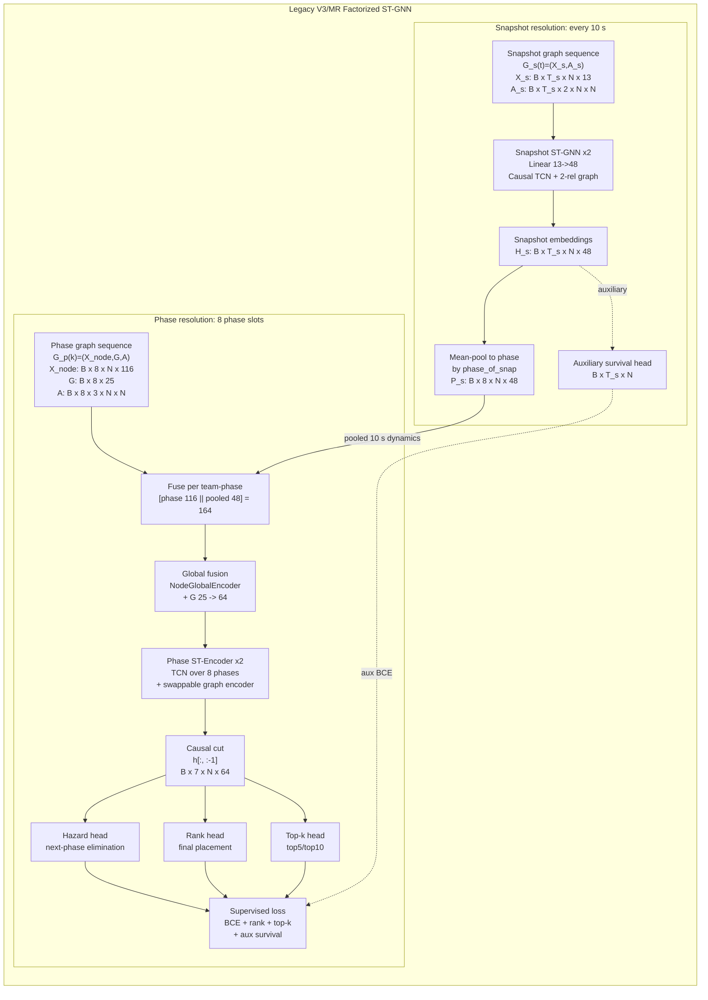

# Model Architecture Design Spec - Legacy Factorized Multi-Resolution ST-GNN (V3)

**Purpose:** presentation-ready architecture design spec for the already-produced legacy V3/MR results.

**Code-grounded date:** 2026-06-22

**Primary code paths:**

- Data assembly: `model_stgcn/v3/factorized_data.py`
- Snapshot tensors: `stdb/snapshot_queries.py`
- Phase tensors and labels: `stdb/queries.py`
- Snapshot encoder and pooling: `model_stgcn/snapshot_encoder.py`
- Main V3 architecture: `model_stgcn/v3/models.py`
- Shared temporal and snapshot graph block: `model_stgcn/dyn_stgnn.py`
- Training loss: `model_stgcn/v3/models.py::factorized_mr_loss`

This document describes the **past/current result-producing model**, not the redesigned `snapshot_phase_survival_v1`.

For the next domain-aware redesign, use:

```text
docs/PUBG_DOMAIN_DESIGN_LAYER_2026-06-22.md
```

That document defines the PUBG mechanisms that future figures should expose:
population rule-set, roster survival capital, rotation tempo, zone/habitat
pressure, local opponent field, combat exchange, resource readiness, strategic
behavior, relation topology, and phase horizon. Keep those as future-design
annotations unless the corresponding model has been rerun.

The honest model name is:

> **Factorized multi-resolution ST-GNN with a 10-second snapshot encoder and a phase-level prediction head.**

Do not describe this model as a fully snapshot-resolution survival model. It uses 10-second data, but after snapshot encoding it mean-pools snapshot embeddings into phase-level representations.

---

## 1. One-Sentence Architecture

The model receives two time resolutions in parallel:

1. a **10-second snapshot lane** with compact team-state features and 2-relation team graphs;
2. a **phase lane** with phase-aggregated team features, phase-global context, and 3-relation phase graphs.

The snapshot lane is encoded first, then **mean-pooled into phase slots**, concatenated with phase features, processed by a phase-resolution spatio-temporal graph encoder, and decoded into next-phase elimination hazard, final rank, and top-k forecasts.

---

## 2. What The Diagram Must Show

The diagram must not start from a single generic "Input graph" box. The code has **two input lanes**.

```text
+----------------------------+      +----------------------------+
| Snapshot lane             |      | Phase lane                 |
| every 10 seconds          |      | each game phase            |
| X_s: 13 team features     |      | X_node: 116 team features  |
| A_s: 2 graph relations    |      | G: 25 global features      |
| T_s <= 200                |      | A: 3 graph relations       |
+-------------+--------------+      | T = 8 phases               |
              |                     +-------------+--------------+
              v                                   |
      Snapshot ST-GNN x2                          |
              |                                   |
              v                                   |
      mean-pool snapshots                         |
      into 8 phase slots                          |
              |                                   |
              +-------------- concat -------------+
                             |
                             v
              Phase ST-Encoder x2 at phase resolution
                             |
                             v
              causal cut phases 1..7
                             |
                             v
              hazard head / rank head / top-k head
```

The key annotation is:

> 10-second dynamics are encoded before pooling, but main graph reasoning and final heads operate at phase resolution.

---

## 3. Graph Structure And Scale

### 3.1 Node Definition

One node is one PUBG team.

```text
node = team
N = 128 padded team slots
real squad match usually uses far fewer valid team slots
team_mask and node masks remove padded or dead/invalid slots
```

The same team index is used in both lanes. This is why snapshot tensors and phase tensors can be fused later.

### 3.2 Two Dynamic Graphs

The model has two graph scales.

| Graph | Tensor | Time scale | Relations | Used where |
| --- | --- | --- | --- | --- |
| Snapshot graph | `A_s` | every 10 seconds | proximity, combat | snapshot encoder |
| Phase graph | `A` | 8 phase slots | proximity, combat, co-pressure | phase ST-Encoder |

In the presentation, draw these as two separate graph inputs. Do not draw one graph and imply it is used identically throughout the model.

---

## 4. Input Tensors

Notation:

```text
B   = batch size, one item is one match
T_s = number of 10-second snapshots, padded to max 200
T   = number of phase slots, fixed at 8
N   = padded team slots, fixed at 128
```

### 4.1 Snapshot Lane Inputs

Code source: `stdb/snapshot_queries.py::fetch_snapshot_match_tensors`

| Tensor | Shape | Meaning |
| --- | --- | --- |
| `X_s` | `(B, T_s, N, 13)` | 10-second team-state features |
| `A_s` | `(B, T_s, 2, N, N)` | 10-second team graph, 2 relations |
| `phase_of_snap` | `(B, T_s)` | phase id for each snapshot, 0 for landing/pre-phase |
| `node_mask_s` | `(B, T_s, N)` | valid/alive team mask per snapshot |
| `death_snap_idx` | `(B, N)` | last alive snapshot index, used by auxiliary survival loss |

The 13 snapshot features are:

| # | Feature | Meaning for the slide |
| --- | --- | --- |
| 1 | `pos_x` | team x-position |
| 2 | `pos_y` | team y-position |
| 3 | `pos_z` | team elevation |
| 4 | `rel_zone_x` | x-position relative to safe zone |
| 5 | `rel_zone_y` | y-position relative to safe zone |
| 6 | `speed_mps` | movement speed |
| 7 | `dist_blue_boundary_m` | distance to blue-zone boundary |
| 8 | `inside_blue` | whether team is inside blue zone |
| 9 | `dist_target_center_m` | distance to next safe-zone center |
| 10 | `mean_health` | mean player health in team |
| 11 | `min_health` | minimum player health in team |
| 12 | `alive_n` | number of alive players in team |
| 13 | `vehicle_ratio` | fraction of team in vehicle |

Snapshot graph relations:

| Relation | Meaning | Slide wording |
| --- | --- | --- |
| proximity | teams close in space at snapshot time | "spatial proximity" |
| combat | combat interaction attributed to the past 10-second window | "recent combat" |

### 4.2 Phase Lane Inputs

Code source:

- `stdb/queries.py::fetch_phase_match_tensors`
- `model_stgcn/v3/factorized_data.py::factorize_phase_tensors`
- `model_stgcn/v3/spec.py::split_feature_names`

| Tensor | Shape | Meaning |
| --- | --- | --- |
| `X_node` | `(B, 8, N, 116)` | team-specific phase features |
| `G` | `(B, 8, 25)` | phase/global context |
| `A` | `(B, 8, 3, N, N)` | phase graph, 3 relations |
| `node_mask` | `(B, 8, N)` | valid/alive team mask per phase |
| `phase_mask` | `(B, 8)` | valid phase mask |
| `target_mask` | `(B, 7, N)` | at-risk team-phase mask for hazard scoring |

The full phase feature view contains 141 input columns. V3 splits them into:

```text
116 team/node features + 25 global phase features = 141 total phase features
```

For the diagram, do not list all 116 node features. Use grouped labels:

| Phase node feature group | Meaning |
| --- | --- |
| conventional team state | position, health, alive players, movement and combat summaries |
| STDB spatial/exposure | zone distance, boundary exposure, trajectory summaries |
| network role features | team relational role or cumulative graph-style summaries |
| habitat/pressure features | safe-area pressure, crowding, zone pressure features |

Global phase context `G` summarizes the phase itself:

| Global context group | Meaning |
| --- | --- |
| phase clock | phase index and phase duration |
| alive population | alive teams and alive players |
| zone geometry | safe radius, radius delta, center shift, poison radius |
| habitat globals | safe area, area loss, crowding pressure, global zone gap |

Phase graph relations:

| Relation | Meaning | Slide wording |
| --- | --- | --- |
| proximity | phase-level spatial closeness |
| combat | phase-level combat relation |
| co-pressure | shared pressure or habitat/zone pressure relation |

### 4.3 Labels And Supervision Targets

| Target | Shape | Meaning | Head |
| --- | --- | --- | --- |
| `y_hazard` | `(B, 7, N)` | whether team is eliminated before the next phase | hazard head |
| `y_rank` | `(B, N)` | final placement/rank label | rank head |
| `y_topk` | `(B, N, 2)` | final top-5 and top-10 labels | top-k head |
| snapshot survival target | `(B, T_s, N)` | auxiliary survival target from `death_snap_idx` | auxiliary survival head |

The main prediction unit is:

```text
at-risk team x cut-phase
```

There are 7 scored cut phases because phase slots are 1..8 and the model predicts next-phase events from phases 1..7.

---

## 5. End-To-End Forward Pass

This section is the exact data flow to draw.

### Stage A: Fetch And Factorize Inputs

Code:

```text
fetch_factorized_mr_match(match_id)
  -> fetch_factorized_phase_match(match_id)
       -> fetch_phase_match_tensors(match_id)
       -> factorize_phase_tensors(...)
  -> fetch_snapshot_match_tensors(match_id)
```

Output batch keys:

```text
X_s, A_s, phase_of_snap, node_mask_s, death_snap_idx
X_node, G, A, y_hazard, y_rank, y_topk, masks
```

Diagram box label:

```text
Input: dynamic team graph at two resolutions
```

But inside that box, split it into snapshot and phase lanes.

### Stage B: Snapshot Encoder

Code:

```text
FactorizedMRGNN.forward
  snap_emb = self.snap_encoder(X_s, A_s)
```

Architecture:

```text
X_s: (B,T_s,N,13)
  -> Linear 13 -> 48
  -> Snapshot DynamicSTBlock x2
  -> snap_emb: (B,T_s,N,48)
```

Each snapshot block is:

```text
Causal TCN over T_s
  -> 2-relation heterogeneous graph convolution
  -> Causal TCN over T_s
  -> LayerNorm + Dropout + Residual
```

Important slide note:

```text
This branch sees the 10-second sequence.
It is causal in snapshot time.
It uses 2 graph relations: proximity and combat.
```

### Stage C: Snapshot-To-Phase Pooling

Code:

```text
pooled = pool_snapshots_to_phase(
    snap_emb,
    phase_of_snap,
    node_mask_s,
    t_phase=X_node.shape[1],
)
```

Tensor flow:

```text
snap_emb: (B,T_s,N,48)
  -> masked mean over snapshots assigned to each phase
pooled:   (B,8,N,48)
```

This is the most important honesty point in the diagram:

> The 10-second sequence is encoded first, then collapsed into 8 phase slots.

Draw a visible box:

```text
MEAN-POOL TO PHASE
10 s embeddings -> 8 phase embeddings
```

Do not hide this inside a generic "Fuse" arrow.

### Stage D: Fuse Snapshot And Phase Lanes

Code:

```text
X_aug = torch.cat([X_node, pooled], dim=-1)
```

Tensor flow:

```text
X_node: (B,8,N,116)
pooled: (B,8,N,48)
concat: (B,8,N,164)
```

Diagram label:

```text
Fuse per team per phase
[phase node 116 || pooled snapshot 48] = 164-d
```

### Stage E: Global Fusion

Code:

```text
FactorizedPhaseGNN.input = NodeGlobalEncoder(...)
h = self.input(X_aug, G)
```

Tensor flow:

```text
X_aug: (B,8,N,164)
G:     (B,8,25)
  -> NodeGlobalEncoder
h:     (B,8,N,64)
```

What happens inside:

```text
node branch:   Linear 164 -> 64
global branch: Linear 25 -> 64, broadcast to all teams in the phase
fusion: concat / add / FiLM / none
```

Default V3 setting is usually `concat`; some result rows use `film`.

Slide wording:

```text
Global phase context gates or fuses with every team embedding.
```

### Stage F: Phase ST-Encoder

Code:

```text
for block in self.blocks:
    h = block(h, A, edge_active_mask=phase_edge_mask)
```

Tensor flow:

```text
h: (B,8,N,64)
  -> GraphTemporalBlock x2
h: (B,8,N,64)
```

Each phase block is:

```text
Causal TCN over 8 phase steps
  -> Graph Encoder over phase graph A
  -> Causal TCN over 8 phase steps
  -> LayerNorm + Dropout + Residual
```

The graph encoder is the ablated/swapped component:

```text
none / GCN / GraphSAGE / GAT / Relational-GCN
```

The phase graph has 3 relations:

```text
proximity / combat / co-pressure
```

Critical diagram label:

```text
Phase ST-Encoder x2
time axis = 8 phases, not 10-second snapshots
```

### Stage G: Causal Cut

Code:

```text
cut_h = h[:, :-1]
```

Tensor flow:

```text
h:     (B,8,N,64)
cut_h: (B,7,N,64)
```

Meaning:

```text
phase 1 embedding -> predicts event before phase 2
phase 2 embedding -> predicts event before phase 3
...
phase 7 embedding -> predicts event before phase 8
```

Draw this as a small box before the heads:

```text
Causal cut
use phases 1..7
predict next-phase outcomes
```

### Stage H: Output Heads

Code:

```text
hazard_logits = hazard_head(cut_h)
decoded = team_decoder(cut_h)
rank_pred = rank_head(decoded)
topk_logits = topk_head(decoded)
survival = survival_head(snap_emb)
```

Main outputs:

| Output | Shape | Meaning | Metric |
| --- | --- | --- | --- |
| `hazard_logits` | `(B,7,N)` | next-phase elimination risk | AUC, AP, BCE, Brier, ECE |
| `rank_pred` | `(B,7,N)` | final placement forecast at each cut | Spearman rho, rank error |
| `topk_logits` | `(B,7,N,2)` | top-5 and top-10 forecasts | top-k AUC/AP/Brier |

Auxiliary output:

| Output | Shape | Meaning |
| --- | --- | --- |
| `survival` | `(B,T_s,N)` | snapshot-level auxiliary survival signal |

The auxiliary survival head is not the main task head. It only regularizes the snapshot encoder.

---

## 6. Loss Function

Code:

```text
factorized_mr_loss(...)
```

Total loss:

```text
total =
    hazard BCE
  + 0.3 * rank L1
  + 0.3 * top-k BCE
  + 0.3 * auxiliary snapshot survival BCE
  + optional pairwise rank loss
```

Main loss terms:

| Loss term | Masked by | Purpose |
| --- | --- | --- |
| hazard BCE | `target_mask` | next-phase elimination prediction |
| rank L1 | `target_mask` | final placement forecast from each cut phase |
| top-k BCE | `target_mask` | top-5 and top-10 classification |
| auxiliary survival BCE | snapshot at-risk mask | regularize 10-second snapshot encoder |
| optional pairwise rank | valid team pairs | improve ordering among teams |

Presentation wording:

```text
Training is supervised at the team-phase level, with an auxiliary snapshot survival loss.
```

---

## 7. Spatio-Temporal Block Internals

Use this inset box in the diagram, similar to the reference GNN pipeline figure.

### 7.1 Generic Block Shape

```text
                    residual / skip connection
                  +---------------------------+
                  |                           v
Input embedding -> Causal TCN -> Graph Encoder -> Causal TCN -> LayerNorm + Dropout -> + -> ReLU
```

### 7.2 Snapshot Block

Used in:

```text
SnapshotEncoder -> DynamicSTBlock x2
```

Block details:

```text
time axis: T_s 10-second snapshots
node dim: teams
graph: A_s with 2 relations
channels: 48 -> 96 -> 48
graph layer: R-GCN-style heterogeneous spatial GCN
```

### 7.3 Phase Block

Used in:

```text
FactorizedPhaseGNN -> GraphTemporalBlock x2
```

Block details:

```text
time axis: T = 8 phase slots
node dim: teams
graph: A with 3 relations
channels: 64 -> 128 -> 64
graph layer: swappable graph encoder
```

The graph encoder choices in result tables are:

```text
none, GCN, GraphSAGE, GAT, Relational-GCN
```

Only the phase graph encoder is the main swapped part in the V3 matrix.

---

## 8. Visual Design Grammar

The figure must work like a paper-style GNN architecture diagram: every box, symbol, line, arrow, color, and label must mean something. Do not add decorative modules or arrows.

This design borrows the visual grammar of the reference figure, but not its method. Our legacy V3/MR model has no tokenizer, EMA teacher, SSL reconstruction branch, or transformer downstream stage. Therefore, those elements must not appear.

### 8.1 Overall Reading Order

The viewer should be able to read the figure left-to-right in 10 seconds:

```text
telemetry-derived graph inputs
  -> snapshot graph encoder
  -> snapshot embeddings
  -> mean-pool to phase
  -> fuse with phase graph/features/context
  -> phase graph-temporal encoder
  -> phase-cut heads
  -> supervised losses
```

Use two horizontal lanes, not two unrelated training stages:

```text
TOP LANE    = snapshot-resolution branch, every 10 seconds
BOTTOM LANE = phase-resolution branch, 8 phase slots, main prediction path
```

The two lanes meet only at the explicit **Mean-pool to phase -> Fuse** step.

### 8.2 Figure Canvas

Use one outer frame with a title at top-left:

```text
Legacy V3/MR Factorized ST-GNN
10-second snapshot encoder + phase-level prediction head
```

Inside the frame, draw two shaded horizontal bands:

| Band | Position | Label | Meaning |
| --- | --- | --- | --- |
| Snapshot band | top 35-40% | `Snapshot resolution: every 10 s` | high-frequency branch using `X_s` and `A_s` |
| Phase band | bottom 55-60% | `Phase resolution: 8 phase slots` | main branch using `X_node`, `G`, and `A` |

The phase band should be visually heavier because it contains the main prediction path. The snapshot band is an auxiliary input branch that feeds the phase band after pooling.

### 8.3 Shape Semantics

Use these shapes consistently.

| Visual element | Shape | Meaning in our model | Example label |
| --- | --- | --- | --- |
| Graph data | node-link mini graph | teams and edges at one time scale | `G_s(t)` or `G_p(k)` |
| Feature tensor | rectangular table or stacked grid | node/global feature matrix | `X_s`, `X_node`, `G` |
| Trainable module | tall rounded rectangle | neural encoder block | `Snapshot ST-GNN x2` |
| Operation | small capsule or narrow rounded box | deterministic tensor operation | `Mean-pool by phase`, `Concat`, `Causal cut` |
| Embedding tensor | stacked vertical rectangles | learned embeddings after encoder | `H_s`, `H_p` |
| Prediction head | small rounded rectangle | MLP/decoder head | `Hazard`, `Rank`, `Top-k` |
| Loss box | rightmost rectangle | training objective | `Supervised loss` |
| Inset/callout | dashed outline box | expands internals of a module | `Inside each ST block` |

Do not use the same shape for data, model, operation, and loss. Shape is part of the explanation.

### 8.4 Node And Edge Semantics In Mini Graphs

The mini graph should contain about 10-15 nodes, not the full 128 padded slots.

| Graph visual | Meaning |
| --- | --- |
| teal node | focal / example team whose representation is being predicted |
| orange nodes | interacting or nearby opponent teams |
| white nodes | other valid teams |
| light gray nodes | inactive, dead, masked, or padded teams |
| solid black edge | proximity relation |
| orange dashed edge | combat relation |
| gray dotted edge | co-pressure relation, phase lane only |
| gray dashed circle | safe-zone or local neighborhood boundary |

Use the same node color semantics in both lanes. This makes it clear that both graphs are team graphs, but at different temporal resolutions.

### 8.5 Arrow Semantics

Use only three arrow types.

| Arrow type | Style | Meaning | Allowed examples |
| --- | --- | --- | --- |
| Main data flow | thick blue solid arrow | learned representation moves forward | `X_s -> Snapshot ST-GNN`, `H_p -> Causal cut` |
| Side input / context | thin black solid arrow | additional input joins an operation | `G -> NodeGlobalEncoder`, `phase_of_snap -> Pool` |
| Auxiliary or explanatory | gray dashed arrow | not the main forward path | `H_s -> auxiliary survival head`, callout lines to ST-block inset |

Do not use dashed arrows for main computation. Do not use arrows without labels when they change tensor resolution.

### 8.6 Color Budget

Use at most four functional colors plus black text/outlines.

| Color | Meaning |
| --- | --- |
| blue | main data-flow arrows and snapshot-lane accent |
| green | phase-lane accent |
| teal | focal team node or focal team representation |
| orange | interacting opponent nodes or combat relation |
| light gray | inactive/background/auxiliary/callout |

Do not add red/purple colors for heads unless the rest of the palette is simplified. Output heads should be distinguished by labels and small icons, not by extra colors.

### 8.7 Text Rules

Every box must have:

1. one short title;
2. one small technical line;
3. optionally one tensor shape.

Do not place paragraph-length explanations inside the figure. Put those in the speaker notes or caption.

Examples:

```text
Snapshot ST-GNN x2
causal TCN + 2-rel graph
H_s: B x T_s x N x 48
```

```text
Mean-pool to phase
group by phase_of_snap
B x T_s x N x 48 -> B x 8 x N x 48
```

---

## 9. Exact Figure Blueprint

### 9.1 Panel Structure

Draw the architecture as one framed panel with two lanes.

```text
+-----------------------------------------------------------------------------------+
| Legacy V3/MR Factorized ST-GNN                                                     |
|                                                                                   |
| SNAPSHOT RESOLUTION, EVERY 10 S                                                   |
| [G_s(t): X_s,A_s] -> [Snapshot ST-GNN x2] -> [H_s] -> [Mean-pool to phase]         |
|                                      |                         |                   |
|                                      +---- dashed aux ---------+                   |
|                                                                                   |
| PHASE RESOLUTION, 8 PHASE SLOTS                                                    |
| [G_p(k): X_node,G,A] ---------------------------> [Fuse] -> [Phase ST-Encoder x2] |
|                                                            -> [Causal cut]        |
|                                                            -> [Heads] -> [Loss]   |
+-----------------------------------------------------------------------------------+
```

This is the conceptual layout. The final slide should use real boxes, graph icons, embedding stacks, and arrows following the grammar above.

### 9.2 Stage-By-Stage Drawing Contract

| Stage | Visual | Exact text to put in figure | Main output |
| --- | --- | --- | --- |
| S0 | node-link graph + small tensor table | `Snapshot graph sequence` / `X_s: 13 features, A_s: 2 relations` | `G_s(t)` |
| S1 | tall rounded module | `Snapshot ST-GNN x2` / `causal TCN + proximity/combat graph` | `H_s: B x T_s x N x 48` |
| S2 | stacked matrix | `Snapshot embeddings` | `H_s` |
| S3 | capsule operation | `Mean-pool to phase` / `group by phase_of_snap` | `P_s: B x 8 x N x 48` |
| P0 | node-link graph + tensor table | `Phase graph sequence` / `X_node: 116, G: 25, A: 3 relations` | `G_p(k)` |
| P1 | capsule operation | `Fuse per team-phase` / `[116 || 48] = 164` | `X_aug` |
| P2 | small gate box | `Global fusion` / `G: 25 -> 64` | `H_0: B x 8 x N x 64` |
| P3 | tall rounded module | `Phase ST-Encoder x2` / `TCN over 8 phases + graph encoder` | `H_p: B x 8 x N x 64` |
| P4 | capsule operation | `Causal cut` / `h[:, :-1]` | `B x 7 x N x 64` |
| P5 | three small head boxes | `Hazard`, `Rank`, `Top-k` | logits/predictions |
| P6 | rightmost loss box | `Supervised loss` / `BCE + rank + top-k + aux survival` | training objective |

The vertical arrow from S3 to P1 is mandatory. Label it:

```text
pooled 10 s dynamics, now phase-aligned
```

### 9.3 Internal ST-Block Inset

Add one dashed inset above the encoder modules. It should explain both encoders without duplicating the whole architecture.

```text
Inside each spatio-temporal block

Input H
  -> Causal TCN
  -> Graph Encoder
  -> Causal TCN
  -> Residual + LayerNorm
  -> Output H
```

Add two small captions inside or under the inset:

```text
Snapshot block: time axis = T_s, graph relations = 2
Phase block:    time axis = 8 phases, graph relations = 3, graph encoder is swapped
```

Use gray dashed leader lines from `Snapshot ST-GNN x2` and `Phase ST-Encoder x2` to this inset. These dashed lines mean "expanded view", not data flow.

### 9.4 Output And Loss Area

The right side must show predictions and losses separately.

Prediction heads:

```text
Hazard head
next-phase elimination
B x 7 x N

Rank head
final placement forecast
B x 7 x N

Top-k head
top-5 / top-10
B x 7 x N x 2
```

Auxiliary branch:

```text
H_s -> Auxiliary survival head -> aux survival BCE
```

Draw the auxiliary branch in light gray with a dashed arrow. It must not appear as a main output head.

Loss box:

```text
Supervised loss
hazard BCE
rank L1 / optional pairwise rank
top-k BCE
0.3 x aux survival BCE
```

Thin black arrows go from each head to the loss box. The main blue pipeline arrow stops at the heads; loss arrows are supervision flow, not feature flow.

### 9.5 Stage Labels Under The Figure

Put small labels under each major column, similar to the reference image.

```text
1. Build dynamic team graphs
2. Encode 10 s snapshot dynamics
3. Pool snapshots to phase
4. Fuse phase features and context
5. Phase-level graph-temporal reasoning
6. Predict hazard/rank/top-k
7. Optimize supervised losses
```

These stage labels are not decorative. They are the shortest explanation of the method.

### 9.6 Mandatory Honesty Labels

Place these as small gray callouts, not as big titles.

```text
10 s order is encoded before pooling.
Pooling collapses snapshot embeddings into phase slots.
Main graph reasoning and heads run at phase resolution.
Legacy result: pooled-MR phase-head model.
```

### 9.7 What Must Not Appear

Do not include these reference-image elements because they are not in our code:

```text
Tokenizer
EMA
RVQ / quantizer
SSL heads
reconstruction loss
contrastive / infomax loss
Transformer downstream encoder
masked-subgraph pretraining
```

Do not draw:

```text
single graph -> generic GNN -> embedding -> loss
```

That hides the two-resolution input contract and the snapshot-to-phase pooling.

Do not imply:

```text
13 features are the total model input
hazard is predicted at every 10-second tick
snapshot and phase graph encoders are symmetric
```

Correct implications:

```text
13 features are the snapshot-lane features only.
The model also receives 116 phase node features and 25 global phase features.
The main heads predict at phase cut points.
The snapshot branch is encoded then pooled; the phase branch is the main decision path.
```

---

## 10. Mermaid Draft For Fast Redrawing

This draft fixes logical structure only. The final visual should follow the shape, arrow, and color grammar above.



---

## 11. Presenter Explanation Script

Use this explanation when introducing the slide.

> We model a match as a dynamic team graph, but at two different temporal resolutions. The first input lane is the raw 10-second snapshot stream. At each snapshot, every team has 13 compact state features and two graph relations, proximity and recent combat. A snapshot ST-GNN encodes this high-frequency sequence causally. The resulting 48-dimensional snapshot embeddings are then mean-pooled into the game phase they belong to.

> The second input lane is the phase-level representation. For each of 8 phase slots, each team has 116 engineered phase features, the phase has 25 global context features, and the phase graph has three relations: proximity, combat, and co-pressure. After pooling the snapshot lane, we concatenate the 48-dimensional pooled snapshot vector with the 116-dimensional phase node vector, fuse the 25-dimensional global context, and obtain a 64-dimensional team embedding per phase.

> The main spatio-temporal encoder then runs over the 8 phase steps, not over the 10-second grid. Each block applies a causal temporal convolution, a graph encoder, and another causal temporal convolution with residual normalization. Across the architecture variants, the graph encoder is the swapped component: none, GCN, GraphSAGE, GAT, or Relational-GCN.

> Finally, the model uses causal cuts. Phase 1 predicts what happens before phase 2, phase 2 predicts what happens before phase 3, and so on through phase 7. The main heads predict next-phase elimination hazard, final placement rank, and top-5/top-10 outcomes. A separate snapshot survival head is auxiliary supervision for the snapshot encoder.

---

## 12. Result Interpretation Guardrail

Use this exact interpretation for old results:

> The legacy V3/MR results show that high-resolution 10-second observations improve phase-level survival prediction when encoded before phase pooling.

Avoid this interpretation:

> The legacy V3/MR results prove a fully snapshot-resolution survival model.

The correct distinction is:

```text
legacy model:
10-second input -> snapshot encoding -> phase pooling -> phase-level heads

redesigned target:
10-second input remains the primary temporal substrate -> phase-cut survival heads
```

---

## 13. Acronyms

| Acronym | Meaning |
| --- | --- |
| ST-GNN | spatio-temporal graph neural network |
| TCN | temporal convolutional network |
| GLU | gated linear unit |
| GCN | graph convolutional network |
| GraphSAGE | sample-and-aggregate graph neural network |
| GAT | graph attention network |
| R-GCN | relational graph convolutional network |
| FiLM | feature-wise linear modulation |
| MR | multi-resolution |
| AUC | area under ROC curve |
| AP | average precision |
| ECE | expected calibration error |
