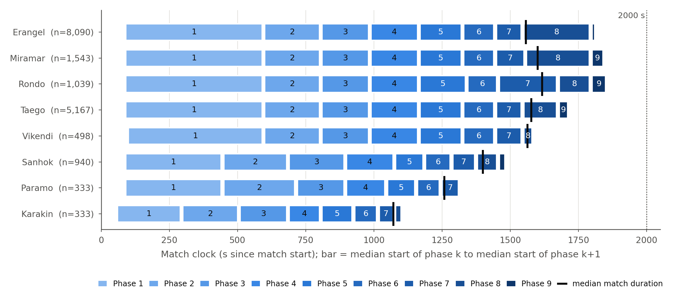
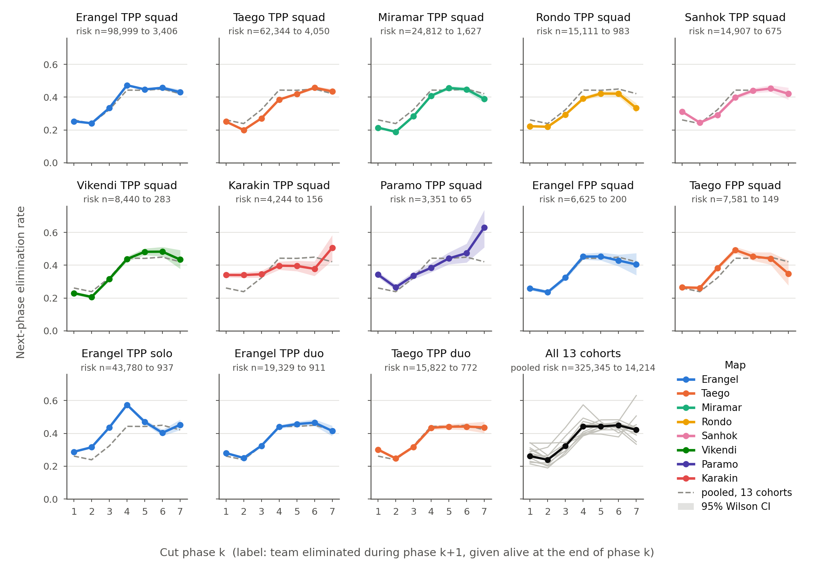

# BigComp 2027 데이터 프로파일 (2026-10-05)

- 설계 문서: `docs/experiment_design/BIGCOMP2027_PTR_STUDY_DESIGN_2026-10-05.md` 3절. 목적은 2단계(플레이어 계층)에 쓸 코퍼스의 규모와 추출 가능성을 재는 것이다.
- DB는 읽기 전용 SELECT만 썼다(`default_transaction_read_only=on`, `statement_timeout=120s`). 재작성 중인 파생 테이블 6종(`stdb.team_phase_trajectory`, `team_phase_exposure`, `team_phase_habitat_features`, `team_phase_edge_cache`, `team_phase_network_features`, `team_phase_z_affordance_features`)은 조회하지 않았다.
- 사용한 테이블: `pubg.matches`, `participants`, `rosters`, `telem_positions`, `telem_damage`, `telem_kills`, `telem_groggy`, `telem_item_use`, `telem_phase_changes`, `telem_match_start`, `stdb.matches`, `match_phase_global`, `team_phase_state`, `team_phase_combat`, `team_phase_labels`.
- 범위: 1~4절, 6.1절, 표 9b는 13개 코호트 전수(17,943매치)다. 표 9a·10, 5절, 6.2~6.7절의 원시 텔레메트리 수치는 코호트별 무작위 표본(seed 42)이며, 11개 코호트는 400매치, Karakin·Paramo TPP squad는 333매치(전수), 합계 5,066매치다.
- 코드 인용은 2026-10-05 작업 트리 기준이다. 다른 에이전트가 `stdb/rq1_feature_etl.py` 등을 수정 중이지만(Fix B), `git diff stdb/rq1_feature_etl.py`는 `build_match_phase_global`의 구역 반경 열만 바꾸고 이 문서가 인용한 생존 인원·라벨·로트 로직은 건드리지 않았다.
- 원자료는 `reports/bigcomp2027_data_profile/csv/`, 스크립트는 `.../scripts/`, 실행 로그는 `.../logs/`에 있다. 표마다 출처 파일을 적었다. 백분위수는 numpy 선형 보간이다.

## 0. 요약

1. 깔때기: `pubg.matches` 28,458 → 텔레메트리 수집 27,491 → 범위 내 맵 21,833 → graph-eligible 21,824 → 13개 코호트 17,943.
2. 기간: 매치 생성 2026-03-26~2026-06-09(코호트 CSV는 2026-06-02까지). 달력 76일 중 50일에만 매치가 있고 26일은 공백이다. 하루 매치 수 중앙값은 594.5이다.
3. 라벨: 13개 합산 hazard는 컷 1에서 0.261, 컷 4에서 0.443이고 컷 7까지 0.42~0.45를 유지한다. 위험집합은 컷 1의 325,345팀에서 컷 7의 14,214팀으로 줄어든다.
4. 봇: 표본의 플레이어 중 27.8%가 AI 계정(`ai.` 접두)이고, 표본 매치의 71.2%에 AI가 1명 이상 있다. Erangel TPP squad는 AI 비율이 56.4%이며 코호트 매치 3,497개(19.5%)가 `airoyale` 유형이다.
5. 2단계 코퍼스: 매치당 플레이어-단계 노드(컷 1~7 중 타깃이 있는 컷의 합)는 코호트 평균 128~239, 13개 코호트 합계 약 3.89M개다. 적 근접 엣지(300 m, 컷 생존자)는 합계 약 3.79M쌍, 교전 쌍은 약 3.17M쌍이다.
6. 크기와 비용: ragged 레이아웃 텐서는 코호트 합계 1.59 GB(상한 1.85 GB), 팀 150차원을 플레이어마다 복제하면 3.01~3.26 GB다. 표본 5,066매치 추출이 88.7초(2 worker)였고, 전체 17,943매치는 약 5.2분으로 외삽된다.
7. 이상 징후: `team_phase_state.alive_players_*`는 1단계에서 실제 생존 수의 약 1/2.9이고, 이 열에서 파생된 `team_phase_labels`는 이벤트 기반 정답 대비 양성 정밀도 72.1%, 재현율 81.3%다(6.4절; 6.5절은 `BIGCOMP2027_LABEL_AUDIT_2026-10-05.md`로 정정).
8. Vikendi는 매치당 `Monster.` 계정 약 30개가 위치·피해 텔레메트리에 섞여 있고, `team_phase_combat` 피해량 합이 raw 적 대상 합보다 크다(6.7절).
9. 판정: 데이터·추출 측면은 GO다. 조건과 남은 위험은 7절에 적었다.

## 1. 코퍼스 깔때기

표 1. 단계별 매치 수. 출처: `csv/raw_db_by_map_mode_matchtype_custom.csv`, `csv/funnel_map_mode_persp.csv`, `csv/funnel_coverage_checks.json`, `logs/01_stable_profile.log`(`pubg.v_collection_status`).

| 단계 | 매치 수 | 직전 단계 대비 | 근거 |
| --- | ---: | ---: | --- |
| `pubg.matches` 전체 | 28,458 |  | `SELECT count(*) FROM pubg.matches` (01 스크립트 1절) |
| 텔레메트리 수집 완료 = flat CSV 전체 | 27,491 | -967 | `v_collection_status`: matches_fetched 28,458 / telemetry_fetched 27,491. 나머지 967매치는 CSV에 없다. |
| 범위 내 맵 = `stdb.matches` | 21,833 | -5,658 | Tutorial_Main 3,696 + Range_Main 1,962 제외(`exclude_reason=out_of_scope_map`) |
| graph-eligible (n128) | 21,824 | -9 | `missing_target_labels` 6, `missing_team_positions` 3 |
| 13개 코호트 (>=300매치) | 17,943 | -3,881 | 300매치 미만인 41개 (맵, 모드, 시점) 조합 제외(42매치 이상 28개 조합 3,501매치, 나머지 13개 조합 380매치). 레지스트리 `docs/data_layer/BATTLE_ROYALE_COHORT_REGISTRY_2026-07-03.md`의 보조 코호트 표는 28행(최소 42매치)이다 |

`pubg.matches`의 `match_type` 분포는 official 15,728, airoyale 3,612, tutorialatoz 3,806, competitive 3,292, trainingroom 2,020이고 `is_custom=true`는 0건이다.

표 2. 맵 × 모드 × 시점별 매치 수(13개 코호트와 나머지). 출처: `csv/funnel_map_mode_persp.csv`. 전체 57행은 CSV 참조.

| 코호트 | DB 전체 | flat CSV | graph-eligible | 13개 코호트 |
| --- | ---: | ---: | ---: | ---: |
| Erangel TPP squad | 6,400 | 6,206 | 6,204 | 6,204 |
| Taego TPP squad | 4,323 | 4,160 | 4,159 | 4,159 |
| Miramar TPP squad | 1,605 | 1,545 | 1,543 | 1,543 |
| Rondo TPP squad | 1,089 | 1,041 | 1,039 | 1,039 |
| Sanhok TPP squad | 944 | 940 | 940 | 940 |
| Erangel TPP solo | 826 | 801 | 800 | 800 |
| Erangel TPP duo | 677 | 656 | 656 | 656 |
| Taego TPP duo | 596 | 574 | 573 | 573 |
| Vikendi TPP squad | 505 | 498 | 498 | 498 |
| Taego FPP squad | 449 | 435 | 435 | 435 |
| Erangel FPP squad | 449 | 430 | 430 | 430 |
| Karakin TPP squad | 379 | 333 | 333 | 333 |
| Paramo TPP squad | 334 | 333 | 333 | 333 |
| 300매치 미만 조합 41개 | 4,056 | 3,881 | 3,881 | 0 |
| Tutorial_Main·Range_Main(범위 밖) | 5,826 | 5,658 | 0 | 0 |
| 합계 | 28,458 | 27,491 | 21,824 | 17,943 |

수집 기간(경기 생성, KST): DB 2026-03-26 ~ 2026-06-09, flat CSV 2026-03-26 ~ 2026-06-02. 수집 실행 시각은 2026-03-27 ~ 2026-06-09다.
하루 매치 수(`pubg.matches`, 매치가 있는 50일): 최소 138, p10 160.0, 중앙값 594.5, p90 895.1, 최대 1,082. 달력 76일 중 26일은 매치가 0건이다. flat CSV 기준 하루 graph-eligible 중앙값은 478.5, 13개 코호트는 391.5다. 일별 표는 `csv/matches_per_day.csv`.

## 2. 코호트별 프로파일

표 3. 분할, 매치당 팀·플레이어 수, 길이, 최대 관측 단계. 값은 중앙값(p10–p90). 플레이어 수는 AI 계정을 포함한다. 출처: `split.json`(`br_om_ladder_required_v1/<cohort>/`), `match_cohort_flat.csv`(`num_teams`, `num_players`, `duration`), `stdb.match_phase_global`(최대 단계). 파일: `csv/cohort_summary.csv`.

| 코호트 | train | val | test | 합계 | 팀 수/매치 | 플레이어 수/매치 | 길이(초) | 2000초 초과(매치) | 최대 단계 |
| --- | ---: | ---: | ---: | ---: | ---: | ---: | ---: | ---: | ---: |
| Erangel TPP squad | 4,964 | 620 | 620 | 6,204 | 27 (25–29) | 99 (90–100) | 1,547 (1,387–1,698) | 0.5% (34) | 7 (5–8) |
| Taego TPP squad | 3,329 | 415 | 415 | 4,159 | 27 (19–30) | 97 (63–100) | 1,573 (1,464–1,743) | 0.5% (20) | 7 (6–8) |
| Miramar TPP squad | 1,235 | 154 | 154 | 1,543 | 26 (16–29) | 95 (60–99) | 1,601 (1,471–1,864) | 2.7% (42) | 7 (6–9) |
| Rondo TPP squad | 833 | 103 | 103 | 1,039 | 25 (16–29) | 64 (60–99) | 1,617 (1,428–1,898) | 5.4% (56) | 7 (6–9) |
| Sanhok TPP squad | 752 | 94 | 94 | 940 | 28 (26–30) | 97 (93–100) | 1,400 (1,303–1,617) | 3.7% (35) | 7 (6–8) |
| Erangel TPP solo | 640 | 80 | 80 | 800 | 100 (98–100) | 100 (98–100) | 1,631 (1,513–1,996) | 9.6% (77) | 7 (6–8) |
| Erangel TPP duo | 526 | 65 | 65 | 656 | 51 (48–53) | 98.5 (94–100) | 1,626 (1,528–2,056) | 11.1% (73) | 8 (7–8) |
| Taego TPP duo | 459 | 57 | 57 | 573 | 51 (48–54) | 98 (92–100) | 1,627 (1,522–2,075) | 12.2% (70) | 8 (7–9) |
| Vikendi TPP squad | 400 | 49 | 49 | 498 | 27 (26–29) | 97 (92–100) | 1,563 (1,470–1,775) | 5.4% (27) | 7 (6–8) |
| Taego FPP squad | 349 | 43 | 43 | 435 | 29 (18–47) | 97 (60–100) | 1,577 (1,392–2,461) | 16.3% (71) | 7 (6–8) |
| Erangel FPP squad | 344 | 43 | 43 | 430 | 28 (17–31) | 97 (60–100) | 1,558 (1,413–2,148) | 12.3% (53) | 7 (6–8) |
| Karakin TPP squad | 267 | 33 | 33 | 333 | 18 (16–19) | 61 (56–64) | 1,071 (954–1,360) | 4.8% (16) | 7 (5–8) |
| Paramo TPP squad | 267 | 33 | 33 | 333 | 18 (16–19) | 62 (58–64) | 1,258 (1,149–1,539) | 5.4% (18) | 6 (5–8) |

표 4. 최대 관측 단계 분포(매치 수). 출처: `csv/max_phase_distribution.csv`(`stdb.match_phase_global`).

| 코호트 | 2단계 | 3단계 | 4단계 | 5단계 | 6단계 | 7단계 | 8단계 | 9단계 | 5단계 이하 |
| --- | ---: | ---: | ---: | ---: | ---: | ---: | ---: | ---: | ---: |
| Erangel TPP squad | 2 | 14 | 69 | 894 | 1,516 | 2,155 | 1,314 | 240 | 979 (15.8%) |
| Taego TPP squad | 4 | 13 | 37 | 130 | 443 | 1,736 | 1,442 | 354 | 184 (4.4%) |
| Miramar TPP squad | 3 | 3 | 15 | 48 | 163 | 630 | 473 | 208 | 69 (4.5%) |
| Rondo TPP squad | 1 | 4 | 23 | 45 | 145 | 403 | 266 | 152 | 73 (7.0%) |
| Sanhok TPP squad | 0 | 0 | 0 | 10 | 107 | 482 | 307 | 34 | 10 (1.1%) |
| Erangel TPP solo | 0 | 0 | 0 | 8 | 96 | 342 | 315 | 39 | 8 (1.0%) |
| Erangel TPP duo | 0 | 0 | 0 | 2 | 43 | 265 | 294 | 52 | 2 (0.3%) |
| Taego TPP duo | 0 | 0 | 0 | 6 | 41 | 239 | 225 | 62 | 6 (1.0%) |
| Vikendi TPP squad | 0 | 0 | 0 | 9 | 82 | 264 | 139 | 4 | 9 (1.8%) |
| Taego FPP squad | 0 | 3 | 5 | 34 | 136 | 182 | 62 | 13 | 42 (9.7%) |
| Erangel FPP squad | 0 | 0 | 6 | 24 | 129 | 179 | 77 | 15 | 30 (7.0%) |
| Karakin TPP squad | 0 | 0 | 5 | 33 | 98 | 120 | 62 | 15 | 38 (11.4%) |
| Paramo TPP squad | 0 | 2 | 15 | 57 | 126 | 98 | 34 | 1 | 74 (22.2%) |

표 5. 맵별 구역 일정: 단계의 시작–종료 시각 중앙값(경기 시계 초). 해당 단계에 도달한 매치가 30개 미만이면 `-`. 출처: `csv/phase_timing_by_map.csv`(`stdb.match_phase_global.phase_start_s/phase_end_s`, 13개 코호트 합산), 매치 길이는 `csv/duration_median_by_map.csv`. 코호트별 값은 `csv/phase_timing_by_cohort.csv`.

| 맵 | 매치 | 1 | 2 | 3 | 4 | 5 | 6 | 7 | 8 | 9 | 길이 중앙값 |
| --- | ---: | ---: | ---: | ---: | ---: | ---: | ---: | ---: | ---: | ---: | ---: |
| Erangel | 8,090 | 90–590 | 600–800 | 810–980 | 990–1160 | 1170–1320 | 1330–1440 | 1450–1540 | 1550–1600 | 1800–1810 | 1,557 |
| Miramar | 1,543 | 90–590 | 600–800 | 810–980 | 990–1160 | 1170–1320 | 1330–1440 | 1450–1540 | 1560–1660 | 1800–1840 | 1,601 |
| Rondo | 1,039 | 90–590 | 600–800 | 810–980 | 990–1160 | 1170–1320 | 1345–1440 | 1460–1540 | 1680–1740 | 1800–1850 | 1,617 |
| Taego | 5,167 | 90–590 | 600–800 | 810–980 | 990–1160 | 1170–1320 | 1330–1440 | 1450–1540 | 1550–1600 | 1680–1710 | 1,577 |
| Vikendi | 498 | 100–590 | 600–800 | 810–980 | 990–1160 | 1170–1320 | 1330–1440 | 1450–1530 | 1550–1580 | - | 1,563 |
| Sanhok | 940 | 90–440 | 450–680 | 690–890 | 900–1070 | 1080–1180 | 1190–1280 | 1290–1360 | 1380–1410 | 1460–1480 | 1,400 |
| Paramo | 333 | 90–440 | 450–710 | 720–890 | 900–1040 | 1050–1150 | 1160–1240 | 1250–1300 | 1320–1320 | - | 1,258 |
| Karakin | 333 | 60–290 | 300–500 | 510–680 | 690–800 | 810–920 | 930–1010 | 1020–1060 | 1080–1100 | - | 1,071 |

종료 시각은 `phase_end_s`(단계 안 마지막 game-state 스냅샷)라서 비종결 단계는 다음 단계 시작보다 10초 빠르다. 마지막으로 관측된 단계의 종료는 매치 종료에 잘린다. Erangel·Miramar·Rondo·Taego·Vikendi는 거의 같은 일정(1단계 시작 90~100초, 2단계 600초, 5단계 1170초)을 따르고, Sanhok·Paramo(5단계 1080·1050초)와 Karakin(810초)이 빠르다. 그림 2는 이 일정을 시각화한 것이다.

그림 2. 막대는 단계 k 시작 중앙값부터 단계 k+1 시작 중앙값까지, 검은 세로선은 매치 길이 중앙값이다. PDF는 같은 폴더의 `fig2_phase_timing_by_map.pdf`.

표 6. 매치 유형(`pubg.matches.match_type`) 구성. 출처: `csv/cohort_match_type.csv`.

| 코호트 | airoyale | competitive | official | airoyale 비율 |
| --- | ---: | ---: | ---: | ---: |
| Erangel TPP squad | 2,921 | 574 | 2,709 | 47.1% |
| Taego TPP squad | 0 | 579 | 3,580 | 0.0% |
| Miramar TPP squad | 0 | 588 | 955 | 0.0% |
| Rondo TPP squad | 0 | 553 | 486 | 0.0% |
| Sanhok TPP squad | 0 | 0 | 940 | 0.0% |
| Erangel TPP solo | 576 | 0 | 224 | 72.0% |
| Erangel TPP duo | 0 | 49 | 607 | 0.0% |
| Taego TPP duo | 0 | 55 | 518 | 0.0% |
| Vikendi TPP squad | 0 | 0 | 498 | 0.0% |
| Taego FPP squad | 0 | 135 | 300 | 0.0% |
| Erangel FPP squad | 0 | 130 | 300 | 0.0% |
| Karakin TPP squad | 0 | 0 | 333 | 0.0% |
| Paramo TPP squad | 0 | 0 | 333 | 0.0% |
| 합계 | 3,497 | 2,663 | 11,783 | 19.5% |

`competitive` 매치는 플레이어 수 중앙값이 61~62인 소형 로비이고(표본 AI 0명), `airoyale`는 표본에서 AI가 90% 안팎이다(6.6절). Erangel TPP squad의 hazard를 유형별로 보면 컷 4에서 airoyale 0.566, competitive 0.324, official 0.430으로 갈린다(표 6b). 코호트 안에서 유형 구성이 달라지면 hazard 보정이 달라진다.

표 6b. Erangel TPP squad의 매치 유형별 hazard. 출처: `csv/hazard_by_cohort_matchtype_cutphase.csv`.

| 매치 유형(매치 수) | 컷 1 | 컷 2 | 컷 3 | 컷 4 | 컷 5 | 컷 6 | 컷 7 |
| --- | ---: | ---: | ---: | ---: | ---: | ---: | ---: |
| airoyale (2,921) | 0.271 | 0.289 | 0.406 | 0.566 | 0.436 | 0.402 | 0.429 |
| competitive (574) | 0.245 | 0.201 | 0.283 | 0.324 | 0.360 | 0.348 | 0.332 |
| official (2,709) | 0.237 | 0.203 | 0.282 | 0.430 | 0.466 | 0.489 | 0.461 |

## 3. 라벨: 다음 단계 탈락 hazard

정의는 `stdb.team_phase_labels`(`stdb/rq1_feature_etl.py`의 `build_team_phase_labels`)를 그대로 따른다. 위험집합은 `target_defined`(컷 단계 끝에 생존 `alive_players_end>0`이고 다음 단계가 존재)이고, 양성은 `eliminated_next_phase`다. 컷 k는 1~7이다.

표 7. 컷 단계별 다음 단계 탈락률 = 양성 / 위험집합. 출처: `csv/hazard_by_cohort_cutphase.csv`(95% Wilson 구간 포함).

| 코호트 | 컷 1 | 컷 2 | 컷 3 | 컷 4 | 컷 5 | 컷 6 | 컷 7 |
| --- | ---: | ---: | ---: | ---: | ---: | ---: | ---: |
| Erangel TPP squad | 0.2530 | 0.2409 | 0.3339 | 0.4728 | 0.4474 | 0.4572 | 0.4307 |
| Taego TPP squad | 0.2509 | 0.1999 | 0.2707 | 0.3848 | 0.4197 | 0.4577 | 0.4351 |
| Miramar TPP squad | 0.2140 | 0.1889 | 0.2833 | 0.4088 | 0.4560 | 0.4477 | 0.3897 |
| Rondo TPP squad | 0.2229 | 0.2196 | 0.2943 | 0.3913 | 0.4221 | 0.4214 | 0.3337 |
| Sanhok TPP squad | 0.3118 | 0.2447 | 0.2908 | 0.3992 | 0.4397 | 0.4528 | 0.4207 |
| Erangel TPP solo | 0.2877 | 0.3154 | 0.4360 | 0.5741 | 0.4702 | 0.4033 | 0.4525 |
| Erangel TPP duo | 0.2800 | 0.2501 | 0.3245 | 0.4394 | 0.4566 | 0.4655 | 0.4149 |
| Taego TPP duo | 0.3013 | 0.2473 | 0.3175 | 0.4344 | 0.4408 | 0.4414 | 0.4365 |
| Vikendi TPP squad | 0.2301 | 0.2069 | 0.3160 | 0.4381 | 0.4821 | 0.4830 | 0.4346 |
| Taego FPP squad | 0.2651 | 0.2622 | 0.3835 | 0.4933 | 0.4542 | 0.4409 | 0.3490 |
| Erangel FPP squad | 0.2580 | 0.2363 | 0.3249 | 0.4529 | 0.4536 | 0.4290 | 0.4050 |
| Karakin TPP squad | 0.3407 | 0.3404 | 0.3452 | 0.3975 | 0.3957 | 0.3783 | 0.5064 |
| Paramo TPP squad | 0.3432 | 0.2656 | 0.3369 | 0.3846 | 0.4418 | 0.4739 | 0.6308 |
| 13개 합산 | 0.2614 | 0.2390 | 0.3235 | 0.4430 | 0.4420 | 0.4495 | 0.4214 |

표 8. 양성 수 / 위험집합 크기(팀·컷). 출처: 같은 파일.

| 코호트 | 컷 1 | 컷 2 | 컷 3 | 컷 4 | 컷 5 | 컷 6 | 컷 7 |
| --- | ---: | ---: | ---: | ---: | ---: | ---: | ---: |
| Erangel TPP squad | 25,048 / 98,999 | 18,543 / 76,989 | 20,206 / 60,513 | 19,808 / 41,898 | 9,817 / 21,940 | 4,954 / 10,836 | 1,467 / 3,406 |
| Taego TPP squad | 15,645 / 62,344 | 9,549 / 47,767 | 10,606 / 39,173 | 11,323 / 29,426 | 7,897 / 18,816 | 5,066 / 11,068 | 1,762 / 4,050 |
| Miramar TPP squad | 5,310 / 24,812 | 3,772 / 19,970 | 4,722 / 16,665 | 5,046 / 12,344 | 3,488 / 7,649 | 1,908 / 4,262 | 634 / 1,627 |
| Rondo TPP squad | 3,368 / 15,111 | 2,635 / 11,999 | 2,831 / 9,621 | 2,742 / 7,007 | 1,865 / 4,418 | 1,051 / 2,494 | 328 / 983 |
| Sanhok TPP squad | 4,648 / 14,907 | 2,597 / 10,613 | 2,410 / 8,287 | 2,445 / 6,125 | 1,711 / 3,891 | 1,012 / 2,235 | 284 / 675 |
| Erangel TPP solo | 12,595 / 43,780 | 9,837 / 31,185 | 9,309 / 21,350 | 6,915 / 12,045 | 2,404 / 5,113 | 1,022 / 2,534 | 424 / 937 |
| Erangel TPP duo | 5,413 / 19,329 | 3,538 / 14,149 | 3,508 / 10,811 | 3,278 / 7,460 | 1,967 / 4,308 | 1,106 / 2,376 | 378 / 911 |
| Taego TPP duo | 4,767 / 15,822 | 2,777 / 11,231 | 2,734 / 8,610 | 2,601 / 5,987 | 1,533 / 3,478 | 877 / 1,987 | 337 / 772 |
| Vikendi TPP squad | 1,942 / 8,440 | 1,382 / 6,679 | 1,730 / 5,475 | 1,706 / 3,894 | 1,115 / 2,313 | 553 / 1,145 | 123 / 283 |
| Taego FPP squad | 2,010 / 7,581 | 1,504 / 5,735 | 1,667 / 4,347 | 1,367 / 2,771 | 649 / 1,429 | 291 / 660 | 52 / 149 |
| Erangel FPP squad | 1,709 / 6,625 | 1,197 / 5,065 | 1,292 / 3,976 | 1,260 / 2,782 | 709 / 1,563 | 311 / 725 | 81 / 200 |
| Karakin TPP squad | 1,446 / 4,244 | 1,010 / 2,967 | 718 / 2,080 | 566 / 1,424 | 353 / 892 | 171 / 452 | 79 / 156 |
| Paramo TPP squad | 1,150 / 3,351 | 609 / 2,293 | 595 / 1,766 | 460 / 1,196 | 315 / 713 | 136 / 287 | 41 / 65 |
| 13개 합산 | 85,051 / 325,345 | 58,950 / 246,642 | 62,328 / 192,674 | 59,517 / 134,359 | 33,823 / 76,523 | 18,458 / 41,061 | 5,990 / 14,214 |

그림 1. 코호트별 hazard. 점선은 13개 합산, 음영은 95% Wilson 구간, 부제는 컷 1과 컷 7의 위험집합 크기다. PDF는 `fig1_hazard_by_phase_per_cohort.pdf`.

소형 코호트의 컷 7은 위험집합이 작다(Paramo TPP squad 65팀·양성 41, Taego FPP squad 149팀·양성 52, Karakin TPP squad 156팀·양성 79, Erangel FPP squad 200팀·양성 81). 이 구간의 코호트별 차이는 구간 폭(그림 1 음영)을 같이 봐야 한다.

## 4. 이벤트 볼륨

표 9a. 매치당 이벤트 수(원시 텔레메트리, 표본 평균). 피해 이벤트는 `telem_damage` 행 수이고, 적 대상은 공격자·피해자가 서로 다른 팀의 플레이어인 행, 공격자 없음은 `attacker_id`가 NULL인 행(자기장·출혈 등)이다. 피해량 합은 적 대상 행의 `damage` 합이다. 출처: `csv/sample_events_per_match_by_cohort.csv`.

| 코호트 | 매치 | kill | 기절(groggy) | 피해 이벤트 전체 (p10–p90) | 적 대상 | 공격자 없음 | 피해량 합(적 대상) |
| --- | ---: | ---: | ---: | ---: | ---: | ---: | ---: |
| Erangel TPP squad | 400 | 95.6 | 92.4 | 6,300 (3,822–9,343) | 846 | 3,285 | 12,799 |
| Taego TPP squad | 400 | 94.2 | 94.3 | 6,415 (3,715–9,090) | 1,015 | 3,868 | 14,151 |
| Miramar TPP squad | 400 | 86.6 | 88.5 | 6,986 (3,362–10,734) | 889 | 4,634 | 13,164 |
| Rondo TPP squad | 400 | 79.4 | 78.8 | 5,934 (2,800–10,163) | 825 | 3,769 | 11,794 |
| Sanhok TPP squad | 400 | 99.6 | 96.0 | 6,034 (4,076–8,184) | 1,029 | 3,390 | 13,551 |
| Erangel TPP solo | 400 | 98.4 | 0.8 | 4,327 (2,306–6,547) | 456 | 3,849 | 11,017 |
| Erangel TPP duo | 400 | 96.5 | 64.7 | 6,347 (4,085–9,043) | 754 | 4,565 | 13,303 |
| Taego TPP duo | 400 | 96.6 | 63.5 | 5,838 (3,588–8,291) | 777 | 4,044 | 13,543 |
| Vikendi TPP squad | 400 | 100.4 | 101.0 | 7,711 (4,922–10,603) | 981 | 4,851 | 14,107 |
| Taego FPP squad | 400 | 87.9 | 83.8 | 6,391 (2,951–11,348) | 819 | 3,871 | 12,593 |
| Erangel FPP squad | 400 | 88.3 | 88.8 | 5,897 (3,106–8,636) | 855 | 3,320 | 13,200 |
| Karakin TPP squad | 333 | 60.1 | 54.9 | 3,115 (2,043–4,365) | 648 | 1,518 | 8,184 |
| Paramo TPP squad | 333 | 61.2 | 59.9 | 2,969 (1,948–4,279) | 644 | 1,271 | 8,828 |

표본 전체에서 피해 이벤트의 14.1%가 적 대상이고 62.5%는 공격자가 없다. 적 대상 피해량 합은 모든 코호트에서 `participants.damage_dealt` 합과 1.000배로 일치한다(`csv/raw_consistency_checks_by_cohort.csv`).

표 9b. 같은 지표를 코호트 전수로 본 값. `stdb.team_phase_combat`의 팀 단위 합계이며 서로 다른 팀 사이의 이벤트만 포함하고, 단계 구간(시작~종료) 밖의 이벤트는 빠진다. 값은 매치당 평균(damage 열은 p10–p90). 출처: `csv/events_per_match_by_cohort_teamlevel.csv`.

| 코호트 | 매치 | kill | 기절 | 피해 이벤트 (p10–p90) | 피해량 합 | 전수 ÷ 표본 raw(적 대상): kill / 피해 이벤트 |
| --- | ---: | ---: | ---: | ---: | ---: | ---: |
| Erangel TPP squad | 6,204 | 83.3 | 81.4 | 803 (631–1,041) | 11,994 | 0.930 / 0.950 |
| Taego TPP squad | 4,159 | 81.1 | 79.9 | 910 (628–1,126) | 12,616 | 0.904 / 0.896 |
| Miramar TPP squad | 1,543 | 72.3 | 73.6 | 797 (568–1,032) | 11,754 | 0.894 / 0.897 |
| Rondo TPP squad | 1,039 | 68.6 | 68.1 | 801 (555–1,077) | 12,665 | 0.916 / 0.970 |
| Sanhok TPP squad | 940 | 86.0 | 80.4 | 912 (766–1,055) | 11,964 | 0.900 / 0.886 |
| Erangel TPP solo | 800 | 82.5 | 0.7 | 430 (381–478) | 10,401 | 0.941 / 0.943 |
| Erangel TPP duo | 656 | 83.8 | 55.4 | 693 (582–801) | 12,207 | 0.921 / 0.919 |
| Taego TPP duo | 573 | 82.8 | 53.6 | 696 (543–809) | 12,210 | 0.906 / 0.896 |
| Vikendi TPP squad | 498 | 85.4 | 84.6 | 1,082 (796–1,377) | 20,223 | 0.912 / 1.103 |
| Taego FPP squad | 435 | 71.7 | 72.1 | 752 (484–1,045) | 11,561 | 0.918 / 0.918 |
| Erangel FPP squad | 430 | 75.6 | 77.1 | 789 (556–1,031) | 12,178 | 0.922 / 0.923 |
| Karakin TPP squad | 333 | 51.6 | 48.1 | 595 (473–717) | 7,468 | 0.916 / 0.917 |
| Paramo TPP squad | 333 | 52.3 | 50.7 | 568 (456–679) | 7,874 | 0.893 / 0.881 |

표 10. 단계별 이벤트 수(표본 13개 코호트 합산, 해당 단계가 있는 매치의 평균). 단계 k는 [시작 k, 시작 k+1)로 나눴고, k=0은 1단계 이전(낙하 전후)이다. 출처: `csv/sample_events_by_phase.csv`, 코호트별은 `csv/sample_events_per_phase_by_cohort.csv`.

| 단계 | 매치 | kill | 기절 | 피해 이벤트 전체 | 피해 이벤트(적 대상) | 피해량 합 전체 | 피해량 합(적 대상) |
| --- | ---: | ---: | ---: | ---: | ---: | ---: | ---: |
| 0 | 5,066 | 3.4 | 4.7 | 90 | 51 | 751 | 649 |
| 1 | 5,066 | 41.6 | 36.0 | 1,776 | 429 | 6,991 | 5,931 |
| 2 | 5,066 | 10.8 | 8.7 | 1,700 | 90 | 2,619 | 1,462 |
| 3 | 5,066 | 8.5 | 7.0 | 1,185 | 68 | 2,158 | 1,181 |
| 4 | 5,055 | 8.9 | 7.3 | 643 | 68 | 1,854 | 1,219 |
| 5 | 5,007 | 8.0 | 5.9 | 232 | 55 | 1,301 | 1,008 |
| 6 | 4,746 | 4.6 | 3.4 | 106 | 33 | 744 | 620 |
| 7 | 3,823 | 3.2 | 2.1 | 61 | 23 | 460 | 403 |
| 8 | 1,709 | 2.3 | 1.2 | 39 | 16 | 304 | 268 |
| 9 | 319 | 2.5 | 1.2 | 41 | 16 | 362 | 264 |

## 5. 2단계(플레이어 계층) 코퍼스 추정

정의(설계 문서 3절의 2단계를 그대로 계산 가능한 형태로 옮겼다).

- 노드: 단계 k 시작 시 생존한 플레이어. 사망 시각은 `telem_kills`의 `victim_id` 시각이고, 킬 이벤트가 없는 이탈자는 `participants.time_survived`로 대신했다. 팀 소속은 `participants`→`rosters`(`telem_positions.team_id`와 불일치 0건).
- 컷 시각 t_c = `phase_end_s` − 10초(Fix B). 위치와 체력은 t_c 이전 마지막 `telem_positions` 샘플이고 좌표 단위는 cm를 m로 바꿨다. 샘플이 t_c보다 30초 넘게 오래된 노드는 "신선하지 않음"으로 봤다.
- 팀원 엣지: 시작 시 생존자 사이 C(n,2)(무방향). 컷 시점 생존자 기준 값도 함께 적었다.
- 적 근접 엣지: 서로 다른 팀, 거리 300 m 이하, 무방향 쌍 수. 주 추정은 컷에서도 살아 있고 위치가 신선한 노드만 쓴 값이고, 상한은 시작 시 생존자 전원(사망 노드의 마지막 위치 포함)을 쓴 값이다.
- 교전 엣지: [단계 시작, t_c] 구간 `telem_damage`에서 damage>0, 공격자·피해자 ID가 모두 있고 서로 다른 팀인 distinct (공격자→피해자) 쌍.
- 집계는 학습에 쓰이는 컷만 합친다: k<=7이고 단계 k+1이 존재하는 컷. k<=7 전체 합은 `csv/stage2_per_match_totals_by_cohort.csv`의 `all_k1to7`.

표 11. 매치당 합계(컷 합). 노드는 평균(p10–p90). 출처: `csv/stage2_per_match_totals_by_cohort.csv`(scope=cuts_with_target), 스크립트 `02_sample_player_level.py`, `03_summarize_sample.py`.

| 코호트 | 표본 | 노드 | 팀·단계 | 팀원 엣지(시작) | 팀원 엣지(컷 생존) | 적 근접(컷 생존) | 적 근접(상한) | 교전 쌍 | 교전 이벤트 |
| --- | ---: | ---: | ---: | ---: | ---: | ---: | ---: | ---: | ---: |
| Erangel TPP squad | 400 | 224.7 (171–274) | 75.6 | 273.2 | 155.5 | 209.9 | 634.8 | 184.4 | 464.1 |
| Taego TPP squad | 400 | 210.6 (147–267) | 73.1 | 246.7 | 145.2 | 207.1 | 683.1 | 185.2 | 482.0 |
| Miramar TPP squad | 400 | 231.7 (146–300) | 79.5 | 274.1 | 178.8 | 297.8 | 689.4 | 177.3 | 427.7 |
| Rondo TPP squad | 400 | 200.7 (114–274) | 69.2 | 237.8 | 148.9 | 199.3 | 562.4 | 159.6 | 396.8 |
| Sanhok TPP squad | 400 | 214.1 (177–251) | 74.7 | 246.1 | 139.3 | 228.2 | 833.2 | 172.1 | 454.7 |
| Erangel TPP solo | 400 | 234.0 (188–276) | 234.0 | 0.0 | 0.0 | 156.6 | 435.4 | 142.9 | 409.9 |
| Erangel TPP duo | 400 | 234.7 (200–269) | 132.5 | 102.2 | 63.5 | 215.1 | 560.4 | 172.3 | 448.4 |
| Taego TPP duo | 400 | 219.2 (179–256) | 125.8 | 93.5 | 55.9 | 178.7 | 520.2 | 172.4 | 461.1 |
| Vikendi TPP squad | 400 | 238.9 (196–281) | 81.5 | 281.4 | 169.1 | 246.7 | 678.5 | 192.0 | 471.4 |
| Taego FPP squad | 400 | 195.7 (124–285) | 78.8 | 209.7 | 117.7 | 142.6 | 526.7 | 174.2 | 444.0 |
| Erangel FPP squad | 400 | 198.8 (121–260) | 72.3 | 223.7 | 127.6 | 159.2 | 562.6 | 181.5 | 448.9 |
| Karakin TPP squad | 333 | 147.6 (125–171) | 52.7 | 166.3 | 98.5 | 225.3 | 584.1 | 108.6 | 286.9 |
| Paramo TPP squad | 333 | 127.9 (101–154) | 44.0 | 148.4 | 82.0 | 134.4 | 419.1 | 115.2 | 300.3 |

코퍼스 합계(매치 수 × 코호트 평균): 노드 3.89M, 팀원 엣지 4.18M쌍, 적 근접 3.79M쌍, 교전 3.17M쌍. Erangel TPP solo는 팀이 없어 팀원 엣지가 0이다.

표 12. 컷 단계별 평균(표본 13개 코호트 합산, 컷당). "컷 생존"은 t_c에 살아 있는 노드 수다. 출처: `csv/sample_cut_level.csv`, 코호트별은 `csv/stage2_cut_means_by_cohort_phase.csv`.

| 컷 k | 컷 수 | 노드(시작 생존) | 팀 | 컷 생존 | 팀원 엣지 | 적 근접(컷 생존) | 적 근접(상한) | 교전 쌍 | 그중 컷에서 300 m 이내 | 교전 이벤트 |
| --- | ---: | ---: | ---: | ---: | ---: | ---: | ---: | ---: | ---: | ---: |
| 1 | 5,066 | 84.0 | 34.0 | 43.6 | 88.4 | 34.5 | 268.4 | 84.6 | 14.3 | 243.9 |
| 2 | 5,066 | 42.5 | 19.6 | 32.9 | 38.1 | 29.5 | 65.6 | 21.9 | 8.8 | 52.6 |
| 3 | 5,066 | 32.0 | 15.2 | 24.9 | 27.5 | 35.9 | 64.9 | 17.8 | 7.7 | 39.7 |
| 4 | 5,055 | 24.0 | 11.6 | 17.0 | 19.9 | 44.4 | 80.1 | 18.4 | 7.7 | 39.6 |
| 5 | 5,007 | 16.0 | 7.9 | 10.2 | 12.7 | 37.9 | 75.9 | 14.7 | 6.8 | 32.0 |
| 6 | 4,746 | 9.3 | 4.6 | 6.5 | 7.1 | 18.0 | 39.1 | 8.3 | 4.4 | 18.1 |
| 7 | 3,823 | 5.9 | 3.0 | 4.5 | 4.3 | 6.9 | 14.4 | 4.4 | 2.8 | 10.0 |

"그중 컷에서 300 m 이내"는 교전 쌍 가운데 양쪽 위치가 신선하게 관측된 쌍만 센 값이다(교전 후 사망한 쪽은 제외된다).

표 13. 단계 시작 시 생존 플레이어 수(매치당 평균, 해당 단계가 있는 매치). 출처: `csv/stage2_cut_means_by_cohort_phase.csv`.

| 코호트 | k=1 | k=2 | k=3 | k=4 | k=5 | k=6 | k=7 |
| --- | ---: | ---: | ---: | ---: | ---: | ---: | ---: |
| Erangel TPP squad | 93.9 | 47.0 | 34.5 | 26.0 | 17.0 | 9.7 | 6.6 |
| Taego TPP squad | 85.8 | 38.2 | 30.5 | 24.6 | 18.0 | 11.3 | 7.5 |
| Miramar TPP squad | 81.4 | 46.6 | 37.4 | 29.9 | 21.0 | 12.7 | 7.9 |
| Rondo TPP squad | 75.0 | 39.6 | 31.8 | 24.8 | 17.6 | 11.0 | 7.3 |
| Sanhok TPP squad | 90.8 | 43.2 | 30.8 | 22.7 | 15.5 | 9.5 | 5.9 |
| Erangel TPP solo | 97.3 | 51.9 | 38.2 | 26.0 | 14.2 | 5.6 | 3.1 |
| Erangel TPP duo | 92.0 | 47.8 | 36.6 | 27.3 | 17.9 | 10.0 | 5.8 |
| Taego TPP duo | 90.3 | 43.1 | 32.8 | 24.6 | 16.5 | 9.3 | 5.4 |
| Vikendi TPP squad | 93.4 | 47.7 | 37.5 | 29.1 | 19.7 | 11.0 | 6.5 |
| Taego FPP squad | 83.2 | 39.8 | 30.3 | 22.8 | 14.5 | 7.9 | 5.3 |
| Erangel FPP squad | 83.3 | 39.5 | 30.8 | 23.2 | 15.4 | 8.5 | 5.5 |
| Karakin TPP squad | 59.5 | 36.5 | 22.8 | 14.7 | 9.8 | 6.4 | 4.6 |
| Paramo TPP squad | 57.9 | 28.4 | 18.1 | 13.3 | 8.9 | 6.2 | 4.4 |

텐서 크기 가정(float32, ragged): 플레이어 특징 12개(팀 중심 기준 위치 2, 맵 위치 2, 체력, 준 피해, 받은 피해, 기절시킴, kill, 누적 kill, 회복 아이템 사용, 생존 마스크), 팀 특징 150개를 팀·단계마다 1회 저장(복제 시 노드 수 × 150), 엣지 1개 17 B(int32 2개 + 유형 1 B + float32 2개; 팀원·적 근접은 양방향 2개로 셈, 교전은 방향 1개), 플레이어–구역 엣지는 노드당 2개 × 21 B. 계산은 `03_summarize_sample.py`.

표 14. 텐서 크기. 출처: `csv/stage2_tensor_size_estimate.csv`(scope=cuts_with_target).

| 코호트 | 코호트 매치 | MB/매치(compact) | GB/코호트(compact) | GB/코호트(팀 특징 복제) | GB(compact, 상한) | GB(복제, 상한) |
| --- | ---: | ---: | ---: | ---: | ---: | ---: |
| Erangel TPP squad | 6,204 | 0.085 | 0.528 | 1.083 | 0.618 | 1.173 |
| Taego TPP squad | 4,159 | 0.081 | 0.339 | 0.682 | 0.406 | 0.749 |
| Miramar TPP squad | 1,543 | 0.091 | 0.140 | 0.281 | 0.161 | 0.302 |
| Rondo TPP squad | 1,039 | 0.077 | 0.080 | 0.162 | 0.093 | 0.175 |
| Sanhok TPP squad | 940 | 0.083 | 0.078 | 0.157 | 0.098 | 0.176 |
| Erangel TPP solo | 800 | 0.169 | 0.135 | 0.135 | 0.143 | 0.143 |
| Erangel TPP duo | 656 | 0.114 | 0.075 | 0.115 | 0.083 | 0.123 |
| Taego TPP duo | 573 | 0.107 | 0.062 | 0.094 | 0.068 | 0.100 |
| Vikendi TPP squad | 498 | 0.092 | 0.046 | 0.093 | 0.053 | 0.100 |
| Taego FPP squad | 435 | 0.080 | 0.035 | 0.065 | 0.040 | 0.071 |
| Erangel FPP squad | 430 | 0.077 | 0.033 | 0.066 | 0.039 | 0.072 |
| Karakin TPP squad | 333 | 0.060 | 0.020 | 0.039 | 0.024 | 0.043 |
| Paramo TPP squad | 333 | 0.050 | 0.016 | 0.033 | 0.020 | 0.036 |
| 합계 | 17,943 |  | 1.588 | 3.005 | 1.845 | 3.263 |

"상한"은 적 근접 엣지를 시작 시 생존자 전원 기준으로 센 경우다. 어느 쪽이든 코호트 전체가 수 GB 이하라 메모리에 올릴 수 있다.

표 15. 추출 가능성(컷 시점 입력). 출처: 스키마(`information_schema.columns`), 표본 계산 결과.

| 입력 | 테이블·컬럼 | 컷 시점 사용 | 상태 |
| --- | --- | --- | --- |
| 위치 | `pubg.telem_positions` `pos_x/pos_y/pos_z`(cm), `elapsed_time`, `account_id`, `team_id`, `is_game>=0.1` | t_c 이전 마지막 샘플(10초 간격) | 가능. 컷 전 15초 안 샘플 없는 생존자 0.58% |
| 체력 | `telem_positions.health`(NaN 0.0%) | 같은 샘플 | 가능. 0은 기절(DBNO)이며 컷 생존자의 3.85% |
| 준·받은 피해 | `pubg.telem_damage` `attacker_id/victim_id/damage/event_time`, 위치 컬럼 | [단계 시작, t_c] 합산 | 가능. 적 대상 피해 합 = `participants.damage_dealt`(배율 1.000) |
| kill·사망 | `pubg.telem_kills` `killer_id/victim_id/event_time/finisher_id/dbno_maker_id/victim_team_id` | 사망 시각 > t_c로 생존 판정, 누적 kill | 가능. 행 수 / `participants.kills` = 1.071(자기장 등 무킬러 사망 포함) |
| 기절시킴 | `pubg.telem_groggy` `attacker_id/victim_id/event_time` | 단계별 집계 | 가능. 행 수 / `participants.dbnos` = 1.062 |
| 회복 아이템 사용 | `pubg.telem_item_use` `account_id/team_id/category/sub_category/item_id/stack_count` | `category=Use`, `sub_category in (Heal, Boost)` 집계 | 가능. 표본 78매치에서 Heal 10,561행, Boost 15,632행(매치당 135.4, 200.4) |
| 팀 소속 | `participants`+`rosters`, `telem_positions.team_id` | 정적 | 가능. 두 출처 불일치 0건 |
| 봇 여부 | `account_id`가 `ai.`로 시작 | 정적 | 가능하나 전용 컬럼이 없다. 노드 플래그로 넣어야 한다 |
| 구역 기하 | `pubg.telem_game_states` `safe_zone_*/poison_zone_*`, `stdb.dynamic_regions` | 단계 경계 기준 | 가능 |
| 소생(revive) | 이벤트 테이블 없음. `participants.revives`는 매치 합계만 있다(표본 매치당 평균 19.78) | 체력 시계열(0 → 양수)로 간접 추정 | **결측**. 기절 후 60초 뒤 체력이 양수인 샘플이 있는 비율이 20.8%이고, 기절 직후 첫 샘플의 체력이 0인 비율은 81.5%다 |

추출 처리량(표본 5,066매치, 2 worker): 벽시계 88.7초. 매치당 DB 조회 16.2 ms(위치 9.3 ms, 피해 4.8 ms) + 계산 17.2 ms. 전체 17,943매치는 단일 프로세스 약 10.0분, 2 worker 약 5.2분이다. 매치당 위치 행 6,502개, 피해 행 5,783개를 읽는다. 출처: `csv/sample_run_meta.json`, `csv/sample_batch_timing.csv`.

## 6. 데이터 품질

### 6.1 비정상 단계 수

단계 번호가 비연속이거나 1단계가 없는 매치는 13개 코호트 전부에서 0건이고, 단계 행이 없는 매치도 0건이다. 최대 단계가 10 이상인 매치도 없다(원시 `telem_phase_changes` 전체 매치에는 10단계 386행이 있으나(`logs/01_stable_profile.log`) `match_phase_global`의 코호트 매치 최대 단계는 9다). 최대 단계 2인 매치는 10건이다. 컷 1~7 단계 중 길이가 20초 미만인 단계는 1.3%, 10초 미만은 0.7%다(가중 평균, `csv/phase_timing_by_cohort.csv`). 이런 단계에서는 t_c 이전 구간이 거의 비어 있다.

표 16. 짧게 끝난 매치. 출처: `csv/cohort_summary.csv`.

| 코호트 | 매치 | 최대 단계 <=3 | 최대 단계 <=5 (비율) | 비연속·1단계 부재 |
| --- | ---: | ---: | ---: | ---: |
| Erangel TPP squad | 6,204 | 16 | 979 (15.8%) | 0 |
| Taego TPP squad | 4,159 | 17 | 184 (4.4%) | 0 |
| Miramar TPP squad | 1,543 | 6 | 69 (4.5%) | 0 |
| Rondo TPP squad | 1,039 | 5 | 73 (7.0%) | 0 |
| Sanhok TPP squad | 940 | 0 | 10 (1.1%) | 0 |
| Erangel TPP solo | 800 | 0 | 8 (1.0%) | 0 |
| Erangel TPP duo | 656 | 0 | 2 (0.3%) | 0 |
| Taego TPP duo | 573 | 0 | 6 (1.0%) | 0 |
| Vikendi TPP squad | 498 | 0 | 9 (1.8%) | 0 |
| Taego FPP squad | 435 | 3 | 42 (9.7%) | 0 |
| Erangel FPP squad | 430 | 0 | 30 (7.0%) | 0 |
| Karakin TPP squad | 333 | 0 | 38 (11.4%) | 0 |
| Paramo TPP squad | 333 | 2 | 74 (22.2%) | 0 |
| 합계 | 17,943 | 49 | 1,524 (8.5%) | 0 |

5단계 이하에서 끝나는 매치는 Erangel TPP squad에 몰려 있다. 이 코호트의 중앙값 최대 단계는 airoyale 6, competitive 7, official 7이다(`csv/cohort_matchtype_profile.csv`).

### 6.2 위치 샘플링 간격

표본 32,485,309개 간격(플레이어별 연속 샘플 사이)에서 중앙값 10초, p10 9초, p90 10초, 평균 9.92초다. 10초가 87.66%, 9초가 11.97%(경과 시간이 정수 초라 생기는 반올림), 0초(같은 초의 중복 행)가 0.24%, 11초 이하가 99.94%이고 20초 초과는 0.06%, 60초 초과는 0.06%다. 코호트별 값은 `csv/position_interval_stats_by_cohort.csv`.

### 6.3 컷 부근 위치 결측

표 17. t_c에 생존한 플레이어·팀 중 t_c 이전 15초·30초 안에 위치 샘플이 없는 비율. 팀은 생존자 전원이 결측일 때만 센다. 출처: `csv/sample_cut_level.csv`(`C_miss15/30`, `C_team_miss15/30`), 코호트별은 `csv/missing_positions_near_cut_by_cohort_phase.csv`.

| 컷 k | 생존 플레이어 | 결측(15초) | 결측(30초) | 생존 팀 | 팀 결측(15초) | 팀 결측(30초) |
| --- | ---: | ---: | ---: | ---: | ---: | ---: |
| 1 | 220,852 | 0.96% | 0.94% | 101,662 | 1.14% | 1.12% |
| 2 | 166,888 | 0.61% | 0.58% | 78,974 | 0.59% | 0.58% |
| 3 | 126,049 | 0.34% | 0.31% | 60,641 | 0.31% | 0.30% |
| 4 | 86,140 | 0.24% | 0.19% | 42,145 | 0.18% | 0.15% |
| 5 | 50,938 | 0.28% | 0.18% | 25,033 | 0.19% | 0.12% |
| 6 | 30,818 | 0.32% | 0.13% | 15,577 | 0.21% | 0.06% |
| 7 | 17,076 | 0.13% | 0.06% | 9,075 | 0.09% | 0.06% |
| 합계 | 698,761 | 0.58% | 0.53% | 333,107 | 0.59% | 0.57% |

단계 시작 시 생존했지만 t_c 이전 샘플이 하나도 없는 노드는 0.045%다. `stdb.team_phase_state`로는 이 결측을 잴 수 없다. 그 표는 위치 행이 있어야 행이 생기므로 팀·단계 1,471,361행 중 위치 행 0인 행이 0건이다(`csv/quality_team_position_rows_state_by_cohort_phase.csv`).

### 6.4 `team_phase_state`의 생존 인원은 생존 수가 아니다

`stdb.team_phase_state.alive_players_start/end/min/avg`는 (팀, 경과 초) 스냅샷에서 체력>0인 서로 다른 플레이어 수이고(`build_team_phase_state`의 `snap` CTE), 시작·종료 값은 단계 안 첫·마지막 스냅샷 한 곳의 값이다(`start_snap`·`end_snap` CTE의 `DISTINCT ON`). 플레이어별 10초 샘플의 시각이 서로 어긋나 있어서 (팀, 초)당 서로 다른 플레이어가 1명인 비율이 88.0%, 2명 11.3%, 3명 0.7%, 4명 0.01%다(표본 60매치, 318,451행, 평균 1.127명).

표 18. 상태 테이블 값과 실제 생존자 수의 비교(squad 3개 코호트에서 각 20매치). 출처: `csv/alive_definition_check.csv`, 스크립트 `06_verify_alive_definition.py`, `07_vikendi_check.py`, `08_nonparticipant_accounts.py`.

| 단계 | 팀·단계 행 | 상태 `alive_start` 평균 | 상태 `alive_end` 평균 | 상태 `alive_min` 평균 | 상태 `alive_avg` 평균 | 실제 생존/팀(시작) | 실제 생존/팀(컷) | 실제/상태(시작) |
| --- | ---: | ---: | ---: | ---: | ---: | ---: | ---: | ---: |
| 1 | 1,435 | 1.156 | 0.716 | 0.348 | 1.010 | 3.321 | 2.768 | 2.87 |
| 2 | 849 | 1.126 | 0.938 | 0.648 | 1.042 | 2.756 | 2.715 | 2.45 |
| 3 | 686 | 1.112 | 0.898 | 0.587 | 1.031 | 2.691 | 2.614 | 2.42 |
| 4 | 558 | 1.143 | 0.832 | 0.484 | 0.993 | 2.572 | 2.480 | 2.25 |
| 5 | 405 | 1.109 | 0.709 | 0.375 | 0.934 | 2.474 | 2.329 | 2.23 |
| 6 | 236 | 1.140 | 0.742 | 0.386 | 0.950 | 2.262 | 2.221 | 1.98 |
| 7 | 139 | 1.144 | 0.748 | 0.374 | 0.899 | 2.196 | 2.051 | 1.92 |

`stdb.v_team_phase_feature_long`(`schema_rq1.sql`)은 `alive_players_start/end`를 모델 입력 쪽으로 내보낸다. 이 문서의 2단계 추정은 이 열을 쓰지 않고 `telem_kills`·`participants`·`telem_positions`에서 다시 계산했다. 표 18 마지막 열처럼 실제 생존자는 상태 테이블 값의 1.9~2.9배다.

### 6.5 라벨 감사

**정정(2026-10-05, Part 1b):** 이 절의 표는 1차 감사다. 첫 킬 이벤트를 사망 시각으로 쓰고 마지막 단계의 경계를 엄격하게 잡아 소생 팀과 종결 단계를 잘못 셌다. 정정본은 `docs/data_layer/BIGCOMP2027_LABEL_AUDIT_2026-10-05.md`이며 전수 기준 3상태 불일치 5.95%, 양성 정밀도 70.4%, 재현율 75.2%다.

팀 라벨(`eliminated_next_phase`)을 이벤트 기반 정답과 비교했다. 정답의 정의: 팀 사망 시각 = 팀원 마지막 사망 시각(`telem_kills`, 이탈자는 `time_survived`), 컷 k 위험집합 = 사망 시각 > `phase_end_s`(k)이고 다음 단계가 있는 팀, 양성 = 사망 시각 <= `phase_end_s`(다음 단계). 표본 5,066매치 전체 팀 행에서 비교했다. 출처: `csv/label_audit_overall_by_phase.csv`, 코호트별은 `csv/label_audit_by_cohort_phase.csv`.

표 20. 컷별 라벨 대 이벤트 기반 정답(표본 5,066매치).

| 컷 k | 라벨 위험집합 | 정답 위험집합 | 교집합 | 라벨 양성 | 정답 양성 | 교집합 | 양성 정밀도 | 양성 재현율 | hazard 라벨 | hazard 정답 | 라벨 양성 중 컷 이전 이미 사망 | 라벨 양성 중 다음 단계 끝까지 생존 |
| --- | ---: | ---: | ---: | ---: | ---: | ---: | ---: | ---: | ---: | ---: | ---: | ---: |
| 1 | 103,526 | 100,571 | 96,472 | 28,391 | 22,585 | 18,629 | 65.6% | 82.5% | 0.2742 | 0.2246 | 24.4% | 10.0% |
| 2 | 76,776 | 77,986 | 74,841 | 19,400 | 18,299 | 15,320 | 79.0% | 83.7% | 0.2527 | 0.2346 | 8.4% | 12.6% |
| 3 | 58,773 | 59,673 | 57,041 | 19,893 | 18,632 | 15,723 | 79.0% | 84.4% | 0.3385 | 0.3122 | 6.5% | 14.4% |
| 4 | 39,917 | 40,963 | 37,983 | 18,065 | 17,182 | 13,969 | 77.3% | 81.3% | 0.4526 | 0.4195 | 8.4% | 14.3% |
| 5 | 22,469 | 23,350 | 20,730 | 10,030 | 9,041 | 6,695 | 66.7% | 74.1% | 0.4464 | 0.3872 | 13.9% | 19.4% |
| 6 | 11,923 | 12,681 | 10,944 | 5,351 | 4,341 | 3,025 | 56.5% | 69.7% | 0.4488 | 0.3423 | 14.2% | 29.3% |
| 7 | 3,980 | 4,356 | 3,688 | 1,660 | 1,037 | 700 | 42.2% | 67.5% | 0.4171 | 0.2381 | 11.9% | 46.0% |
| ALL k1-7 | 317,364 | 319,580 | 301,699 | 102,790 | 91,117 | 74,061 | 72.1% | 81.3% | 0.3239 | 0.2851 | 13.3% | 14.6% |

라벨은 `alive_players_end>0`에서 파생되므로(`build_team_phase_labels`의 `target_defined`·`eliminated_next_phase` 식) 6.4절의 단일 스냅샷 정의를 그대로 물려받는다. 불일치의 원인으로 가능성이 높은 것은 (a) 마지막 스냅샷에 잡힌 한 명이 기절(health=0)인 경우와 (b) 마지막 스냅샷 이후 컷 이전에 사망한 경우지만, 원인별 분해는 하지 않았다. 컷 7은 정밀도가 낮고 컷 1은 라벨 양성 중 컷 이전 사망 비율이 높다. 정답 정의가 이벤트 기반 하나뿐이므로 라벨 소유자의 확인이 필요하다.

### 6.6 봇(AI 계정)

표 19. 표본의 AI 계정 비율. AI는 `account_id`가 `ai.`로 시작하는 참가자다. 출처: `csv/bots_by_cohort.csv`, `csv/bots_by_cohort_matchtype.csv`.

| 코호트 | 표본 매치 | AI 비율(플레이어) | 사람 수/매치(평균) | AI 1명 이상 매치 비율 |
| --- | ---: | ---: | ---: | ---: |
| Erangel TPP squad | 400 | 56.4% | 41.6 | 85.0% |
| Taego TPP squad | 400 | 9.8% | 82.3 | 60.2% |
| Miramar TPP squad | 400 | 15.1% | 71.8 | 50.5% |
| Rondo TPP squad | 400 | 12.5% | 67.9 | 35.5% |
| Sanhok TPP squad | 400 | 17.9% | 79.5 | 78.0% |
| Erangel TPP solo | 400 | 76.9% | 22.9 | 93.0% |
| Erangel TPP duo | 400 | 22.9% | 73.5 | 81.5% |
| Taego TPP duo | 400 | 18.9% | 77.3 | 72.5% |
| Vikendi TPP squad | 400 | 19.4% | 78.0 | 81.2% |
| Taego FPP squad | 400 | 28.7% | 61.8 | 64.8% |
| Erangel FPP squad | 400 | 24.9% | 65.0 | 63.2% |
| Karakin TPP squad | 333 | 23.2% | 46.4 | 82.3% |
| Paramo TPP squad | 333 | 22.6% | 47.3 | 81.1% |
| 전체 | 5,066 | 27.8% | 63.1 | 71.2% |

매치 유형별 AI 비율: airoyale 90.6%(표본 492매치), competitive 0.0%(표본 762매치), official 22.6%(표본 3,812매치). `official` 안에서도 코호트별 AI 중앙값은 1~60명, p90은 30~93명이라 AI 위주 로비가 섞여 있다(`csv/bots_by_cohort_matchtype.csv`). AI 플래그 없이 학습하면 플레이어 계층 모델은 사람과 AI를 구분하지 못한다.

### 6.7 그 밖에 확인한 것

- `pubg.telem_phase_changes.elapsed_time`은 코호트 매치 249,427행 전부 NULL이다(`logs/01_stable_profile.log`). 단계 경계는 `event_time − telem_match_start.event_time`로 복원되고(`etl.py`의 coalesce), 복원값과 `match_phase_global.phase_start_s`의 중앙값 차이는 (맵, 단계) 72개 중 66개가 ±1초 이내이며 범위는 -0.7~8.7초다(`csv/phase_timing_by_map.csv`).
- `stdb.matches.started_at`과 경과 시계 0점의 차이는 중앙값 5.87초(p10 0.91, p90 13.62, 최대 71.92)다. 로트 ETL(`build_team_phase_loot`)은 `event_time − started_at`을 단계 경계와 비교하므로 이만큼 어긋난다. 이 문서의 계산은 매치마다 `event_time − elapsed_time` 중앙값으로 시계를 맞췄다(`csv/sample_match_level.csv`의 `off_minus_started`).
- 위치 좌표는 cm이고 `is_game>=0.1` 행에 비행기 구간이 포함되어 x가 -168,999~984,999까지 나온다. 단계 1 이후 위치는 맵 안이다.
- 원시 텔레메트리 합계와 `participants`의 비율: kill 행 / `kills` = 1.071, groggy 행 / `dbnos` = 1.062, 적 대상 피해 합 / `damage_dealt` = 1.000. `team_phase_combat` 합계는 같은 코호트 표본 raw의 적 대상 이벤트 대비 kill 0.893~0.941배, 피해 이벤트 0.881~1.103배다(최댓값은 Vikendi, 아래 항목).
- `participants.time_survived`와 킬 이벤트 사망 시각의 차이는 매치별 절대 차이의 중앙값이 9.56초이고 최대 8,511초까지 벌어진다. 사망 시각은 킬 이벤트를 쓴다.
- Vikendi(DihorOtok_Main): 위치 텔레메트리에 `participants`에 없는 `Monster.` 계정이 매치당 30개 있다(점검한 10매치 모두 같은 팀 ID 1개, 로스터에 없음). Erangel·Sanhok·Miramar 30매치에서는 0개다. 이 계정이 낀 `telem_damage` 행은 매치당 중앙값 147.5행, `telem_kills` 행은 0.5행이다. 그래서 Vikendi의 매치당 위치 행은 11,695개로 다른 코호트(3,008~7,248개)의 중앙값 대비 1.8배이고, `stdb.team_phase_combat` 피해량 합은 raw 적 대상 합의 중앙값 1.42배다(Erangel 0.94, Taego 0.92). 근거: `csv/vikendi_anomaly_check_matches.csv`(코호트당 8매치), `csv/nonparticipant_accounts_check.csv`(코호트당 10매치). 이 문서의 2단계 노드는 `participants` 기준이라 몬스터를 포함하지 않는다.

## 7. 판정: 2단계 데이터·추출은 GO (10/9 18:00 기준)

근거:

1. 입력이 모두 원시 `pubg.*`에 있다. 위치·체력·피해·kill·기절·회복 아이템과 팀 소속이 컷 시점 기준으로 재구성된다(표 15). 컷 전 15초 안 위치 결측은 생존자 0.58%, 팀 0.59%다.
2. 규모가 작다. 컷 7까지 노드 약 3.89M, 매치당 방향 엣지(팀원·적 근접 양방향 + 교전) 합은 코호트 평균 456~1,321개이고 ragged 텐서 합계가 1.59~1.85 GB다.
3. 추출이 빠르다. 표본 5,066매치를 89초에 처리했고 전체 17,943매치는 약 5분이다. 피처가 늘어도 DB 조회가 병목이 되지 않는다.
4. 관계 밀도가 충분하다. 컷당 적 근접 엣지는 평균 30.5개(컷 생존자 기준), 교전 쌍은 컷 2 이후 평균 14.7개다. 팀원 엣지는 후반 컷에서 컷당 5.9개로 적고, solo 코호트에는 없다.

조건과 위험:

- 봇: 플레이어의 27.8%가 AI다. 노드에 AI 플래그를 넣고, 결과를 `match_type`(airoyale / official / competitive)별로 나눠 보고하지 않으면 AI 위주 매치가 지표를 지배한다(Erangel TPP squad의 47.1%).
- 소생 이벤트가 없다. 노드 특징의 "기절" 상태는 체력 0으로만 보이며 소생 시각은 10초 해상도의 체력 복귀로만 추정된다. 회복 아이템 사용 수는 가능하다.
- 2단계 노드 특징은 `team_phase_state.alive_players_*`를 재사용하면 안 된다(6.4절). 원시에서 재계산해야 한다. 팀 150차원에 같은 열이 들어 있는지는 이 조사에서 확인하지 않았다.
- 라벨 일관성: 팀 라벨은 이벤트 기반 정답과 양성 정밀도 72.1%, 재현율 81.3%로 어긋난다(6.5절). 2단계에서 라벨을 바꾸면 1단계와 비교가 깨지므로 같은 라벨을 쓰되 이 한계를 보고해야 한다.
- Vikendi: 매치당 몬스터 계정 약 30개가 위치·피해 텔레메트리에 있고 `team_phase_combat` 피해량 합이 raw보다 크다(6.7절). 플레이어 노드에서는 제외했다. 팀 수준 combat 특징이 이 영향을 받는지는 확인이 필요하다.
- 소형 코호트(Karakin, Paramo, FPP squad 둘)는 컷 6~7 위험집합이 수십~수백 팀이라 코호트별 컷 7 결론은 약하다(표 8).
- 이 판정은 데이터와 추출만 다룬다. 플레이어 토큰 attention 모델의 구현·학습 시간은 이 조사 범위 밖이며 10/9 18:00 마감의 남은 위험은 그쪽이다.

## 8. 산출물과 재현

- 문서: 이 파일. 그림: `reports/bigcomp2027_data_profile/figures/fig1_hazard_by_phase_per_cohort.{pdf,png}`, `fig2_phase_timing_by_map.{pdf,png}`.
- 스크립트(`reports/bigcomp2027_data_profile/scripts/`): `dbh.py`(읽기 전용 연결), `01_stable_profile.py`(깔때기·코호트·라벨·이벤트), `02_sample_player_level.py`(플레이어 단위 표본), `03_summarize_sample.py`(집계·텐서 크기), `04_figures.py`, `05_build_doc.py`(이 문서 생성), `06_verify_alive_definition.py`.
- 실행 순서: DB 환경 변수를 불러온 뒤 `01` → `02 --per-cohort 400 --workers 2 --batch 6 --tag sample` → `03 sample` → `06` → `07` → `08` → `04` → `05`. `PG_DATABASE`만 설정돼 있어도 `dbh.py`가 처리한다.
- CSV 목록은 `reports/bigcomp2027_data_profile/csv/`(81개 파일). 로그는 `.../logs/`.

