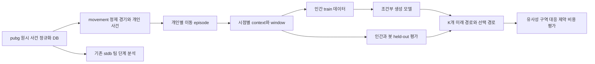
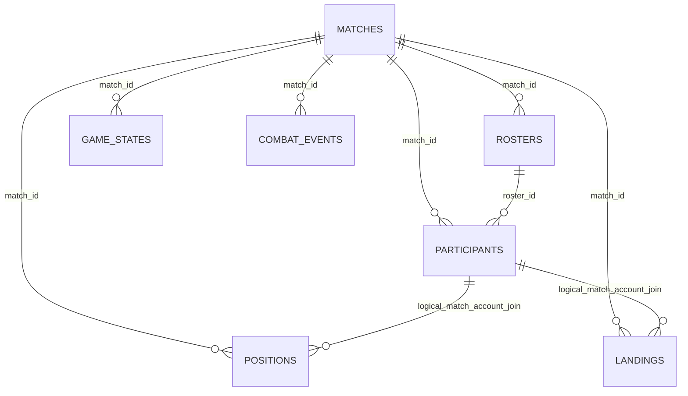

# PUBG 이동 연구 프로젝트 스키마와 데이터 계약

2026-10-15 현재 DB 구조와 새 이동 연구의 제안 스키마를 구분한다. **기존 DB는 조회만 했으며 새 DB 테이블·모델·학습 데이터셋은 만들지 않았다.** 이 문서의 `movement.*`는 앞으로 생성할 논리 테이블 이름이고, MVP는 Parquet와 JSON 파일로 저장하는 것을 권한다.

연구의 의미와 평가 설계는 [연구 계획](../experiment_design/FDG2027_MOVEMENT_RESEARCH_PLAN_2026-10-15.md), feature 순서는 [기계 판독 계약](../experiment_design/fdg2027_movement_contract_v1.json), 현재 DB의 모든 컬럼·형식·키는 [전체 DB 사전](DB_SCHEMA_CATALOG_2026-10-15.md)에 있다.

**공식 source schema는 [PUBG API 홈페이지 대조표](PUBG_OFFICIAL_API_SCHEMA_AUDIT_2026-10-15.md)를 기준으로 한다.** 이 문서의 DB 구조는 source schema의 일부를 저장한 구현이다. 아래 구역 별칭과 분절 규칙은 공식 정의와 대조표의 검증 상태를 함께 읽는다.

## 1. 세 가지 스키마 계층



`pubg`는 원시 API 사건에서 필요한 필드를 뽑은 관계형 자료이고, `stdb`는 팀·공간·단계 중심의 파생 자료다. 따라서 `pubg`를 원본 JSON 전체와 동일하다고 부르지 않는다. 이번 metadata 조회는 `pubg`와 `stdb` 범위이며, 외부 디스크에 원본 JSON이 있는지는 확인하지 않았다.

새 `movement` 계층은 개인별 시간창이 분석 단위다. 기존 `stdb.team_phase_*`의 한 행은 주로 팀×단계라서 본 연구의 주 학습 데이터가 될 수 없다. 기존 자료를 재사용할 때는 필드가 어느 시점까지의 사건을 포함하는지 다시 검증한다.

## 2. 현재 DB의 전체 구조

조회 범위는 월별 child partition을 제외한 부모 relation 49개와 그 컬럼 정의 1,130개다. 중복 의미의 view 컬럼도 포함한 수이며 1,130개의 독립 변수가 있다는 뜻은 아니다.

| 영역 | 테이블 / 뷰 | 역할 |
|---|---|---|
| 경기·명단 | `pubg.matches`, `rosters`, `participants` | 경기 메타, 팀, 개인 식별·경기 최종 통계 |
| 주기적 상태 | `pubg.telem_positions`, `telem_game_states` | 개인 위치·차량·체력, 현재/공개 목표 구역 |
| 경기·단계 사건 | `pubg.telem_match_start`, `telem_match_end`, `telem_phase_changes` | 공통 시계, 경기 종료, 단계 전환 |
| 이동 사건 | `pubg.telem_parachute_landing` | 착지 시점·위치 |
| 교전 사건 | `pubg.telem_damage`, `telem_groggy`, `telem_kills` | 피해·기절·사망, 당사자 ID |
| 아이템 사건 | `pubg.telem_item_pickup`, `telem_item_equip`, `telem_item_use` | 획득·장착·사용 |
| 운영·조회 | `pubg.api_rate_log`, `collection_log`, `v_collection_status`, `v_match_summary` | 수집 현황·요약, 모델 입력 아님 |
| 시공간 기반 | `stdb.matches`, `teams`, `moving_objects`, `dynamic_regions`, `spatial_events`, `team_proximity` | 경기/팀, 공간 위치·구역·사건·팀 간 거리 |
| 단계·스냅샷 | `stdb.match_phase_global`, `team_snapshot_features` | 단계 요약, 팀 시점 특징 |
| 팀 단계 특징 | `team_phase_state`, `trajectory`, `features`, `exposure`, `combat`, `loot`, `graph` | 상태·경로·노출·교전·아이템·그래프 |
| 추가 특징 | `team_phase_edge_cache`, `f0_extra`, `habitat_features`, `network_features`, `z_affordance_features` | 엣지·추가 위치·공간 수용·네트워크·높이 |
| 기존 정답 | `stdb.team_phase_labels` | 다음 단계 탈락 등. 새 모델 input 금지 |
| 기존 view 9개 | 아래 목록 | 기존 연구용 결합·집계 표현 |

위 표에서 `trajectory`, `features` 등 축약 이름은 모두 `stdb.team_phase_` 접두어를 갖는다. 실제 이름과 컬럼은 전체 DB 사전에서 확인한다.

`stdb` view: `v_match_phase_bounds`, `v_positions_ingame`, `v_team_by_phase`, `v_team_phase_feature_long`, `v_team_phase_feature_v2`, `v_team_phase_official_raw_features`, `v_team_phase_trajectory`, `v_team_phase_wide`, `v_team_truncated_targets`.

relation 종류는 `pubg`: 일반 테이블 16개+partition 부모 1개+view 2개, `stdb`: 일반 테이블 21개+view 9개다. schema의 `estimated_rows`는 PostgreSQL 통계 추정치이며 정확한 행 수가 아니다.

## 3. 키와 조인 관계



일부 연결은 DB foreign key가 아닌 분석상 논리 관계다. 참가자-위치 관계의 유일성은 ingestion constraint가 보장하지 않으므로 실제 자료로 검사한다.

| 대상 | 실제 PK 또는 제약 | 분석에서 쓰는 연결 |
|---|---|---|
| matches | PK `match_id` | 모든 테이블의 경기 키 |
| rosters | PK `roster_id`, FK `match_id` | `(match_id, roster_id)`로 참가자와 연결 |
| participants | PK `participant_id`, FK `match_id`, `roster_id` | `player_id`가 account ID. `(match_id, player_id)` 유일성 별도 검증 |
| telem_positions | PK `(id, event_time)` | `(match_id, account_id)` → participants |
| telem_match_start | PK `id`, UNIQUE `match_id` | 각 경기의 시간 원점 |
| game states / landing / phase / damage / kills 등 | 주로 PK `id` | `match_id`와 사건 시각, 역할별 계정 ID |

예시 조인:

```sql
SELECT p.match_id, p.player_id AS account_id, r.team_id,
       t.event_time, t.elapsed_time, t.pos_x, t.pos_y
FROM pubg.participants p
JOIN pubg.rosters r
  ON r.match_id = p.match_id AND r.roster_id = p.roster_id
JOIN pubg.telem_positions t
  ON t.match_id = p.match_id AND t.account_id = p.player_id
WHERE p.match_id = :match_id;
```

`participant_id`와 `player_id`를 혼동하지 않는다. `team_id`는 경기 간 고유 ID가 아니다. 계정 ID도 봇에서 경기 간 동일 개체·정책을 뜻한다고 가정하지 않는다. 기본 actor key는 항상 `(match_id, account_id)`다.

## 4. 이동 연구에 직접 필요한 원시 필드

| 테이블 | 핵심 컬럼 | 사용 규칙 |
|---|---|---|
| matches | match_id, created_at, map_name, game_mode, match_type, is_custom, shard_id | created_at은 공식상 API 객체 저장시각. 실제 경기 시간 분할은 match-start 우선 |
| rosters | roster_id, match_id, team_id | 팀 매핑. rank/won은 input 금지 |
| participants | participant_id, player_id, match_id, roster_id | 식별/검증. kills, time_survived, win_place, 총 이동거리 등 최종 요약은 input 금지 |
| positions | id, event_time, is_game, elapsed_time, account_id, team_id, health, pos_x/y/z, vehicle_type/id/speed, num_alive | 개인 시계열. player_name은 모델에서 제외 |
| game states | event_time, is_game, elapsed_time, num_alive_teams/players, safe_zone_*, poison_zone_*, red_zone_*, black_zone_* | as-of 구역 조건. red/black은 확장 QC/위험 조건으로 보존 |
| match start | event_time, camera_view_type, team_size, blue_zone_options | 공식 cameraViewBehaviour와 수집 사본 키 불일치 확인 필요. options 문자열 해석 후 빈 배열 검사 |
| phase changes | event_time, is_game, phase, elapsed_time | event time 중심. 현 표본의 elapsed_time은 전부 NULL |
| parachute landing | event_time, account_id, team_id, pos_x/y/z, distance | 착지 앵커. 여러 행≠여러 생명 |
| kills | event_time, killer_id, victim_id, victim_team_id, is_suicide, damage_* | 최초 kill 전 episode 종료; input은 과거 사건만 |
| groggy | event_time, attacker_id, victim_id, damage_*, is_attacker_in_vehicle | 기절 후보; death와 구분 |
| damage | event_time, attacker_id, victim_id, damage, damage_type/reason/causer | 과거 피해량, blue damage 구분 후보 |
| item use | event_time, account_id, item_id, category, sub_category, stack_count | 확장 과거 회복·사용; MVP 필수 입력 아님 |

Location 좌표는 공식 cm→m 변환을 적용한다. 반경은 공식 객체 페이지에 number로만 표기되어 있으므로 기존 ETL의 /100 관례를 원시 기하와 대조한 뒤 확정한다. `vehicle_speed`는 공식 Vehicle.velocity에서 왔지만 단위가 명시되어 있지 않아 검증 전 `vehicle_speed_raw`로 보존한다. 학습 속도는 위치 변위와 실제 시각차에서 계산한다. participant의 walk/ride/swimDistance는 공식적으로 m이므로 다시 /100 하지 않는다. 원점은 공식상 지도 좌상단이며, 그림의 y축 반전 여부를 명시한다.

시간 규칙은 `w_s = event_time − telem_match_start.event_time`. raw `elapsed_time`은 보존하지만 다른 event와 섞지 않는다. 위치 window와 구역 join은 모든 source event가 각 기준 시각 이하임을 보장한다. 기존 `phase_v2/source.py`의 W-clock·SQL cutoff 개념을 참고하되, 기존 centered `grid.zone_at_grid`를 새 온라인 context에 그대로 쓰지 않는다.

## 5. 제안하는 정제 계층 스키마

필수 필드만 본문에 기재한다. 모든 산출물은 `dataset_version`, `source_snapshot_id`, `build_config_hash`를 file metadata 또는 manifest에서 참조한다. 타입은 Arrow/Parquet 기준 제안이다.

| 논리 테이블 | 한 행의 단위 / 키 | 필수 필드와 타입 |
|---|---|---|
| `movement.matches` | 경기 / match_id:string | map:string, mode:string, perspective:string, match_type:string, team_size:int16, created_at:timestamp UTC, start_at:timestamp UTC, map_extent_m:float32, cohort_id:string, qc_status:string |
| `movement.actors` | 경기×계정 / match_id+actor_id | actor_id:string, account_key:string, team_id:int32, class:enum(human,bot,other,unknown), label_rule:string, roster_valid:bool |
| `movement.positions` | 정제 사건 / match_id+actor_id+event_key | w_s:float64, raw_elapsed_s:float64 nullable, x/y/z_m:float32, health:float32, vehicle_type/id:string nullable, vehicle_speed_raw:float32 nullable, mobility_state:enum, quality_flags:list[string], source_refs:list[struct] |
| `movement.zones` | 경기×관측 구역 / match_id+event_key | w_s:float64, blue_cx/cy/r_m:float32 nullable, white_cx/cy/r_m:float32 nullable, is_game:float32, num_alive_players:int16, valid flags, red/black optional, source_ref:struct |
| `movement.events` | 개인 관련 사건 / match_id+event_key+role | kind:enum, actor_id:string nullable, other_actor_id:string nullable, role:string, w_s:float64, value:float32 nullable, source_table/id/time, semantic_dedup_key:string |
| `movement.episodes` | 연속 관측 구간 / episode_id:string | match_id, actor_id, first_w_s, last_w_s, start_reason, end_reason, first_landing_w_s, censor_reason, mobility_confidence, n_points:int32 |

`account_key`는 같은 인간의 경기 간 중복 확인을 위한 private pseudonym(HMAC 등)이다. 원계정은 접근 제한된 원자료 매핑에 남기고 공개 dataset에는 직접 넣지 않는다. `actor_id`는 경기 안에서의 로컬 ID다. class 라벨을 암시하는 ID 문자열을 neural input에 전달하지 않는다.

`event_key`는 원시 row PK와 의미 중복 구분을 위한 build-local key다. `source_refs`는 `(source_table, source_id, source_event_time)`을 포함한다. `telem_positions`의 PK가 복합키이므로 source_id 하나만으로 lineage를 완성하지 않는다. 의미 중복 제거로 여러 원시 행을 합치면 모든 참조를 남긴다.

공식 LogPlayerPosition.elapsedTime은 number이므로 신규 canonical 원본 값은 float64로 보존한다. 기존 DB integer에서 읽었다면 이미 정수화된 출처라는 표시를 남기며 소수 정보를 복구했다고 주장하지 않는다. `source_field_path`, `official_type`, `storage_type`, `transform`, `verification_status`를 매핑 metadata로 관리한다.

QC flag의 최소 집합: `missing_position`, `conflicting_same_timestamp`, `missing_landing`, `aircraft`, `vehicle`, `transport`, `possible_swim`, `dbno`, `post_first_kill`, `gap`, `jump`, `outside_map`, `ambiguous_mobility`. 확정과 추정 flag를 분리한다. 여러 landing이 있다는 사실만으로 `redeploy_confirmed`를 만들지 않는다.

## 6. 제안하는 학습·평가 계층 스키마

| 논리 테이블 | 키 / 단위 | 필수 필드 |
|---|---|---|
| `movement.splits` | split_version+match_id | split(train/val/test), seed, grouping_rule, date_range, account_overlap_audit, source_snapshot_id |
| `movement.windows` | window_id | match_id, actor_id, episode_id, split, anchor_w_s, class, history_refs, future_refs, history_times, target_times, horizon_s, valid_steps, quality_flags, exclusion_reason, feature_shard+row_index |
| `movement.context` | window_id | ego_hist, zone_hist, team_hist, context, feature masks, team_present, source_max_w_s, asof_ages |
| `movement.targets` | window_id | target_delta[6,2], target_xy_m[6,2], target_valid[6], target_time_offset_s[6], censor/event flags |
| `movement.matches_hb` | matching_version+bot_window_id+human_window_id | split, strata, distance, weight, overlap_pass, matching_feature_version |
| `movement.runs` | run_id | model/config/code/data/split hashes, seed, training budget, best checkpoint, selection metric, device/runtime |
| `movement.predictions` | run_id+window_id+sample_idx | predicted_delta[6,2], predicted_xy_m[6,2], K, sampler, steps, candidate_cost, violation flags, selected, fallback, latency_ms |
| `movement.metrics` | run_id+scope+metric+group | estimate, unit, n_matches, n_actors, n_windows, CI, seed, aggregation_rule, reference_population |

context와 target은 같은 window_id로 연결하며, feature shard의 행 번호는 window_id를 대체하지 않는다. class는 인간 학습 표본 선택에만 사용하고 모델 입력에서는 제외한다. 탈락 창도 제외 사유를 보관해 class·단계·horizon별 손실률을 계산한다.

매칭 reference와 생성 후보를 연결해도 다른 경기의 실제 좌표를 그대로 빼지 않는다. 비교용 이동은 각 anchor 상대좌표 또는 공개 구역 상대좌표로 변환하며, 지도 절대 위치 매칭을 먼저 수행한다. 원시 인간 future를 bot anchor로 옮기는 retrieval은 속도/범위/지도 맥락을 별도 검사한다.

## 7. 텐서와 저장 자료를 연결하는 규칙

```text
movement.positions + zones + events + actors
    ↓ episode 분절, split 고정, anchor 생성
movement.windows + context + targets
    ↓ 인간 training만 sampling
batch: ego [B,4,8], zone [B,4,10], team [B,4,3,6], context [B,4]
    + 유효성 mask
    ↓ model
delta paths [B,K,6,2]
    ↓ 누적합 ×100m + anchor_xy_m
world-coordinate paths [B,K,6,2]
    ↓ 공통 selector
one path [B,6,2] + chosen sample_idx + cost + fallback flag
```

feature 계약 JSON은 각 feature 순서·unit scale·shape를 정의한다. 아직 loader가 이 shape를 실제로 반환한다는 검증은 하지 않았다. 모델 구현 시 실제 batch를 읽어 dtype·shape·mask·source cutoff를 함께 assertion해야 한다.

dataset manifest 필수 항목: 버전, 생성시각, DB snapshot 식별, read query hash, 코드 commit/dirty diff hash, 입력 테이블 범위, 맵 메타데이터 버전, class rule, clock rule, coordinate rule, mobility filter, window offsets, gap/tolerance, split seed, normalizer의 training scope, 모든 산출물 SHA-256, class별 원자료→유효창 funnel.

## 8. 프로젝트 디렉터리 제안

아래는 구현할 구조이며 현재 생성된 모델 패키지가 아니다.

```text
movement_diffusion/
  data/          # extract.py, clock.py, episodes.py, windows.py, splits.py
  features/      # ego.py, zones.py, teammates.py, contract.py
  models/        # baselines.py, cvae.py, diffusion.py, encoders.py
  evaluation/    # matching.py, forecasting.py, human_likeness.py, constraints.py
  simulation/    # 공개 구역 상태, low-level controller, receding-horizon loop
  train.py
  infer.py
configs/movement/ # cohort, feature, model, evaluation 설정
data/movement/<dataset_version>/
  manifest.json
  matches.parquet, actors.parquet, episodes.parquet
  positions/, zones/, events/
  splits.parquet, windows/, features/, targets/
  exclusions.parquet, matching_pairs.parquet
reports/movement/<run_id>/
  run_manifest.json, metrics.csv, predictions.parquet, figures/
tests/movement/  # 시간 누수, split, mask, 단위, selector 평가
```

1차 구현 순서는 `schema audit → match manifest → canonical events → episodes → split → windows/context → QC → baselines → diffusion → selector → evaluation`이다. 기존 `model_stgcn` 학습 경로와 분리하면 팀 생존 라벨과 이동 목표의 혼동을 줄일 수 있다.

필수 검증: (1) 읽기 전용 extraction, (2) natural key·조인 cardinality, (3) 모든 input source_time ≤ cutoff, (4) input prefix replay 일치, (5) source coordinate 복원 round-trip, (6) match split 교집합 0, (7) normalizer train-only, (8) future로 selector 튜닝하지 않음, (9) raw/selected 후보 모두 보존, (10) dropout 이유·모델 비용 보고.

## 9. 구현 전에 해결할 항목

| 항목 | 현재 상태 | 처리 |
|---|---|---|
| 전체 적격 이동 창 수 | 미측정 | 분절·필터 후 전수 funnel |
| 봇 라벨의 공식 보증 | API Character에 전용 isBot 없음, 접두어 규칙 사용 | rule version과 unknown 보관; 임의로 인간성·숙련도 등치 금지 |
| 복수 landing 의미 | 봇·인간 모두 관측 | 전후 위치·차량·사망 trace 검증 |
| raw JSON 재파싱 | 보관 위치 미확인, 공식 API에는 필요한 이동 사건 존재 | 원본 위치·event 존재·parser 버전 먼저 조사하고 재추출 가능성을 판단 |
| 실제 구역 timer | 표본 blue_zone_options 비어 있음 | MVP 제외, state_age만 사용 |
| walkability·고도 | 지형 자원/정확도 미검증 | 지도 범위·운동 제약과 지형 통과 가능성 분리 |
| GPU·수업 마감 | 미지정 | pilot 비용 실측과 일정 조정 |
| 데이터 공개 | 별도 판단 필요 | 공개 전 계정 가명처리·이용조건·재현용 추출 코드 검토 |

수집 코드 사본의 camera/kill/groggy 추출 경로 불일치, 미보존 이동 사건, enum drift의 상세 목록은 공식 대조표 6–8절에 있다. 현재 DB를 만든 코드라는 증거가 없으므로 사본만 보고 DB 오류를 확정하지 않는다.

출처: [공식 객체 정의](https://documentation.pubg.com/en/telemetry-objects.html), [공식 사건 정의](https://documentation.pubg.com/en/telemetry-events.html), [live schema snapshot](../../reports/movement_schema_2026-10-15/schema_snapshot.json). 스키마 존재는 필드의 완전성·정확성·전체 자료 보존을 뜻하지 않는다.
