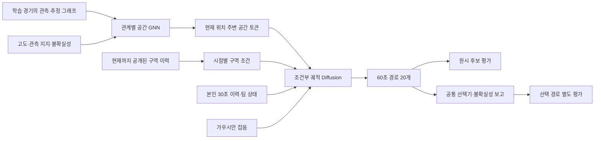

# 100m 공간 그래프를 이용한 안전구역 조건부 경로 Diffusion

> 후속 사용자 수정 반영: 주 노드 설계는 [개인·팀 이종 그래프 v3](./PLAYER_TEAM_HETEROGRAPH_DIFFUSION_V3_2026-10-15.md)로 대체한다. v2의 정적 공간 중심 구조와 비차량 전용 범위는 현재 권장안이 아니다. 공간 출처·검증 분리·불확실성 원칙은 유지한다.

## Material Passport

- Origin Skill / Mode: academic-research-suite / experiment-agent plan
- Date: 2026-10-15, Asia/Seoul
- Version: graph_zone_diffusion_design_v2
- Status: **설계안. 공간 그래프는 생성·검사됐지만 아래 인코더·궤적 데이터로더·Diffusion은 구현 및 학습 전이다.**
- 기존 [이동 연구 v1](./FDG2027_MOVEMENT_RESEARCH_PLAN_2026-10-15.md)의 인간 학습 → 인간/봇 상태 평가 방향을 유지하고 공간 조건을 구체화한다. 기존 JSON 계약을 덮어쓰지 않는다.
- 연결 자료: [현재 지도 감사](../data_layer/ERANGEL_100M_APPROXIMATE_MAP_40_2_2026-10-15.md), [논문용 공간 타당도 메모](../data_layer/ERANGEL_SPATIAL_VALIDITY_PAPER_MEMO_2026-10-15.md), [v2 설계 계약](./erangel_graph_diffusion_contract_v2.json).

## 1. 권장 구조와 연구 범위

**관계 유형을 구분하는 공간 GNN을 먼저 학습한 뒤, 그 임베딩과 공개된 안전구역을 연속 좌표 Diffusion의 조건으로 넣는다.** 생성 단위는 10초 간격의 거시적 경로이며 조준·실내 이동·충돌 없는 조작 정책은 아니다. 공간 학습을 했다고 지형의 정확도가 자동으로 검증되는 것은 아니다.



Diffuser는 궤적을 점진적으로 복원하는 생성과 조건부 계획의 선행 근거다. 이 설계는 그 모델을 PUBG에서 재현했다고 주장하는 것이 아니라, 공간 그래프와 정보 공개 시점을 추가한 연구 제안이다. [Janner et al., ICML 2022](https://proceedings.mlr.press/v162/janner22a.html)

처음부터 격자 ID에 대한 이산 Diffusion으로 제한하지 않는다. 100m 셀 중심만 출력하면 셀 내 이동·정지를 잘 표현하기 어렵고 부정확한 연결을 반드시 따르게 만들 수 있다. 연속 XY를 생성하고 셀 ID를 보조 출력으로 둔다. D3PM 계열의 격자 ID → 셀 내 offset 2단계 모델은 FDG 확장 비교군으로 남긴다. 그 경우에도 순방향 확산은 정보 훼손 과정이지 실제 게임 이동이므로 관측 엣지에만 제한하지 않고 mask/전역 혼합을 포함해야 한다. [Austin et al., D3PM](https://arxiv.org/abs/2107.03006)

## 2. 현재 사용할 수 있는 데이터와 새로 필요한 데이터

현재 `reports/erangel_100m_40_2_2026-10-15/`에는 2,675경기 분할, 경기별 집계, 학습 전용 그래프가 있다. 노드 6,724개, 비차량 관측 방향 엣지 27,158개, 추정 방향 엣지 169개다. 차량 엣지 114,243개는 분리한다. **이 수치는 현재 분할에서만 유효하며 재분할하면 다시 계산한다.**

`match_cache/*.npz`는 경기·셀·종류별 집계다. 개별 플레이어의 시간 순서, 안전구역 시계열, 정지 전이, 팀원 관계를 복원할 수 없다. 다음 학습 데이터는 DB에서 새로 만든다.

| 데이터 | 필요한 실제 원천 | 저장 단위 |
|---|---|---|
| 이동 episode | `pubg.telem_positions`, participants, parachute_landing, kills | 경기·플레이어·연속 이동 구간 |
| 구역 이력 | `pubg.telem_game_states`, 필요 시 phase_changes와 raw 사건 | 경기·관측 시각 |
| 팀 이력 | roster/participant 관계 및 과거 positions | 팀원 최대 3명·관측 시각 |
| 학습 창 | 위 원천의 시점 정합 | 본인 4시점 + 미래 6시점 |
| 분절·제외 감사 | 착지/사망/중복/결측/차량/시간 간격 | 경기·종류·사유별 수량 |

계정 식별자는 내부 조인과 플레이어별 가중치에만 사용한다. 모델 입력에서 제거하고 산출물에는 프로젝트 내부 pseudonym 또는 집계만 보존한다. 공간 NPZ의 경기 수를 궤적 학습 표본 수라고 부르지 않는다.

초기 행동 학습·인간/봇 비교의 주 모집단은 **40.2 추정, 일반, TPP squad, 비커스텀, 비이벤트**다. 다른 모드와 AI Royale을 단순 합쳐 인간·봇 차이를 계산하지 않는다. 공간 그래프에는 같은 분할의 모든 유형을 사용할 수 있지만, 주 행동 모집단 밖의 학습 경기만 공간 사전학습에 추가했다는 사실을 명시한다. 일반 경기만의 공간 그래프도 민감도 분석한다. 적격 창 수는 아직 미측정이다.

이력 시점은 `[-30,-20,-10,0]초`, 미래 목표는 `[10,20,30,40,50,60]초`다. 이력은 과거 방향 as-of와 age ≤11초, 목표는 실제 관측점 중 허용 오차 ±2초로 선택하고 서로 다른 원시 행만 허용한다. 인접 원시 관측 간 5–15초·비차량 수평 평균속도 ≤12m/s를 유지하고, 단절 구간을 보간하지 않는다. 시작점을 30초 간격으로 두고 비중첩 90초 간격도 비교한다.

주 실험은 미래 6시점이 모두 있는 창을 사용한다. 따라서 60초 안에 사망하거나 기록이 끊긴 집단의 선택 편향이 생긴다. 인간/봇·단계별 적격률과 제외율을 필수 보고하고 20초 horizon을 비교한다. 전체 생존자나 전체 플레이어에 대한 결론으로 확대하지 않는다. 10초는 공식 보장 주기가 아니라 로컬 관측 기반 규격이다.

## 3. 공간 표현: 지형 보조값과 행동 지지를 분리

노드의 고정 수치 특징은 정규화 XY, 셀 폭·높이, 과거 높이 근사값, 과거 육지 비율, RGB 수면 비율, 관측 플레이어 고도 요약, 높이 잔차, 수직 변동이다. 결측 마스크를 함께 넣는다. 관측 고도는 지면 높이의 정답으로 취급하지 않는다.

별도 근거 채널은 `log1p(match_support)`, `log1p(nonvehicle_points)`와 8개 불확실성 flag다. 단순한 하나의 confidence 값으로 압축하지 않는다. 관측 부족, 높이 불일치, 지도 변경 가능성, 수면 후보 관측은 의미가 다르다. 인간/봇 개별 관측 수와 경기 유형별 수는 감사·분석에 남기되 주 공간 인코더 입력에서는 제외한다. 클래스별 히트맵으로 정답 종류가 간접 주입되는 것을 줄이려는 조치이며, 공통 점유 빈도에도 행동 편향이 남는다는 점은 인정한다.

| 관계 | 원천 | 모델 처리 |
|---|---|---|
| 관측 이동 O | 학습에서 해당 방향으로 관측 | 별도 가중치 행렬, 경기 지지와 실제 평균 dt/변위 입력 |
| 추정 인접 I | 과거 육지 후보의 상하좌우 인접, 방향 관측 없음 | 별도 가중치 행렬, 메시지 크기 상한을 낮게 설정 |
| 자기 메시지 | 인코더의 residual/self 연산 | 이동 정지의 관측 근거로 세지 않음 |
| 역방향 메시지 | 방향 그래프의 정보 집계를 위한 incoming/outgoing 연산 | 원래 반대 방향 이동이 관측됐다는 라벨로 변환하지 않음 |

관측 엣지를 높이 자료와 다르다는 이유로 추정 엣지로 바꾸거나 삭제하지 않는다. ‘관측됐다’는 사실과 ‘과거 지형 설명이 일치한다’는 판단은 별개다. 추정 엣지는 사전학습·경로 생성 뒤에도 추정 출처를 유지하며 모델의 높은 점수만으로 관측 엣지로 승격하지 않는다.

공간 GNN은 hidden 128, 3층, residual, 관계별 집계로 시작한다. 관계를 나누는 아이디어는 R-GCN을 참고하되 이 설계의 게이트가 해당 논문의 원형 구현이라는 뜻은 아니다. [Schlichtkrull et al., R-GCN](https://arxiv.org/abs/1703.06103)

제안하는 메시지 형태는 다음과 같다.

```text
h_i^(l+1) = LayerNorm(h_i^l + MLP(h_i^l)
    + sum_r [ 1/max(1, degree_r(i)) * sum_j g_ij^r * W_r h_j^l ])

g_obs = clip(log(1 + support_ij)/log(31), 0.05, 1) * sigmoid(MLP_obs(edge_features))
g_inf = 0.2 * sigmoid(MLP_inf(historical_grade_proxy, endpoint_flags))
```

0.2와 지지 스케일 30은 개발용 초기값이지 통행 확률이 아니다. inferred cap `{0,0.1,0.2,0.5}`를 내부 validation에서 비교한다. 게이트 합으로 다시 정규화하면 낮은 게이트가 상쇄될 수 있으므로 관계의 고정 degree로 평균내고 residual을 유지한다. incoming/outgoing은 별도 파라미터를 사용한다. 높이 관련 flags는 높이 feature branch의 learned gate에도 넣어 지형 보조값을 덜 신뢰할 수 있게 한다. 이동 관측 자체의 존재는 유지한다.

추정 메시지를 50%, 약한 관측 메시지를 10% 확률로 dropout하는 초기값을 사용한다. 강한 관측까지 모두 깨뜨리는 데이터 훼손은 별도 강건성 실험으로 구분한다. 모든 hyperparameter는 선택 전 후보와 예산을 고정하고 내부 개발 경기에서만 고른다.

## 4. 공간 인코더의 사전학습

목표는 **통행 가능성 인증이 아니라 실제 이동에 유용한 공간 표현**이다.

1. 학습 경기의 연속 이동에서 현재 셀·실제 dt·과거 속도·현재 공개 구역을 조건으로 다음 셀의 범주 분포를 예측한다. 정지 전이를 반드시 포함한다. 현재 엣지 CSV에 정지가 없으므로 새 궤적 데이터에서 산출한다.
2. 근접 후보 셀, 현재 셀, 그 밖의 셀을 표현할 OTHER 범주를 포함한다. 추정 엣지는 메시지 통로로만 쓰며 ‘실제 지나갔다’는 양성 학습 라벨을 주지 않는다. 미관측 셀 쌍에 ‘통행 불가’ 이진 라벨도 주지 않는다. categorical loss가 학습하는 것은 상대적 다음 위치 분포다.
3. 보조 과제로 관측 고도 요약의 일부를 가리고 복원한다. 이것은 노이즈를 포함한 관측 feature 복원으로 명명한다. 실제 지형 RMSE라고 보고하지 않는다. 다음 셀 loss를 1, 보조 loss를 0.1로 시작하고 보조 과제 없는 모델도 비교한다.
4. 경기→플레이어→창을 균등 샘플링하고 사전학습에서는 인간/봇의 균형을 맞춘다. 클래스 라벨은 sampler에만 사용한다. 종류별 빈도는 평균적인 지형 자체를 뜻하지 않는다.

자기 경로가 자기 그래프 지지를 만드는 효과를 줄이기 위해 **외부 train 안을 3개 match fold로 나눈 cross-fitting**을 제안한다. 각 fold의 창은 나머지 2개 fold로 만든 그래프의 feature와 엣지로 학습한다. 각 그래프의 높이 보정도 해당 구성 경기에서만 한다. 같은 encoder 파라미터를 공유하고, 개발/외부 평가에는 전체 outer-train 그래프를 사용한다. 이는 학습/평가 시 그래프 규모 차이를 만들므로 graph coverage를 함께 보고한다. 단순 full-train 그래프 학습은 비용을 줄인 비교군으로 남긴다.

초기 사전학습 최대 30 epoch, AdamW 3e-4, dropout 0.1, patience 5를 제안한다. 하나의 고정 GPU 메모리 요구량이나 실행 시간을 아직 보장하지 않는다. 추출 뒤 표본 수·배치 메모리를 실측한다. 검증은 다른 경기의 next-cell log loss/top-k와 관측 지지 구간별 성능으로 한다. 이 단계의 성능도 통행 가능성 정확도는 아니다.

## 5. 안전구역 조건과 시간 누출 차단

공식 GameState의 `safetyZonePosition/Radius`, `poisonGasWarningPosition/Radius`와 Common의 `isGame`이 원천이다. Location의 cm 단위와 Erangel 범위 816,000cm는 공식 문서에서 확인했다. 두 구역의 현재/공개 목표 의미와 로컬 반경 변환은 **구역 전환 raw trace 감사가 아직 필요**하다. 검증 전에는 로컬 컬럼 이름만으로 의미를 확정하지 않는다. [PUBG 공식 Telemetry Objects](https://documentation.pubg.com/en/telemetry-objects.html)

각 이력 시점까지의 최신 game-state만 as-of로 가져오고 age ≤15초를 적용한다. 현재 경계, 이미 공개된 목표 원의 중심·반경, 단계·축소 여부·관측된 상태 경과시간을 넣는다. 아직 발표되지 않은 원, 미래 단계 종료 시각, 미래 상대 위치는 넣지 않는다. 구역 필드가 없으면 mask하며 미래 값으로 채우지 않는다. zone 데이터가 충분한 창을 주 평가에 쓰고 결측 집단을 별도로 보고한다.

공간 토큰마다 현재/공개 목표 원에 대한 signed distance와 안/밖 여부를 계산한다. 예를 들어 `d_white(i)=||center_i-c_white||-r_white`이며 음수는 안쪽이다. 반경·중심이 유효할 때만 계산한다. 최종 위치의 원 안/밖 평가는 셀 중심이 아닌 생성된 XY로 계산한다.

아직 모르는 다음 원까지 60초 전체 구역 schedule을 만들지 않는다. 기본 생성은 t0의 공개 정보에 조건화한다. 관측된 과거 축소 추세를 연장하는 것은 별도 estimated-schedule 비교군이다. 이후 공개되는 실제 원으로 사후 노출을 평가할 수는 있지만 생성·선택기에 전달하지 않는다. 원 밖으로 나가는 모든 인간 경로를 오답으로 만들지 않으며, 인간 행동 학습과 안전구역 진입을 선호하는 선택 목적을 분리한다.

## 6. 입력·출력과 Diffusion 내부

아래 shape는 **제안 계약**이다. JSON feature 개수는 정적으로 점검하지만 실제 DB loader/model의 runtime shape를 측정한 결과는 아니다. 기존 v1 history 규격을 유지한다.

| 텐서 | 제안 shape | 역할 |
|---|---|---|
| `node_geom`, `node_geom_valid` | `[N,10]`, 동일 mask | 위치·셀 크기·역사적 높이/육수·관측 고도/잔차/변동 |
| `node_support` | `[N,2]` | log 경기 지지, log 비차량 위치 수 |
| `node_uncertainty` | `[N,8]` | 경고 이유별 bit |
| `edge_index_obs`, `edge_index_inf` | `[2,Eo]`, `[2,Ei]` | 방향과 관계 출처 유지 |
| `map_embedding` | `[N,128]` | GNN 출력; 현재 그래프 N=6,724 |
| `local_map_tokens` | `[B,441,128]` | 현재 셀 중심의 21×21 격자; 지도 밖 padding mask |
| `local_node_zone` | `[B,441,4]` + mask | 두 원 signed distance, 각 원 안/밖 |
| `ego_hist` | `[B,4,8]` + mask | 상대 XY, 속도, 체력, 최근 피격량, age, dt |
| `zone_hist` | `[B,4,10]` + mask | v1의 공개 구역 이력 |
| `team_hist`, `team_present` | `[B,4,3,6]`, `[B,4,3]` | 팀원 과거 상태; 팀 없는 경우 mask |
| `context` | `[B,4]` + mask | anchor 절대 XY, 생존 인원, 경기 경과시간 |
| `target_delta` | `[B,6,2]` | 직전 미래 시점 대비 변위 /100m |
| `samples_delta`, `samples_xy_m` | `[B,20,6,2]` | 생성 후보; 변위 누적으로 실제 m 좌표 복원 |
| `cell_logits` | `[B,6,442]` | local 441셀 + OTHER 보조 head |
| `route_support_type` | `[B,20,6]` | stay/observed/inferred/unsupported/outside 구분 |

21×21 토큰은 미래 정답 경로를 보지 않고 t0의 현재 셀에서 선택한다. 이 범위는 초기 속도 필터와 60초 horizon을 고려한 제안이며, 목표 창 추출 후 범위 밖 빈도를 실측한다. 수면·미관측 셀도 토큰에 남긴다. 누락을 육지나 통행 불가로 바꾸지 않는다. 고정 GNN을 freeze하면 전역 임베딩을 캐시할 수 있고, fine-tuning 시에는 optimizer step마다 갱신한다.

시간 인코더는 2층 Transformer, 궤적 denoiser는 hidden 128·4층·4 heads로 시작한다. 이력·구역·팀 토큰과 지역 map 토큰에 cross-attention하고 diffusion timestep embedding을 별도로 넣는다. map token에는 anchor 기준 상대 XY를 추가한다. `node_id`, account ID, 인간/봇 label을 주 모델의 학습 입력으로 쓰지 않는다.

```text
Y0 = 미래 6개 상대 변위 / 100m
Yt = sqrt(alpha_bar_t) * Y0 + sqrt(1-alpha_bar_t) * epsilon
epsilon_hat = Denoiser(Yt, diffusion_t, history, public_zone, local_map)
L = mean((epsilon - epsilon_hat)^2) + 0.1 * CE(cell_logits, target_cells)
```

cell CE는 clean trajectory reconstruction에서 파생한 auxiliary head에 적용하고 노이즈 timestep weight를 기록한다. 정답 셀 index만 label로 쓰며 local crop/attention mask에 정답 미래를 사용하지 않는다. graph support를 절대 정답으로 강제하는 loss는 주 모델의 기본값에서 제외한다.

DDPM training steps 100, DDIM sampling steps 20, 후보 K=20, batch 128을 초기값으로 제안한다. Diffusion 최대 100 epoch, AdamW 1e-4, validation energy score patience 10으로 시작한다. 인코더를 먼저 freeze한 모델을 주 결과로 두고 작은 학습률 1e-5 fine-tuning을 비교한다. seed 3개를 사용한다. 하이퍼파라미터는 실측 결과가 아니라 개발 시작점이다.

공간의 영향을 인코더에만 맡기는 주 모델과, 후처리에서 관측 지지/속도/공개 원까지의 진입 거리를 고려하는 공통 선택기를 분리한다. 학습 그래프에 없는 전이를 즉시 삭제하지 않는다. uncertainty-soft 방식은 지형 제약의 가중치를 낮추고, uncertainty-avoid 방식은 불확실한 지역을 회피한다. 둘은 다른 목적이며 혼용하지 않는다. 주 결과는 soft 방식 또는 무선택 원시 후보다.

선택기는 생성기에 관계없이 같은 후보 수·같은 정보·같은 목적 함수를 쓴다. 예: 정규화된 속도 초과 비용 + 공개 목표 원까지 남은 거리 + 작은 finite 관측 지지 비용. 높이 불일치 지역에서는 높이 비용을 낮추고, 미관측 지역을 벽으로 만들지 않는다. 그 대신 미관측 방문률을 별도 보고한다. λ=0을 반드시 포함하고 raw 후보 대비 선택 후의 다양성·정지율·미관측 방문 변화도 검사한다. 선택에 정답 미래 ADE나 사후 생존을 사용하지 않는다. 모든 후보가 필터를 위반하면 실패를 기록하고 현재 위치 유지 등의 사전 고정 fallback을 반환하되 성공 경로에 섞지 않는다.

## 7. 인간·봇 비교: 같은 지도, 다른 행동 분포

주 생성기는 **인간 후보의 경로만** 학습한다. 같은 encoder·같은 공간 자료로 봇 전용 생성기를 학습한 비교군을 추가한다. 공간이 다른 탓에 행동 차이가 생기지 않도록 한다. 공동 모델에 actor type을 넣는 방식은 확장 연구이며 주 비교에는 쓰지 않는다. 같은 상태에서 actor token만 바꾼 결과도 인과적 ‘봇을 인간으로 바꾼 효과’라고 해석할 수 없다.

관측 비교는 일반 TPP squad에서 인간·봇이 함께 있는 경기 안에서 한다. 같은 단계·축소 상태·대략적 위치 블록·공개 원 안/밖을 맞추고, 경계까지 거리, 과거 속도/방향, 체력, 최근 피격, 생존 인원, 팀원 수/거리 등을 매칭 또는 가중한다. 정확히 같은 셀·상태가 부족하면 공통 지지 구간만 비교하고 제외 비율과 표준화 평균차를 보고한다. 기본 balance 목표 |SMD|≤0.1은 인과적 동일성 인증이 아니다. 기록에 없는 전투 의도·시야·장비·봇 정책 차이는 남는다.

| 비교 | 질문 | 평가 |
|---|---|---|
| 실제 인간 vs 실제 봇 | 조건을 맞춰도 이동 특성이 다른가? | 길이·정지·방향 전환·공개 원 접근·팀 분산 분포 |
| 인간 상태 → 인간 학습 모델 | 인간 미래 분포를 표현하는가? | energy score, ADE/FDE, minADE@20, 다양성 |
| 봇 상태 → 인간 학습 모델 | 유사한 상태의 인간 이동 분포에 가까운가? | matched-human 분포 거리, 독립 판별기 보조 진단 |
| 봇 상태 → 봇 학습 모델 | 개선이 단순 생성 효과인가? | 동일 공간·동일 K·동일 선택기로 비교 |

봇의 실제 미래는 ‘인간형 경로’의 정답이 아니다. 인간 모델을 봇 상태에 적용한 경로가 봇 정답과 더 멀어졌다는 사실은 개선 근거가 아니다. 실제 인간 상태에서의 예측과, 봇 상태에서 matched-human 분포에 대한 적합성을 나눠 보고한다. 판별기가 인간으로 분류하는 비율만 최적화하지 않고, 판별기 학습/개발/평가 경기와 생성기 평가 경기를 분리한다. 이 지표는 관측 기반 유사성이지 플레이어의 주관적 인간다움이나 게임 성능이 아니다.

## 8. 분할과 비교 실험

현재 534 validation 경기의 포괄률을 이미 확인했다. 이를 ‘한 번도 보지 않은 최종 시험’으로 다시 명명하지 않는다. 현재 2,141 train 내부에서 별도 개발 경기를 떼면, **기존 2,141경기 그래프를 그대로 써서는 내부 개발 경기가 누출된다.** 모든 그래프·높이 오프셋·스케일러·사전학습을 실제 fit 경기로 다시 만든다. 기존 그래프는 진단·시각화 기준으로 보존한다.

수업 논문은 기존 534경기를 이미 점검한 외부 validation으로 명시하고, 내부 train/dev만으로 모델과 선택기를 정한다. FDG 확장은 유형·모드 층화 5-fold outer match CV와 각 outer-train 내부 20% 개발 분할을 권장한다. 마지막에는 선택된 설정으로 outer-train 전체를 재학습하되 외부 평가 경기는 끝까지 제외한다. 이미 전체 자료의 지도 포괄률을 살펴본 후 설계한 **후향적 CV**라는 사실을 공개한다. 신규 패치 자료가 생기면 별도의 시간·패치 이동 실험으로 추가하며 같은 40.2의 독립 시험이라고 부르지 않는다.

| 단계 | 모델/제거 실험 | 필요한 이유 |
|---|---|---|
| B0 | 현재 위치 유지, 등속도 | 이동·정지의 최소 기준 |
| B1 | 공개 원 방향 휴리스틱 / 학습 관측 그래프 경로 후보 | 단순 구역·공간 정보만으로 가능한 정도 |
| B2 | 조건부 확률적 AR 또는 CVAE | Diffusion 자체의 필요성 |
| D0 | history + 공개 zone Diffusion | 공간 정보 없는 동일 생성기 |
| D1 | 동일 노드 feature의 MLP 또는 raster encoder, 엣지 없음 | 위치·높이·점유 특징 효과와 GNN 효과 구분 |
| D2 | 관측 O만 사용하는 GNN Diffusion | 관측 연결의 기여 |
| D3 | 관측 O + 추정 I, uncertainty 없음 | 추정 관계 추가 효과 |
| D4 | O + I + uncertainty gate/mask | 제안 주 모델 |
| D5 | D4의 공개 zone 제거 | 안전구역 조건 효과 |
| A1 | D4에서 높이 제거 / 지지 빈도 제거 | 과거 높이와 행동 밀도 의존성 |
| A2 | 학습 가능한 공간 GNN vs 무학습/동결 GNN | 공간 사전학습의 실제 기여 |
| A3 | 구조 보존을 고려한 local edge shuffle | 엣지 구조 효과; 비현실적 전역 shuffle은 별도 음성 대조 |
| A4 | 일반 경기만의 지도 / 전체 유형의 지도 | AI Royale 공간 표본 효과 |

수업 단계에서는 B0, B2, D0, D1, D2, D4를 먼저 실행한다. FDG에서 나머지 제거 실험과 불확실 구역 강건성을 추가한다. 새 loss나 관계 하나만을 기여라고 주장하지 않고, **약한 공간 근거의 통합이 어떤 조건에서 도움이 되고 실패하는지**를 연구 질문으로 둔다.

현재 추정 엣지는 169개로 관측 엣지 27,158개에 비해 적고, 100m 관측 그래프는 조밀하다. 추정 관계의 효과가 전체 평균에서 작거나 0일 수 있다. 자연적으로 추정 연결이 등장하는 지역의 성능을 별도 제시하고, 인위적 엣지 삭제 실험의 효과를 자연 상태의 효과로 대체하지 않는다. 노드 feature-only 또는 규칙 격자 모델이 GNN과 같거나 더 좋다면 그 결과를 보고한다. 50/100/200m 비교는 별도 그래프 재구성과 같은 경기 분할로 진행한다.

## 9. 평가와 통계

주 예측 지표는 인간 평가 창의 **경로 energy score**와 선택된 경로 ADE/FDE다. K개 sample과 정답 경로 y에 대해 `ES = mean_k ||Yk-y|| - 0.5 mean_k,l ||Yk-Yl||`로 계산하며, 6시점 전체 경로 norm과 정규화 방식을 고정한다. minADE@20/minFDE@20은 oracle best-of-K 보조 지표로 보고하고 실제 선택 성능과 구분한다. 서로 다른 후보가 각 최소값을 달성할 수 있음도 명시한다.

거시적 타당성은 좌표 범위 이탈, 전처리에서 선언한 속도 한계 초과, 관측/추정/미지원 전이 비율, 정지율·경로 길이·후보 간 거리·점유 셀 다양성으로 측정한다. 미지원 전이를 충돌률로 부르지 않는다. 정지 비용을 인위적으로 낮추거나 미관측 구역으로 도망가 지표를 개선하는지도 별도 점검한다.

구역 지표는 t0에 공개된 원과의 거리 감소, 60초 안 도달 비율을 기본으로 한다. 출발점이 이미 안쪽인 집단과 바깥인 집단을 분리한다. 실제 미래 구역에 대한 노출은 **사후 평가**로 표시하고 입력으로 쓰지 않는다. 게임 시뮬레이터 없이 생존율·승률·공격 회피의 향상은 주장하지 않는다.

불확실성별로 high-support/no-extra-warning, low-support, height disagreement, known-change, water/mixed를 나누고 각 집단 표본 수와 성능을 제시한다. 단일 전체 평균으로 고도·교량·해안의 실패를 가리지 않는다. 현재 전체 그래프에서 붙인 flag를 새 split에 복사하지 않고 학습 fold에서 다시 계산한다.

모델 간 비교는 같은 평가 창의 paired difference를 경기 단위로 평균낸 뒤, 경기 cluster bootstrap 2,000회로 95% CI를 계산한다. 3개 seed의 변동도 따로 보고하고 seed×window를 독립 표본으로 세지 않는다. 겹치는 이동 창·같은 팀·같은 경기에 따른 의존성을 무시하지 않는다. 주 비교 D4 vs D0 및 D4 vs D1을 먼저 정하고, 다수 탐색 비교는 별도 표시한다. 유효 표본 수를 아직 모르므로 power나 성공 가능성 수치를 만들지 않는다.

## 10. 정확도 검증과 학습 착수 조건

공간 정확도는 별도 [논문 메모](../data_layer/ERANGEL_SPATIAL_VALIDITY_PAPER_MEMO_2026-10-15.md)의 기준으로 관리한다. 현재 99.80%/99.88%/97.98%는 포괄률이며 공간 정확도가 아니다. 같은 그래프를 생성기의 조건과 유일한 타당성 판정기로 동시에 사용하면 순환 검증이 된다. 독립 구역 관측·부분 실측·보류 경기 및 단순 feature baseline을 함께 써야 한다.

학습 시작 전 완료할 항목은 다음과 같다.

1. 40.2 추정 일반 TPP squad의 적격 궤적 창 수와 인간/봇 제외율 산출.
2. 두 구역의 의미·반경 단위·공개 시점 trace 검사와 future-asof 누출 검사.
3. 고정 match split마다 그래프·높이 보정·정규화 재계산; cross-fit 구성 ID 감사.
4. 실제 loader의 shape·mask·dt·target 유효성 검사. 특히 동일 raw 행 재사용 금지, 미래 구역 반영 금지, 지도 밖 padding 구분.
5. 작은 배치의 forward/backward 및 공간 없는 baseline을 먼저 재현한 뒤 GNN을 연결.

이번 요청에서는 위 설계와 근거 메모만 작성했으며, 학습 모델·성능 결과는 생성하지 않았다. 문헌 확인은 아키텍처 근거에 필요한 원문 수준으로 한정했고, FDG 2027 신규성이나 채택 가능성에 대한 전수 문헌 검토를 마친 것은 아니다.
