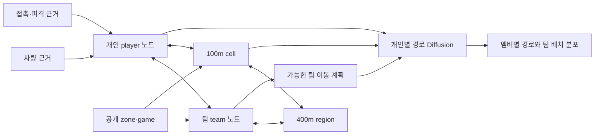

# 플레이어 관측 기반 개인·팀 이종 그래프와 경로 생성 v3


> 구현 업데이트: [학습 데이터셋 v1](../../movement_diffusion/README.md)을 실제 생성했다. 이 문서의 차원·전체 아키텍처는 제안이고, 현재 실행 계약은 `data/processed/heterograph_diffusion_v1/contract.json`과 `graph_schema.json`이다. v1은 첫 사망 이전 구간, 관측자/서버 대응 입력, 공동 경로 정답 및 최소 Diffusion 연결 검증까지 구현했다.

## Material Passport

- 날짜: 2026-10-15. 상태: **설계 수정안, 모델 미구현·미학습**.
- 사용자 수정: 정적인 지형뿐 아니라 관측 가능한 무장·차량·위협·팀·전체 경기 구조를 학습하며, **팀 노드와 개인 노드를 별도 타입으로 분리**한다.
- 우선순위: 이 문서는 [v2 설계](./ERANGEL_GRAPH_CONDITIONED_DIFFUSION_DESIGN_2026-10-15.md)의 주 아키텍처와 비차량 전용 가정을 대체한다. 100m 지도와 [공간 타당도 메모](../data_layer/ERANGEL_SPATIAL_VALIDITY_PAPER_MEMO_2026-10-15.md)는 유지한다.
- 근거: 로컬 스키마·기존 코드, 공식 API 문서, **기존 train의 일반 TPP squad 12경기 읽기 전용 감사**. 전체 코퍼스의 인벤토리 복원 정확도를 확인한 것은 아니다.

## 1. 모델링 대상의 변경

모델이 배워야 하는 대상은 지형 자체가 아니라 **플레이어 p가 시점 t까지 가진 정보 아래에서, 어떤 팀 상황과 이동 선택을 예상하는가**다.

```text
G_(p,t) = Terrain + Regions + Players + Team + Equipment/Mobility
          + AccessibleCombatEvidence + AnnouncedZones + PublicGameState

P(future routes | G_(p,≤t))
```

같은 지역도 체력·무장·탑승·교전·팀 분산에 따라 다른 의미가 생긴다. 예를 들어 고지대라는 정적 특성이 있어도 원거리 무장이 있고 팀과 합류된 사람과, 무장이 부족하고 피격 중인 사람의 경로 분포는 다를 수 있다. 이는 검증할 가설이며 장비 하나가 특정 행동을 결정한다는 규칙을 하드코딩하지 않는다.

100m 셀은 공간 노드로 남긴다. 무기나 현재 체력을 그 셀의 영구 속성으로 저장하지 않는다. 개인 노드와 팀 노드가 공간 노드를 읽으며 **개인별·시점별 지역 가치**를 계산한다. 지도 밖의 적 위치와 현재 숨겨진 자원을 안다고 가정하지 않는다.

## 2. 이종 노드 타입

| 타입 | 개수 / 범위 | 핵심 특징 | 표현 역할 |
|---|---|---|---|
| `cell` | 현재 지도 6,724개 | XY, 역사적 높이/육수, 관측 이동 지지, 경고 | 미세 공간의 근사 구조 |
| `region` | 100m 셀을 4×4 묶은 최대 441개 | 범위·소속 셀, 지지·높이 분포, 지역 간 연결 | 400m 수준의 전역 경로 구조; ‘도시/엄폐’ 정답이 아님 |
| `player` | 자기 자신 + 팀원, 최대 4개 | 위치 이력·체력/상태·자기 무장·차량 상태·자신에게 접근 가능한 교전 근거 | 개별 이동 능력과 상황 |
| `team` | 자기 팀 1개 | 멤버 배치·대표점·분산·분리 집단·알려진 가용 인원·공개 구역에 대한 팀 상태 | 합류·분산·동행·지원 맥락 |
| `vehicle_evidence` | 현재 탑승 또는 실제로 알려진 차량 근거 | 종류·탑승 기록·기록 age·개체 동일성 불확실성 | 이동 가능 범위와 하차/탑승 선택 |
| `contact_evidence` | 최근 접근 가능한 사건 토큰 | 수신 피격·교전 proxy·age·출처·관측 범위·위치 불확실성 | 전투 압박과 정보의 신선도 |
| `zone` | 현재/공개 목표 원, 유효한 것만 | 중심·반경·공개 시각·age·추정 상태 | 시간에 따른 공간 압박 |
| `game` | 1개 | 공개 단계·축소·경기 경과·생존 인원·모드 | 전역 게임 규칙과 진행 |

장비는 처음에는 **개인 노드의 item embedding 집합과 슬롯별 상태**로 처리한다. 동일 아이템 이름을 가진 개인들의 장비를 하나의 공용 소유물 노드로 합치지 않는다. 장비 상태가 복잡해지면 `player owns equipment_instance` 타입으로 확장하되 현재 DB의 아이템 종류 ID를 실제 물건의 unique ID로 오해하지 않는다.

적 전원의 player/team 노드는 주 그래프에 만들지 않는다. 확인되지 않은 적 인지는 `contact_evidence`로 표현하고, 적 개체·팀 소속이 실제 관측된 경우에만 연결할 수 있다. 현재 텔레메트리에 상대 계정 ID가 있다는 이유만으로 플레이어가 그 정체를 알았다고 간주하지 않는다.

## 3. 팀 노드와 개인 노드의 분리

개인 노드 `h_p(t)`는 ‘나는 무엇을 할 수 있는가’를, 팀 노드 `h_T(t)`는 ‘우리의 배치와 공동 제약은 무엇인가’를 표현한다. 개인 정보를 먼저 구분해 인코딩하고 관계별 집계로 팀 상태를 만든 뒤, 각 개인이 팀 상태를 다시 읽는다. 팀 위치는 개인 위치와 독립된 측량 정답이 아니며 멤버 상태로부터 계산되는 집합 표현이다.

**팀 위치를 중심점 하나로 대체하지 않는다.** 다음을 함께 보존한다.

1. 각 팀원의 최신 관측 위치·시각·유효성. 나에게 보이는 과거 값만 as-of로 정렬한다.
2. 팀 중심 `c_T = sum(w_j x_j)/sum(w_j)`. w는 현재 알려진 생존/상태·신선도 기준으로 정의하고, 미관측 멤버를 (0,0)에 넣지 않는다. 제외 멤버 수·age를 보존한다. 가중 중심은 관측된 부분 팀의 요약이며 실제 공동 위치나 목표가 아니다.
3. 대표 멤버 위치인 medoid와 그 멤버의 관측 age. 기하학적 중심이 강·바다·건물 사이에 생기는 문제를 완화하지만 medoid를 지휘자·안전한 장소로 해석하지 않는다.
4. 반경, pairwise 거리의 최댓값/중앙값, 위치 공분산, 퍼짐 방향, 고립 멤버와 팀 내 분리 성분.
5. 멤버별 공개 원까지의 거리와 안/밖 상태, 예상 합류 거리/시간의 범위, 보행/탑승 혼합 상태. 임계거리로 정의한 ‘분리 성분’은 민감도 분석 대상이다.

팀은 하나의 셀이 아니라 **멤버가 점유한 여러 셀에 연결**한다. `team covers cell` 가중치는 유효한 멤버 위치의 집합으로 계산한다. 개인의 체력·무장을 평균내어 구성원의 차이를 지우지 않는다. 동료 무장에 대한 정보가 없으면 팀의 평균 무장 점수도 만들지 않는다.

신선도 가중치의 초기 제안은 `w_j=valid_j·exp(-age_j/10s)`와 별도 age cutoff다. 저체력·기절이라는 이유만으로 멤버 위치의 가중치를 0으로 만들지 않는다. 지원이 필요한 멤버를 팀 위치에서 지워서는 안 된다. 가중치와 cutoff의 민감도를 보고한다. 미래 팀 중심 평가에서는 t0의 고정 대상 멤버가 모두 유효할 때 균등 평균을 쓰고, 입력의 신선도 가중 중심과 명칭·정의를 구분한다.

예: 두 명이 차량으로 원 안에 들어가고 한 명이 뒤에서 피격, 한 명이 부상 상태라면, 중심점만으로는 네 명이 함께 중간에 있는 것처럼 보인다. 이종 표현에서는 각 멤버의 위치·이동 수단과 팀 분리가 남는다. 팀 목표를 샘플링하더라도 개인별 합류·대기·우회 가능성이 달라질 수 있다.

## 4. 관계 타입과 정보 흐름

| 관계 | 부가 정보 | 주의 |
|---|---|---|
| `player -> member_of -> team` | 신선도, 상태, 관측 가시성 | membership는 경기 내 관계키; ID는 입력에서 제거 |
| `team -> context_for -> player` | 분산·합류·공개 구역 맥락 | 팀에게 없는 정보가 개인에게 전달되지 않게 마스크 |
| `player -> located_in -> cell` | 관측 XY·셀 내 offset·age | 개인 위치가 기본이며 팀 중심으로 대체하지 않음 |
| `team -> covers -> cell/region` | 멤버 배치의 가중 집합 | 하나의 대표 셀로 축약하지 않음 |
| `cell -> observed_nonvehicle -> cell` | 관측 지지·dt·변위 | 도보 인증은 아님 |
| `cell -> observed_vehicle -> cell` | 차량 관측 지지·dt·변위 | 비차량 관계와 파라미터 분리 |
| `cell -> inferred -> cell` | 역사적 인접·불확실성 | 미확인 통행 후보 |
| `cell -> belongs_to -> region`, `region -> adjacent -> region` | 계층적 연결·출처 | 전역 구조 학습 |
| `player -> onboard_evidence -> vehicle_evidence` | 최근 탑승 기록 | 근처 차량 발견이나 운전 가능성까지 뜻하지 않음 |
| `contact_evidence -> received_by -> player` | 사건 종류·age·근거 수준 | 관측자의 실제 정보 범위를 유지 |
| `zone/game -> conditions -> team/player/cell/region` | 시간·공개 범위 | 미래 원·실제 미래 종료시각 제외 |

관계마다 별도 projection/attention을 두며 노드 타입 embedding과 시간/age encoding을 사용한다. 개인·팀 집합은 순서에 대해 equivariant/invariant하게 처리한다. 슬롯 순서나 팀 ID를 외워서 학습하지 않는다.

## 5. ‘사용자가 관측할 수 있는 정보’의 계약

관측자 p마다 그래프 `G_(p,t)`가 다르다. **DB에서 아는 정보와 플레이어에게 알려진 정보는 별개**다. 모든 동적 필드에 `event_time`, `available_time`, `source`, `observer_scope`, `valid`, `age`, `is_proxy`를 붙인다. 로그 지연/가시성이 확인되지 않으면 `available_time`이 실제 화면 도착시각이라는 주장을 하지 않고 event-time 근사를 표시한다.

| 범위 | 주 입력의 취급 |
|---|---|
| 자기 자신의 위치·체력·보유 장비·탑승 | 원칙적으로 자기 관측 가능. DB 재구성 완전성은 별도 마스크 |
| 팀원 위치·체력/기절 같은 HUD 근거 | HUD로 알 수 있는 항목만 사용한다는 연구 가정과 해상도/지연 차이를 명시 |
| 팀원 장비·정확한 탄약·상대 위치 전달 | 자동 공유로 간주하지 않음. 실제 통신/핑 근거가 없으면 주 입력 제외 |
| 자기 피격 | 위협 근거로 사용하되 공격자 정체·정확한 위치를 자동 공개하지 않음 |
| 상대에게 준 피해의 정확한 값 | 서버가 아는 값이 실제 UI 지식인지 불명확; 주 strict-view에서 제외, 교전 proxy 변형에서만 사용 |
| 적 전원의 위치·무기·체력 | oracle 분석에만 허용 |
| 전체 경기의 실제 위험 밀도·미래 원·최종 순위 | 주 입력 금지 |

팀 노드를 거치면 비공개 정보가 새어 나갈 수 있다. 따라서 공유 가능한 상태만 읽는 `T_public`와 관측자에게 실제 알려진 정보로 만드는 `T_belief^(p)`를 구분한다. 이는 서로 다른 실제 팀 두 개가 아니라 같은 팀의 공통 상태와 관측자별 추정 표현이다. 다른 멤버의 private weapon/접촉 정보를 `T_public`에 합산하지 않는다. 노드 feature를 마스킹하는 것뿐 아니라 집계·attention 경로에도 접근 마스크가 필요하다.

주 결과는 `strict_view + 명시한 자기 피격 proxy`로 설정하고, teammate communication-assumed와 oracle-all-telemetry는 별도의 정보 접근 상한 실험으로 분리한다. 현재 원시 로그만으로 사용자가 실제로 본 화면과 들은 소리를 완전히 복원할 수 있다는 주장은 하지 않는다.

## 6. 무장·자원 상태의 복원

로컬 `telem_item_equip`에는 equip/unequip, `telem_item_pickup`에는 pickup/drop 및 일부 특수 pickup, `telem_item_use`에는 사용 사건이 있다. 동일 계정에서 시점 t 이전 사건을 순서대로 적용하는 상태 머신을 만든다. 마지막 item 이벤트 하나만 현재 무기로 쓰면 방어구·투척물 이벤트가 총기 상태를 덮을 수 있으므로 category/slot별로 구분한다.

최소 표현은 weapon identity/class embedding의 집합, 확인된 무장 존재, 최근 장착·해제·교체 age, 관측된 부착물, 방어구/회복·탄약 자원에 대한 evidence와 validity다. 총기의 정확한 유효 사거리·DPS를 임의로 부여하지 않는다. 종류별 상호작용을 학습하거나 해당 패치의 검증된 수치를 별도 출처로 넣는다.

**장착된 무기, 현재 손에 든 무기, 전체 인벤토리는 다른 상태**다. 이벤트 의미·동일 시각 순서·누락·초기 지급을 검증하기 전에는 `last_recorded_equipment`라고 부른다. 같은 시각 사건의 의미 순서가 불명확하면 DB id만으로 실제 순서를 인증하지 않고 ambiguity를 남긴다. un/known과 명시적 unarmed를 분리한다.

획득−버리기−사용으로 자원 수량을 추정할 수 있지만 소비량의 의미, 장전·발사·초기 지급·재배치·누락이 완전해야 정확한 잔량을 말할 수 있다. 특히 Ammunition의 use 기록이 있으므로 ‘탄약 소비 이벤트가 전혀 없다’고 단정하지 않되, 이를 곧바로 매 발사량과 같은 값으로 해석하지 않는다. 음수·불일치가 발생하면 잘라서 0으로 확정하지 않고 재구성 불명으로 처리한다.

## 7. 차량: 현재 탑승, 알려진 이용 가능성, 미관측을 구분

`telem_positions.vehicle_type/id/speed`는 해당 샘플의 탑승 관련 근거다. 마지막 유효 샘플 이후 시간이 길면 현재 탑승 여부도 unknown이다. null은 그 샘플에서 차량 기록이 없다는 뜻이지 주변에 차량이 없다는 뜻이 아니다.

현재 DB의 `vehicle_id` 값에는 `Dacia_A_03_v2_Esports_C` 같은 **차종/asset 식별자**가 있다. 이를 차량 개체의 unique ID로 써서 같은 종류 차량을 하나로 합치면 안 된다. 공식 Vehicle에는 `vehicleUniqueId`가 별도로 있지만 현재 정규화 positions에는 없다. 주 구현에서는 player-local 탑승 evidence 노드를 두고, 동일 차량의 팀원 동승 관계는 unique ID 또는 별도 검증 없이는 확정하지 않는다.

주변 빈 차량의 위치·연료·좌석·파손은 자기/팀에 실제 관측된 근거가 있을 때만 넣는다. 타인의 차량 탑승 로그 전체로 주변 이용 가능한 차량 지도를 만드는 것은 oracle이다. 운전석/동승석을 모르면 움직임을 통제할 수 있는 운전자 정책이라고 부르지 않고 탑승자 궤적 분포로 해석한다.

차량 경로가 포함되므로 v2의 ‘모두 비차량으로 필터’는 폐기한다. 비차량/탑승 상태별 속도 전처리와 edge relation을 분리하고, 전환 모드를 함께 모델링한다. 비행기·비상 이동·수상 이동은 데이터 근거와 유형별로 분리한다. 기존 12/90m/s는 추출 휴리스틱이지 게임의 최대 속도 정답이 아니다.

## 8. 피해와 적 인지

피해 데이터는 중요한 단서지만 **enemy_visible=1/0 라벨이 아니다**. 피격됐어도 공격자를 못 봤을 수 있고, 적을 봤어도 피해 사건이 없을 수 있다. 사격/피해 로그가 없는 시간을 ‘적 없음’으로 코딩하지 않는다.

두 축을 분리한다.

- `combat_evidence`: 기록된 근거 없음 / incoming / outgoing-proxy / reciprocal-proxy. 최근 3·10·30초의 사건량·시간 경과·피해 변화와 유효성을 저장한다.
- `enemy_perception`: 시야/청각/핑 등 직접 근거가 없으면 unknown. 관련 정보가 실제 확보된 경우에만 known-contact 또는 broad-direction을 사용한다.

피해는 자기장·낙하·차량 충돌·자해·팀 피해·상대 플레이어 교전·출처 불명으로 분해한다. 최소한 damage_type, attacker/victim 관계, 시점의 팀 소속, damage>0 여부를 결합한다. attacker가 존재한다는 이유만으로 적 피해로 분류하지 않는다. damage=0 사건은 체력 손실과 분리하며, 의미를 확인하기 전 ‘빗나간 사격’으로 해석하지 않는다.

자기 피격 시 DB에 저장된 attacker XY는 상대의 실제 사건 위치이지 피해자가 알았던 정확한 좌표가 아니다. 주 모델에서는 그 좌표·상대 체력·거리·through-wall 정보를 숨긴다. 방향 UI/음향 근거가 없는데 임의의 확률 원뿔로 바꿔도 새로 관측한 사실이 되지는 않는다. 해당 좌표를 쓰는 경우 `oracle_contact_location` 상한 실험으로 명시한다.

contact node는 현재는 익명의 관측 사건·압박 표현이다. 신선도는 age 및 감쇠 특징으로 학습하고, 과거 접촉을 상대의 현재 실시간 위치로 계속 추적하지 않는다. 환경 피해는 별도의 압박 특징이며 enemy contact에 합치지 않는다.

## 9. 전체적 게임 구조와 개인별 공간 의미

전체 구조는 세 요소로 나눈다.

1. **공간 계층**: 100m cell ↔ 400m region ↔ 전체 맵 연결. 관측/추정/차량 출처를 각 레벨에 남긴다. 지역 이름이나 집·엄폐·실내 여부를 확인하지 않았다면 임의 라벨을 붙이지 않는다.
2. **게임 규칙·공개 진행**: 안전구역, 단계·축소, 경과시간, 공개 생존 인원, 팀 규모·모드. 실제 미래 원과 미공개 phase deadline은 제외한다. 남은 적 팀 수가 UI에서 확인되는지 검증 전에는 server numAliveTeams를 주 입력에 쓰지 않는다.
3. **상황별 이동 목적**: 합류, 원 진입, 장비 확보, 교전 회피/유지, 회복, 탑승 전환 등의 잠재 상태. 자기 미래 행동으로 약한 label을 만들 수 있지만 이를 참된 의도라고 부르지 않는다. 목표를 미래 경로 끝점에서 가져와 추론 입력에 넣지 않는다.

후보 셀 i의 상태는 `z_(i,p,t)=f(h_cell_i,h_region_i,h_player_p,h_team^(p),h_zone,h_game,h_contact)`로 만든다. 무장·차량·체력은 player query를 통해 공간의 선택 확률을 바꾸고, 팀 분산과 공개 원은 team/game query를 통해 공동 제약을 바꾼다. 피해 방향을 모르면 특정 셀에 확정 적 위치나 적 위험도를 찍지 않는다. 확인되지 않은 엄폐를 ‘좋은 회복 장소’라고 표시하지 않는다.

차량은 60초에 21×21 local crop 밖으로 갈 수 있다. 따라서 전역 region 토큰을 항상 제공하고, 개인 주변 cell 토큰은 fine context로 추가한다. 차량의 crop 반경을 비차량에 맞춰 고정하지 않는다. 필요하면 coarse predicted route에서 fine 셀을 검색하되 실제 미래 정답 경로를 이용해 crop하지 않는다.

## 10. 인코더와 Diffusion의 연결

권장 순서는 **정적 공간 인코더 → 사건/개인 시간 인코더 → 관측 접근을 제한한 이종 그래프 → 팀 계획 잠재변수 → 개인 경로 생성**이다.



인코더는 타입별 feature projection 128차원, 관계별 attention 2–3층, 과거 4시점의 temporal encoder를 초기값으로 제안한다. 빠른 피격·장비·탑승 사건은 10초 평균만 내지 않고 t0 이전 event token과 age로 함께 넣는다. 타입별 feature는 `valid/age/source/access`를 동반하며 실제 loader shape는 구현 후 검증한다.

팀 head는 하나의 확정 목적지 대신 미래 지역·분산 형태의 분포 또는 team latent를 생성한다. player decoder는 자신의 무장·상태·공간 조건과 같은 team latent를 받아 경로를 만든다. 각자 완전히 독립적으로 경로를 샘플링하는 것보다 팀 내 이동 상관을 표현할 수 있지만 개선 여부는 실험 대상이다. 팀 멤버의 미래 위치나 실제 팀 중심을 조건으로 제공하지 않는다.

주 관측자 p의 입력으로 **팀 전체의 가능한 미래 시나리오**를 예측할 수 있다. 제안 출력은 `Y:[B,K,P,6,2]`, P≤4, K=20이다. 여기서 타 팀원 경로는 p의 정보에서 예측한 분포이지 해당 팀원을 제어하는 정책이 아니다. 다른 관측자의 비공개 무장·접촉 정보를 몰래 넣지 않는다. p가 실행할 후보는 자신의 slot에서 읽는다. 비교군은 단일 개인 출력 `[B,K,6,2]`다.

미래 팀 중심·분산은 **예측한 개인 위치에서 다시 계산**한다. 별도 head가 같은 팀의 불일치한 위치를 내놓지 않도록 한다. 팀 지역 head를 두면 개인 예측의 공간 집계와 consistency loss를 준다. 강제 응집 loss로 모든 사람을 한곳에 모으지 않는다. 관측된 분리·측면 이동도 유효한 행동이다.

현재 알려진 멤버/presence는 입력 마스크, 미래 관측 유효성·사망 이후 결측은 loss 마스크다. 미래 target mask를 입력 attention에 넣지 않는다. 팀 중심 정답은 t0의 고정 대상 멤버 전원이 해당 미래 시점에서 유효할 때만 평가하고, 죽거나 누락된 사람을 제거한 뒤 중심이 이동한 것을 이동 행동으로 학습시키지 않는다. 완전 창에 따른 생존 선택 편향과 제외율을 보고한다. 실제 사망 이후 이동을 생성해 유효 행동이라고 해석하지 않는다.

탑승 전환 head는 미래 mode를 **예측**한다. 생성 시 실제 미래 탑승 상태를 주지 않는다. 좌표 denoising와 mode/지역/팀 배치 예측을 함께 학습하는 hybrid 구조를 제안하며 초기에는 단일 mode 유지 창과 전환 창을 나누어 실패 원인을 점검한다.

## 11. 학습 목표와 비교

학습은 사람의 이동 예측을 기본으로 하되, 개인마다 정보 접근 계약을 동일하게 적용한다. 인간/봇 종류 label은 주 player 입력에 넣지 않고 비교/샘플링에만 쓴다. 상대적으로 봇은 초기 장비 기록 체계가 다를 수 있으므로 결측 패턴만으로 구분하는 shortcut을 점검한다.

초기 손실은 개인 좌표 denoising + 팀 지역/배치 보조 예측 + mode 예측 + 약한 consistency로 구성한다. 행동 동기를 확정 label로 만들거나 다음 피해를 피하도록 직접 강제하기 전에 그 정보가 t0에 알려졌는지 확인한다. 미래 피격은 별도 결과/보조 label일 수 있지만 자기모델이 만든 대안 경로의 실제 생존 결과는 관측 데이터에서 알 수 없다.

필수 비교는 다음과 같다.

- 개인만 vs 개인+팀 이종 노드 vs 팀 정보 단순 concatenate.
- 팀 중심점만 vs 위치 집합+분산+고립 상태.
- 지형만 vs 지형+자기 무장/체력 vs +차량 vs +피격/contact vs +공개 경기 구조.
- 비차량 유지 / 차량 유지 / 탑승 전환 집단별 평가.
- strict-view vs 가정한 팀 정보 공유 vs oracle 상대 위치. 서로 같은 정보 조건인 것처럼 섞지 않는다.
- 현재 관측/추정/불확실성 처리와 v2의 공간 없는/엣지 없는 기준 비교.

평가는 개인 ADE/FDE·경로 energy score, 팀 멤버 위치 집합의 거리·분산·pairwise 거리 오차, 합류/분리 분포, mode 전환, 공개 원 진입, 미지원 경로·불확실 지역 방문을 함께 본다. 팀 centroid 오차 하나로 고립된 멤버의 실패를 숨기지 않는다. 팀/개인 결과는 같은 경기 단위 cluster bootstrap으로 비교한다. 인간·봇은 무장·탑승·피격·팀 분산·구역 상태를 추가로 맞추고 공통 지지 밖은 별도 보고한다.

## 12. 이번에 실제 확인한 데이터와 다음 구현

[12경기 감사 결과](/Users/lunecid/project/PUBG/reports/decision_state_audit_2026-10-15/audit.json)는 기존 40.2 train 중 일반 TPP squad에서 고정 hash로 선정했다. 계정 ID는 결과에 내보내지 않았다.

| 표본 관측 | 결과 | 의미 |
|---|---:|---|
| 인간 participant 행 / equip 존재 | 947 / 947 | 장착 사건 존재. 현재 무장 재구성 정확도는 미검증 |
| 봇 participant 행 / equip 존재 | 222 / 222 | 봇에도 장비 근거 있음 |
| 봇 pickup/drop 존재 | 174 / 222 | 나머지 48을 ‘무장 없음’으로 처리하면 안 됨 |
| main weapon equip / unequip | 4,279 / 4,164행 | 시간순 상태 머신 필요 |
| main weapon equip의 attachments non-null | 54행 | 부착물 완전성 가정 금지; null과 빈 집합 구분 |
| Ammunition use | 8,822행 | 소비 의미·수량 단위 검증 필요 |
| Damage_BlueZone | 60,574행, 양의 피해 57,986행 | 모든 damage를 enemy contact로 합치면 안 됨 |
| Damage_DBNO | 19,540행, 양의 피해 0행 | 사건 수와 체력 손실 분리 |

모든 참가자에게 경기 전체 중 피해 행이 있다는 것과 특정 입력 시점에 최근 교전이 있었다는 것은 다르다. 위 표를 시간창별 피격률로 쓰지 않는다. 표본의 중복·원시 로그 일치·이벤트 순서를 확인하기 전 완전성이나 복원 정확도를 주장하지 않는다.

다음 구현의 첫 산출물은 학습 모델보다 **관측자별 시점 상태 테이블**이다: `player_state_asof`, `team_state_asof`, `equipment_state_asof`, `vehicle_evidence_asof`, `combat_evidence_asof`, `public_game_state_asof`, `heterograph_edges_asof`. 키는 내부적으로 `(match_id, observer_id, anchor_time, node_type, entity_key)`이며 실제 ID는 특징으로 전달하지 않는다. 스키마와 접근 정책은 [v3 계약](./player_team_heterograph_contract_v3.json)에 저장한다.

우선 상태 재구성, 팀 정보 접근 마스크, node/edge 타입별 shape와 미래 누출 검사를 완료하고 그다음 모델을 학습한다. 100m 근사 지도 정확도에 관한 기존 한계는 그대로 유지한다.

공식 참조: [Telemetry Events](https://documentation.pubg.com/en/telemetry-events.html)의 장비·피해·차량 사건, [Telemetry Objects](https://documentation.pubg.com/en/telemetry-objects.html)의 Item·Vehicle·Character·GameState 구조. 공식 필드 존재와 로컬 저장·플레이어 관측 가능성은 구분한다.
