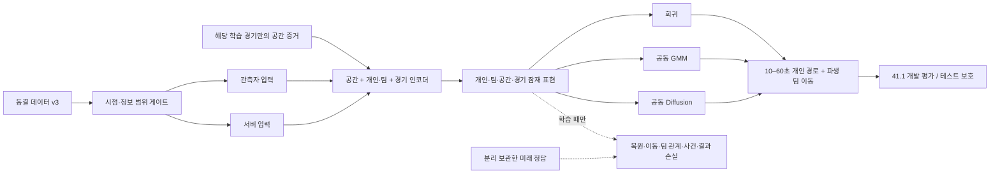

# PUBG 공간·경기 구조 모델: 입력에서 경로 출력까지 V3

## Material Passport

- Origin Skill: academic-research-suite / experiment-agent, plan.
- Origin Date: 2026-10-20. Version: architecture_v3_proposal.
- Verification Status: 설계 제안. 데이터 인터페이스는 현재 코드와 실제 로딩으로 확인했다. 제안 인코더·손실·생성기는 미구현·미학습이다.
- 목표: 수업 논문 → FDG 2027 → 후속 ToG.
- 승인 범위: 설계, 근거 확인, 그림, 작은 수학 검산. 모델 코드 수정·학습·설치는 포함하지 않는다.
- 기준 데이터: `/Users/lunecid/PUBG_Data/runs/20261020_world_model_patch_preprocess_v3`.
- 이전 [전체 코퍼스 V2](PUBG_WORLD_MODEL_FULL_CORPUS_V2_2026-10-20.md)의 방향을 유지하되, 수치·가용 입력·패치 분할은 [완료 전처리](../../reports/world_model_patch_preprocess_2026-10-20/REPORT_KO.md)를 따른다.
- 아래 잠재 폭·층수·손실 가중·실험 예산은 **승인 전 제안값**이다. 문서를 만들었다는 이유로 사전 등록이 확정된 것은 아니다.

## 1. 무엇을 먼저 배우게 할 것인가

먼저 “지금 어디에 있고, 무엇을 알고 있으며, 팀이 어떤 상태이고, 앞으로 어떤 일이 일어날 수 있는가”를 표현하는 모델을 만든다. 이후 같은 표현을 회귀·확률 혼합·Diffusion에 전달해 미래 팀 경로를 비교한다. 순위·우승은 그 표현에 장기 결과를 학습시키는 정답이며, 미래 승패를 예측 입력으로 제공하지 않는다. 이 설계의 월드모델은 **관측 이력에 조건부인 상태·사건·경로 예측 모델**이다. 조작 명령과 환경의 반사실적 반응을 학습한 게임 시뮬레이터나 승리 정책으로 해석하지 않는다.

핵심 연구 질문은 다음과 같다.

1. 공간·개인·팀·경기 결과를 함께 사전학습하면, 다음 패치의 경로 예측이 같은 계산 예산의 직접 학습보다 좋아지는가?
2. 개인을 유지하면서 팀 노드를 분리한 표현은 단순 개인 모델보다 공동 이동을 잘 예측하는가?
3. 같은 표현과 정보로 비교할 때 Diffusion이 회귀·공동 GMM보다 나은 분포 예측을 제공하는가?

개선은 가설이다. 이전 [V4 실패 분석](HETEROGRAPH_DIFFUSION_V4_FORMATION_AUDIT_2026-10-15.md)에서 대형 오차를 줄여도 팀 전체 경로가 틀릴 수 있었고, 생성 폭 축소와 포함률 악화가 함께 나타났다. 따라서 새 주 모델에는 “팀원을 가깝게 모으는” 손실이나 회귀 평균으로의 사후 재중심화를 넣지 않는다.

## 2. 전체 흐름

[편집 가능한 SVG](../../reports/world_model_architecture_2026-10-20/architecture_v3.svg) ·
[벡터 PDF](../../reports/world_model_architecture_2026-10-20/architecture_v3.pdf) ·
[도식 근거 명세](../../reports/world_model_architecture_2026-10-20/FIGURE_SPEC.md)

O와 S는 **서로 다른 실행의 정보 범위**다. 두 입력을 동시에 합쳐 관측자 모델에 넣지 않는다. 그림의 합류는 공통 아키텍처 사용을 뜻하며, 서버 잠재값을 관측자에게 전달하는 증류를 뜻하지 않는다. 정답 화살표는 손실에만 연결한다.

## 3. 구현된 데이터와 설계가 필요한 부분

| 항목 | 현재 확인 | 설계·추가 작업 |
|---|---|---|
| 개인·게임 이력 | 과거 120초, 10초 간격 13프레임 | 유형별 projection과 시간 인코더 |
| 팀 | 개인별 입력, 소속 edge, 현재 팀 집계 7열 | 시점별 set pooling·팀 관계 표현 |
| 공간 | 100m 셀, 현재 아군 주변 3×3 합집합, 관측/추정 연결 | 공간 인코더, 먼 지역을 표현하는 다중 해상도 맥락 |
| 지형 | 개인의 기록된 z만 존재 | 지면 높이·경사·건물·교량·충돌 정답은 없음 |
| 장비 | sparse item 기록, 어휘는 fit에서 생성 | 인벤토리 완전성으로 해석하지 않는 장비 token |
| 차량 | 개인별 이동 모드·나이 | 차량 이용 증거 노드. 공유 차량 인스턴스는 없음 |
| 교전 | 입력의 피해량/사건 집계 | 개인별 압력 증거. 적 시야·위치 확정 노드는 없음 |
| 결과 | 순위/우승 후보와 별도 마스크 | 결과 예측 head; 정책 가치로의 인과 해석 금지 |
| 탈락 | 최종 탈락 시각 mask 모두 False | 최종 탈락 survival head는 현재 보류 |
| 경로 | 알려진 현재 팀원의 6개 미래 시점·mask | 가변 팀 공동 decoder |

실제 `WorldDataset.sample → view_at / targets_at` 경로를 graphify AST로 확인했다.
코드 4개에서 35노드·54관계를 추출했으며, API/LLM 호출 없이 구조 추출만 수행했다.
이는 연구 그래프나 전체 저장소의 완전한 지식 그래프가 아니다.
[코드 그래프](../../reports/world_model_architecture_2026-10-20/graphify-out/graph.json),
[실제 shape 기록](../../reports/world_model_architecture_2026-10-20/runtime_interface.json).

현재 데이터는 학습 4,733경기/검증 9,860경기다. 예측 anchor가 있는 경기는 각각 4,468/9,499개다.
학습 팀 결과 116,810행 중 rank mask는 22,623행, winner mask는 79,681행이다.
이 수는 서로 다른 지도 지형을 확보했다는 증거나 독립 표본 수가 아니다.
순위 과제의 표본 선택 편향과 재진입 경기에서의 보수적 mask를 별도로 보고한다.

## 4. 데이터 입력 계약

`B`=batch, `L=13`, `P`=입력에 허용된 개인 수, `Q`=팀 수, `C`=셀 수,
`M`=t0에 알려지고 현재 위치가 유효한 목표 팀원 수, `H=6`, `K=20`.
M은 미래 생존자로 정하지 않는다. 현재 bank의 targets에는 현재 무효 위치인 팀원도 mask=False로 남을 수 있으므로,
collator가 **현재 입력 mask만으로** 예측 slot을 선택하고 원래 member index와 대응표를 보존한다.

| 현재 필드 | 실제 계약 | 모델에 전달할 의미 |
|---|---|---|
| x / mask | `[L,P,17]` | 좌표·속도·체력·관측 나이·생존 증거·차량·피해·아이템 사건·장비 나이·생명 나이 |
| game / game_mask | `[L,9]` | phase, alive players/teams, safe/poison 중심·반경 |
| member_edges | `[P,2]` | 개인 index→팀 index |
| team_x | `[Q,7]` | 현재 알려진 수/유효 위치 수/평균·표준편차 XY/평균 쌍 거리 |
| items_sparse | `[N,3]` | bank frame, 경기 내부 개인 ID, fit item code |
| mobility / mask | `[L,P]` | 10종 코드; unknown은 물리 이동 모드의 정답이 아님 |
| reentry_confidence / mask | `[L,P]` | 직접/추정 상태 근거; 보정된 확률이 아님 |
| cell_features | `[C,6]` | 중심 XY, 연결 관측 수, 연결 종류 수, 지지 여부 |
| observed_connections | `[Eo,5]` | src,dst,mode,관측 수,경기 수 |
| inferred_adjacency | `[Ei,2]` | 미검증 4방향 인접 가설 |
| targets.xy / mask | `[M_bank,6,2]` / `[M_bank,6]` | 정답 전용; episode·gap 경계를 넘는 좌표 손실을 끔 |
| logged_damage/death/event_mask | `[M_bank,6]` | 누적 기록 사건 정답; 경기 종료 검열 적용 |
| outcomes | focal team | rank utility/winner와 마스크; 정답 전용 |

실제 관측자 한 사례 `[13,4,17]`, 같은 경기 서버 `[13,100,17]`를 다시 로드했다.
`d=128`은 이 입력 폭과 다른 **제안 잠재 폭**이다. 아직 `[B,L,P,128]` 모델 forward를 실행하지 않았다.

새 collator는 anchor의 현재 ego ID를 `ego_local_index`로 명시하고, 현재 입력에서 정한
`target_player_indices`·노드 타입 offset·padding mask를 만든다.
이는 미래 target mask를 읽어 정하지 않는다.
items_sparse의 bank frame을 0…L−1로, 경기 내부 actor ID를 해당 view의 local node index로 바꾼다.
현재 loader가 이 최종 packed batch 계약까지 구현했다는 뜻은 아니다.

단위는 m, s, m/s, damage다. 좌표는 목표 개인 t0 위치를 원점으로 빼고 100m로 나눈다.
모든 팀원·셀·자기장에 같은 변환을 적용해 상대 배치를 보존한다.
절대 맵 위치는 별도 채널로 보존하며 좌표 방향을 임의 회전하지 않는다.
지도/팀 위치 관계가 회전 대칭이라는 근거가 없기 때문이다.
체력은 100, 시간은 120초, 속도는 100m/10초 같은 명시적 단위로 무차원화하는 초기안을 사용한다.
카운트는 log1p, mask·나이는 독립 채널이다. 추가 통계는 정확한 fit ID에서만 적합한다.
범위를 벗어난 값을 임의로 잘라 지형 안에 넣지 않는다.

인칭·규칙·맵은 조건이며 인간/봇은 평가용이다. 개인/팀 정수 ID는 대응표이지 학습 가능한 ID embedding이 아니다.
41.1은 fit에서 보지 못한 패치이므로 학습되지 않은 새 embedding을 무작위로 쓰지 않고 `unknown_patch`로 매핑한다.
패치 번호 크기에 따른 성능 보간도 가정하지 않는다.

## 5. 정보 범위 게이트

각 실행의 입력을 먼저 확정하고 이후 모든 파생 특징·edge·pooling을 만든다.

| 내용 | 관측자 | 서버 |
|---|---|---|
| 자신 장비·피해·이동 증거 | 기록 기반 근사 | 동일 |
| 팀원 위치·체력·생존 증거 | HUD 근사 | 동일 + 기록된 비공개 상태 |
| 적 상태 | 현재 없음 | t0까지 알려진 참가자 상태 |
| 다른 팀의 무장·피해 | 없음 | t0까지 기록 |
| 자기장·생존 수 | 공개 정보의 telemetry proxy | 서버 기록 |
| 최종 순위·미래 경로·미래 모드·미래 mask | 입력 금지 | 입력 금지 |

피해가 없었다고 적을 몰랐다고 표시하지 않는다. 피해량을 “인식 적 수”로 바꾸지 않는다.
contact evidence 노드는 `received/outgoing damage`의 별도 표현이며 exact enemy contact graph가 아니다.
서버도 이 패키지에서 실제 전체 게임 상태를 완전히 복원한 것은 아니다.
FPP/TPP 구분은 관측자/서버와 별도 축이며 카메라 시야를 복원하지 않는다.

Observer↔server 비교는 두 종류로 나눈다.
① 같은 설정을 각 정보로 재학습하는 성능 비교.
② 별도로 mask-view 학습한 **동일 가중치** 모델의 정보 제거 민감도.
②는 masked-view 학습 제거 대조가 필요하며, ①의 차이를 순수한 정보 가치로 부르지 않는다.
서버 teacher를 관측자에게 증류하는 것은 이번 주 실험에 포함하지 않는다.

## 6. 노드·관계 설계

한 사람의 상태와 팀 전체의 상태는 다른 개념이다. 팀은 개인 표현을 모아 만들고, 그 팀 맥락을 다시 개인에게 돌려준다.
팀원의 위치와 무장은 각 개인에 남아 있으므로, 팀이 갈라져 이동하거나 한 사람만 차량을 타는 상태도 표현할 수 있다.

| 노드 | 입력 근거 | 주 연결 | 주의 |
|---|---|---|---|
| player | 허용된 17개 특징·mask·이력 | member_of, located_in, affected_by_zone | 순서 등변 |
| team | 시점별 허용 개인 set, 상대 위치·점유 | has_member, in_game | 중심 하나로 대체하지 않음 |
| cell | 100m 위치·이동 증거·불확실성 | observed_move / hypothetical_adjacent | mode별 관측 edge 유지 |
| equipment | 허용 item 기록 | recorded_for(player) | 기록 없음≠비무장 |
| vehicle_evidence | 개인별 mode/age | mobility_of(player) | 같은 차종으로 합치지 않음 |
| contact_evidence | 개인별 피해 집계 | pressure_on(player) | 실제 적 객체와 구별 |
| zone | 현재 알려진 safe/poison 원 | relative_to(player/team/cell) | 미래 원 금지 |
| game | phase/alive count/시간/규칙 | context_for(team/zone) | 서버 적 요약을 관측자에 복사 금지 |

역방향 관계는 필요한 경로에만 둔다. 관계 종류·출처·나이·support를 별도 edge feature로 둔다.
주 인코더는 **노드 타입별 projection + 관계별 attention + 인과적 시간 block**이다.
HGT의 타입별 메시지 아이디어를 참고하되 원 논문의 전체 구현을 재현한다고 쓰지 않는다.

팀 집계는 각 시점의 허용 개인들에 동일 함수를 적용한 후 평균/attention pooling한다.
개인 잠재값, 여러 셀의 점유, 관측 나이, 알려진 수와 위치 유효 수를 함께 유지한다.
팀원 쌍별 상대 좌표와 거리의 요약은 위치가 모두 유효한 쌍에만 계산한다.
분리된 하위 집단은 거리 cutoff로 강제 분류하기보다 원래 개인 set과 점유를 보존하는 것으로 시작한다.

시간 attention은 t≤t0로 제한한다. 미래의 최종 생명 episode를 역으로 입력에 쓰지 않는다.
현재 입력에서 확인 가능한 사망·재진입/관측 공백 경계는 운동 이력의 연속 연결을 끊는다.
관측자에게 가려진 teammate episode를 서버 bank에서 가져와 attention mask를 만드는 것도 금지한다.
새 collator는 경계를 **그 view에 허용된 증거만으로** 만들고 자기 생명 상태와 팀원 관측 경계를 구분해야 한다.

## 7. 공간: 지금 배울 수 있는 것과 전체 지도 맥락

현재 배울 수 있는 것은 “이 조건에서 이 지역들 사이의 이동이 기록됐다”는 관계다.
지면 높이·건물 내부·다리 차선·통행 가능성까지 같은 정확도로 안다는 뜻이 아니다.
관측이 없는 셀은 막힌 셀이 아니라 모르는 셀이다.

**주 실험 S0:** 현재 동결 데이터의 100m 셀을 사용한다. 관측 edge와 인접 가설은 다른 relation이다.
게이트는 support 수, 서로 다른 경기 수, 이동 모드, 출처, 관측 나이를 받는다.
예: `gate = sigmoid(MLP(log1p(count), log1p(matches), mode, source, age, masks))`.
이는 신뢰도를 조절하는 학습 가중이지 통행 확률이 아니다. 미관측 edge를 음성 예제로 쓰지 않는다.
41.1은 동일 geometry key의 fit 관측이 없으므로 관측 지지가 0이다. 이 조건에서의 실험은 **엄격한 새 패치 전이**다.

**다음 공간 확장 S1 — 승인 전 제안:** 100m local + 800m coarse region을 구분한다.
coarse 노드는 학습 위치 증거가 있는 지역, 현재 허용된 이력/자기장 근처 지역을 좌표로 생성한다.
관측되지 않은 전체 지도 면적이나 지형은 생성하지 않는다. 공간 범위를 현재 3×3에서 늘려도 미래 경로로 crop을 잡지 않는다.
800m는 계산량을 위한 후보값이며 400/800m를 fit 내부에서 비교한다.
coarse support 역시 fit에서만 구성하고, 지도 배치를 식별 못한 모드는 정적 연결 pooling을 보류한다.
전역 game/zone 노드와 coarse 지역 집계는 먼 지역의 맥락을 전달하지만, 정확한 “전체 지형 지도”는 아니다.

**별도 S2 실험:** 40.2 공간 증거를 41.1에 `historical_inferred`로 전달하는 비교.
출처 패치·목표 패치·변경 여부 미확정 mask를 유지하고 관측 edge로 승격하지 않는다.
변경되지 않았다는 검증 없이 보행 강제 제약으로 사용하지 않는다.
S0/S1/S2를 섞어 개선 원인을 숨기지 않는다. 현재 데이터에서 S1/S2 prior는 아직 만들어지지 않았다.

## 8. 인코더와 잠재 인터페이스

초기 후보는 d=128, head=4, 관계 block 2개와 개인별 causal temporal block 2개다.
노드별 값을 mask와 함께 projection하고 공간→개인→팀→game 문맥을 전달한다.
최초 기준선은 시간 인코더로 개인의 과거를 요약한 뒤 t0 이종 메시지를 수행한다.
시점별 동적 이종 메시지를 반복하는 더 큰 구조는 추가 대조로 둔다.
과거 팀 모양은 각 시점의 개인 입력에서 계산한 팀 이력으로 남긴다.

공통 출력은 `z_player[B,P,d]`, `z_team[B,Q,d]`, `z_cell[B,C,d]`,
`z_game[B,d]`, `z_zone[B,2,d]`와 각각의 유효 mask다.
목표 팀의 개인 표현, 해당 팀 표현, 공간·자기장·경기 표현이 모든 decoder의 동일 조건이다.
자기장 상대 거리 `||p-c||-r`, 중심까지 상대 벡터, 과거 원 변화는 현재 알려진 값만으로 계산한다.
원 변화를 계산할 두 관측이 없으면 unknown이다.

현행 game는 공개 시점 proxy다. 미래 실제 자기장 경로를 학습 conditioning에 넣지 않는다.
미래 원을 입력하는 oracle 비교는 수행하더라도 별도 상한 실험이며 주 성능에 섞지 않는다.
경로를 원 중심으로 강제 당기면 전투·엄폐·우회·수송 선택을 지울 수 있으므로 주 손실에 포함하지 않는다.

## 9. 사전학습 과제

다양한 사건을 예측하게 만드는 목적은 “게임 이해”라는 말을 측정 가능한 능력으로 바꾸는 데 있다.
하나의 총 loss가 낮다는 것보다, 동결된 표현이 새 패치에서 각 과제를 얼마나 설명하는지 본다.
과제별 정답과 mask를 분리하고 미래 정답을 conditioning에 연결하지 않는다.

| 과제 | 입력→출력 | 손실·단위 | 사용 범위 |
|---|---|---|---|
| P1 관측 상태 복원 | 허용 과거 일부를 가림→원래 관측값 | 표준화 수치 MSE / 범주 CE | 실제 관측값만 정답. 결측을 정답 0으로 복원 금지 |
| P2 공간·이동 | z→10–60초 상대 이동·mode | 단순 공동 GMM marginal NLL, mode CE | 좌표 mask와 mode known mask 별도 |
| P3 팀 구조 | z_team→미래 팀원 쌍 거리 요약·점유 | 거리 분포 요약의 MSE, 점유 CE | 개인 노드에서 pair를 복원; solo는 제외 |
| P4 기록 사건 | z_player→미래 기록 피해/사망 | 60초 발생 BCE/Brier; 피해량은 보조 | 현재 저장된 로그 사건, 최종 팀 탈락 hazard 아님 |
| P6 결과 | z_team,z_game→rank utility/win | utility MSE / win BCE | 각각 검증된 mask, BR 조건 |

P2는 정밀한 통행 가능성 분류가 아니다. 좌표 예측과 별도로 coarse 목적지 분류를 추가할 때에는
crop 밖 목적지를 `outside` 범주로 보존해 항공·수송 정답을 누락시키지 않는다.
P3에서 팀 중심·분산을 계산할 때 미래 mask에 따라 구성원이 바뀌므로, 완전한 동일 구성원 부분집합에 대한
지표와 pairwise 가능한 지표를 구분한다. “평균 위치가 가까움”만으로 팀 상태를 잘 배웠다고 하지 않는다.

P1 초기에는 장비·체력 등의 과거 block 복원부터 시작한다. 위치를 가릴 때에는 속도·상대 좌표·located_in·
팀 집계·cell 선택 등 해당 값에서 유도된 경로까지 제거/재계산해야 한다.
재계산할 수 없는 경우 위치 복원 과제를 켜지 않는다. 무작위 숫자 몇 개만 0으로 만드는 것으로 충분하지 않다.
다른 시점의 합법적인 관측을 문맥으로 쓰는 것과 숨긴 정답의 복사본을 입력하는 것을 구분한다.

P4의 현재 `event_mask`는 공식 경기 종료를 넘지 않는다는 조건이며, 로그 완전성을 독립적으로 보장하지 않는다.
누락 사건은 “현실에서 발생하지 않음” 대신 “기록에서 관측되지 않음”으로 해석한다.
장기 event-risk 연구에는 결손 과정·위험집합 감사를 추가한다.
P6의 N은 정답의 utility 계산에만 쓰고 관측자에게 알려지지 않은 최초 전체 팀 수를 입력하지 않는다.
각 개인에게 팀 승패를 복제해 개인 공헌도처럼 평가하지 않는다.

초기 결합 후보는 `Lpre=L1+L2+L3+λ4L4+0.25Lrank+0.25Lwin`.
P4 감사 전 λ4=0이며, 기록 사건 목표의 가정을 받아들인 실행에서만 0.25를 후보로 시험한다.
수치 손실은 명시 단위로 정규화하고 각 과제는 **경기→목표 팀→시각** 순으로 평균한다.
가중치는 공학 상수나 문헌 검증값이 아니다. fit 내부 작은 비교와 gradient 규모 기록 후 잠근다.
미사용 최종 테스트에서 가중치를 조정하지 않는다.

## 10. 회귀·공동 GMM·Diffusion의 공정한 출력

모든 head는 현재 유효한 목표 팀원의 10–60초 XY를 예측한다.
head 비교에서는 사전학습 decoder를 모두 버리고 동일한 frozen encoder만 복사한다.
GMM만 사전학습 head 가중치를 이어받게 하지 않는다. P2 목적함수가 특정 decoder에 유리한지는
P2 제거/단순화 대조로 따로 점검한다.
처음에는 현재 생명/관측 구간 안의 연속 경로를 다룬다.
현재 수송 중이거나 재진입 이후인 구간은 사용할 수 있지만, 사망→부활 점프를 하나의 연속 경로로
이어 만드는 모델은 아니다. 미래 mode는 보조 예측값이며 정답 mode를 경로 조건으로 쓰지 않는다.

**회귀:** 동일 잠재값에서 `[B,M,6,2]`의 상대 좌표를 직접 출력한다.
주 회귀는 masked MSE로 조건부 평균을 학습한다. 이전 Huber 기준선은 별도 재현 비교다.
평균 경로의 ADE와 확률 표본의 ADE는 다른 항목으로 기록한다.

**공동 GMM:** 혼합 성분 4개를 초기 후보로 한다. 팀 전체에 공통으로 성분 하나를 뽑고,
그 성분의 개인별 평균·분산으로 공동 표본을 생성한다.
`π[B,4]`, `μ,σ[B,4,M,6,2]`. 성분 내 대각 공분산은 단순화이며,
팀원별로 독립적으로 성분을 뽑는 혼합 모델과 다르다. loss는 관측 좌표의 marginal log-likelihood다.
σ는 softplus와 명시적 작은 양수 floor로 안정화하며 floor 민감도를 fit 내부에서 기록한다.

**Diffusion:** 전체 팀의 미래를 한 번에 잡음 제거한다.
`u=(Y−origin)/100m`, `u_s=sqrt(ᾱ_s)u+sqrt(1−ᾱ_s)ε`.
set denoiser는 noisy team tokens와 timestep, 공통 잠재 조건을 받고 `ε_hat[B,M,6,2]`를 출력한다.
팀원 사이 attention과 조건 cross-attention으로 상호작용한다.
개인 slot을 바꾸면 조건·잡음·출력도 함께 바뀌도록 설계한다.
주 후보는 ε MSE이며 역과정 16/32 step은 fit 내부 비용 시험 후 선택한다.
회귀 출력에 잔차를 붙이는 V4 구조는 기본값으로 재사용하지 않는다.

**미래 결측의 중요한 설계 경계**

현재 bank는 부분 정답을 포함한다. unknown future를 0으로 넣고 그 mask를 denoiser 조건에 주면,
미래 사망/관측 종료 패턴을 알려주는 문제가 생긴다.
따라서 첫 공동 생성 비교는 **t0에 정한 M명 모두 6시점 정답이 있는 완전 관측 경로**에서
회귀/GMM/Diffusion을 동일하게 학습·비교하는 보수적 실험을 제안한다.
이는 bank의 anchor 생성 규칙을 바꾸는 것이 아니라 경로 loss의 eligibility를 정하는 것이다.
적격성은 미래에 의존하므로 이 실험의 모집단을 **60초 연속 관측 가능한 현재 팀**으로 명시한다.
생존 선택 편향을 숨기지 않고 전체 anchor 대비 포함률·인간/봇·mode별 포함률을 보고한다.
현재 개인 완전 정답 수만 확인됐으며, 팀 전체 완전 정답 수는 학습 전 추가 집계가 필요하다.
M은 미래에 남은 사람으로 줄이지 않는다. 적격 표본이 부족하면 주장을 줄이거나 별도 합의 후 지평을 줄인다.

부분 정답은 P1/P2/P3/P4/P6와 회귀/GMM의 보조 평가에 유지한다.
부분 관측 joint diffusion의 통계적 목적함수, 결손 mask 처리와 추론 mismatch는 별도 연구 항목이다.
불명확한 masked diffusion loss를 완전 공동 분포의 일관된 추정이라고 주장하지 않는다.
현재 설계에는 미래 생존/복귀 자체를 함께 생성하는 모델이 아직 없다.

공동 표본 출력은 `[B,K,M,6,2]`이다. 팀 중심, pair distance, 분산, 점유는 **각 표본에서** 계산한다.
독립 head가 팀 중심을 따로 출력해 개인 경로와 불일치하게 만들지 않는다.
팀 대형은 당시 상호 위치의 분포이며 항상 한곳으로 모이는 것이 아니다.

## 11. 수학 계약과 검산

마스크 m에 대한 좌표 오차:

`Lxy = Σ(m_ih ||ŷ_ih−y_ih||²) / Σm_ih` (m²; 학습에서는 100m 척도로 나눔).

빈 mask는 해당 loss를 평균에서 제외한다. 분모를 1로 바꾸어 가짜 0점 표본을 늘리지 않는다.
팀 쌍 거리는 `d_ijh=||y_ih−y_jh||`; 두 위치가 유효하고 i≠j일 때만 사용한다.
solo의 pair loss는 미정의이며 0m 오차로 평균하지 않는다.

전체 유효 팀 경로를 한 벡터로 두고 `d(a,b)=sqrt(Σ_ih||a_ih−b_ih||²/(M H))`라 하자.
독립 K개 표본의 공동 Energy score 추정량은

`ES = (1/K)Σk d(Yk,y) − [1/(2K(K−1))]Σk≠l d(Yk,Yl)`.

둘째 항은 서로 다른 표본 쌍의 U-statistic이다. K는 모든 확률 모델에서 같게 둔다.
GMM NLL, 회귀 MSE, diffusion noise MSE의 학습 loss 크기를 서로 비교해 성능 순위를 정하지 않는다.
회귀는 하나의 점에 집중한 퇴화분포로 평가하며 둘째 항은 0이다.
유한 표본 추정량은 항상 양수일 필요가 없고, 한 경기의 낮은 값으로 우월성을 판정하지 않는다.
이 점수는 정해진 완전 관측 target 공간에서 비교하며 부분 mask로 바뀐 결과는 별도 표다.

“팀 중심이 맞으면 대형도 맞다”는 명제는 거짓이다.
1차원 두 팀원 정답 `[0,10]`, 생성 `[5,5]`는 중심이 모두 5지만 실제 거리 10이 생성에서 0이 된다.
이 검산과 mask 평균·순위 utility·Energy score는
[수학 노트](../superpowers/notes/2026-10-20-math-control-world-architecture.md)에 적고 NumPy 시험으로 확인한다.
이는 설계 식 검증이며 모델 forward/학습 검증이 아니다.

## 12. 부품별 설계 근거 — A0

| 부품 | 요구·원리 | 문헌 근거 | 우리 데이터 근거 | 선택한 형태 | 비용 | 반증·제거 기준 |
|---|---|---|---|---|---|---|
| 정보 게이트 | A3/A5: 미래·비공개 혼합 차단 | HGT가 이 경계를 보장하는 것은 아님; 본 연구 데이터 계약 | view_at 마스킹, prefix 검사 | projection 전에 마스크·파생값 재계산 | O(LPF+E) | 미래 suffix/비공개 상태 변조로 입력이 바뀌면 중단 |
| 공간 encoder | 위치 이웃과 증거 강도 구분 | GraphMAE §3.2는 특징 복원 근거; 지형 진실 근거 아님 | cell 6열, 관측/가설 edge | 유형 관계 message+support gate | O(Cd²+Ed) | no_spatial보다 이득 없으면 공간 기여 주장 제거 |
| 개인 시간 encoder | 120초의 상태 변화 | TrajWorld §4.2의 시간/변수 분리, 직접 복제 아님 | [13,P,17], missing/age | shared causal temporal block | O(PLd²+PL²d) | 30초·현재값 기준선보다 이득 없으면 단순화 |
| 개인↔팀 | 순서 불변 팀, 개인 보존 | HGT §3.1–3.4; MotionDiffuser §3.2 | 가변 M, member edge | set pooling+typed feedback | O(Pd²+ΣM²d) | parameter-matched no_team 대비 pair MAE 개선 미지지 시 팀 노드 주장 보류 |
| 장비·이동·압력 증거 | 현재 선택 조건 구별 | HGT 타입별 관계의 응용 | item/mobility/damage; visibility 없음 | player-local evidence tokens | O(N_evidence d²) | 같은 정보 concatenation보다 비용 대비 이득 없으면 별도 노드 제거 |
| zone/game | 공개 경기 맥락 | Forecast-MAE §3의 context 결합 원리; PUBG 원 가정은 본 설계 | 현재 game 9열 | analytic relative geometry+tokens | O((P+C)d) | no_zone 재학습 대비 개선 없으면 조건 활용 주장 보류 |
| 사전학습 heads | 복원·전이·팀·결과의 압축 | Forecast-MAE §3, GraphMAE §3; 원 손실을 그대로 복제하지 않음 | 각 target mask와 rank coverage | P1/P2/P3/P4/P6 | head별 O(MHd), pair O(M²H) | scratch와 예산 맞춘 전이 성능에 이득 없으면 사전학습 효용 미지지 |
| 공통 decoder interface | 방법만 바꾸어 비교 | MotionDiffuser §3.2의 joint set | 같은 M/6시점/정답 | regression / joint GMM / diffusion | GMM O(JMHd); diffusion D회 denoiser | Diffusion이 GMM 대비 ES 이득 없으면 복잡한 head 채택 안 함 |
| 평가·분할 | 패치 변화·겹친 창 의존성 | 프로젝트 A3-PUBG/F3 | 40.2/41.1, 기존 노출 기록 | 경기 단위 paired 비교 | O(matches×seeds×bootstrap) | 보호/검증 자료 fit 유입 시 결과 무효 |

문헌은 아이디어의 근거이며 이 결합이 PUBG에서 작동한다는 증거가 아니다.
각 새 부품은 구현 전 인터페이스·시험을 포함한 패치로 제시한다.

## 13. 학습 순서와 중간 보고

1. **G0 설계 검토:** 주 모집단, complete-team 경로 범위, S0/S1/S2 공간 비교, 주 지표를 확정한다.
2. **G1 구현·입력 시험:** collator·게이트·인코더 최소 batch, permutation·파생값 가림·경계·CPU 결정성.
   source hash와 실제 shape/메모리를 보고하고 멈춘다.
3. **G2 사전학습 소규모 실행:** 40.2 fit 내부에서 표본 규모·과제 loss·label support·비용을 확인한다.
   임베딩 그림만 제시하지 않고 단순 빈도/표 기반 head와 동결 probe를 비교하고 멈춘다.
4. **G3 사전학습 주 실행:** 확정 예산으로 표현 학습. 동결 probe와 결과 calibration을 보고하고 멈춘다.
5. **G4 같은 frozen encoder의 세 head:** 회귀→GMM→Diffusion을 개별 실행·보고한다.
   경로, 개인별 band, 팀원 거리, 공간 unknown, mode를 같은 사례에 시각화한다.
6. **G5 ablation:** 필수 부품 제거부터 실행한다. 49개 목록을 한꺼번에 자동 학습하지 않는다.
7. **G6 최종 테스트:** 새롭게 확보한 미사용 경기와 프로토콜이 있을 때만 진행한다. 현재 보류 패치가 자동 pristine test는 아니다.

40.2 내부의 적격 경기를 추가로 fit/calibration으로 나눌 때에는 **그 내부 fit만**으로
공간 지지·어휘·정규화·사전학습을 다시 만든다. 기존 4,733경기 전체 prior를 내부 검증에 그대로 쓰지 않는다.
분할은 경기 단위이며 과거 노출 registry를 보존한다. 이번에 내부 분할이나 모델 fitting을 실행하지 않았다.
이미 반복 사용한 41.1은 개발 평가다. checkpoint/가중/threshold 선택에 사용했다면 선택 이력을 남긴다.

## 14. 주 비교와 ablation 제안

주 자료는 41.1 BR 중 complete-team 60초 경로, 경기 내 평균→경기 간 평균이다.
관측자 주 결과와 서버 비교를 분리한다. 비-BR은 적합한 사전학습 과제에 포함하고 BR 성능과 별도 보고한다.
주 후보 seed 41/42/43, K=20이며 optimizer budget과 데이터 노출 수를 비교별 동일하게 정한다.

| 주장 | 주 비교 | 주 지표 | 지지 기준 제안 |
|---|---|---|---|
| C1 사전학습 유용 | P1–P6 pretrain+회귀 vs 같은 구조 scratch 회귀 | 평균 경로 ADE, 10–60초 | paired 차이(pretrained−scratch)의 95% 상한<0 |
| C2 팀 구조 유용 | player+team vs 크기 맞춘 no_team | 팀원 거리 MAE | 차이 95% 상한<0; 개인 ADE 동반 공개 |
| C3 Diffusion의 필요 | 같은 frozen encoder의 diffusion vs joint GMM | 공동 ES | 차이 95% 상한<0; ADE·coverage·비용 공개 |

사전학습+head 총 업데이트 수/처리 token 수를 scratch 대조와 맞춘 비교를 주 비교로 한다.
**C1에서는** pretrain 초기화 모델과 scratch 모델 모두 동일한 encoder+회귀를 end-to-end로 학습한다.
pretrain 예산만큼 scratch에 추가 직접 학습 예산을 배정하고 노출·벽시계 비용도 공개한다.
동결 linear/MLP probe는 이 주 비교와 별도다.
가중치를 동결한 encoder만 다른 비교는 표현의 영향, head만 바꾼 비교는 생성 방식의 영향이다.
동결/미세조정, encoder 크기, 데이터량이 동시에 달라지면 한 원인의 효과로 설명하지 않는다.
비열등성은 별도 ε를 저자가 확정하기 전에는 주장하지 않는다. “유의한 차이 없음”을 동등으로 쓰지 않는다.

세 주장 묶음에는 Holm 보정한 경기 단위 paired 검정을 사용하고, paired 95% bootstrap 구간을 함께 보고한다.
bootstrap은 같은 경기 재표본을 모든 seed에 적용하고 seed별 차이/부호도 공개한다.
3개 seed는 seed 불확실성의 충분한 추정을 보장하지 않는다.
동일 계정의 여러 경기 의존성은 현재 pseudonym 데이터로 완전히 조정하기 어렵다는 한계를 기록한다.
표본 규모는 1,940만 anchor가 아니라 조건별 경기 수·유효 팀 경로 수·불확실성으로 판단한다.

필수 제거군: no_pretraining, no_spatial, observed_only, no_team, no_outcome,
no_zone(새 목록 필요), 30초 이력, evidence node→동일 정보 concatenation(새 목록 필요).
49개 기존 목록이 모든 새 부품 제거 실험을 이미 구현했다는 뜻은 아니다.
맵·인칭·규모별 only/holdout은 이후 확장하며 각 제외 도메인의 사전학습/prior도 제거한다.
전체 자료 효과와 동일 노출 수/compute 비교를 모두 남긴다.

부가 지표: FDE60, 팀 중심 ADE, pair MAE의 per-sample/평균경로 구분, 좌표별 coverage와 폭,
공동 minADE@K(팀 전체 하나의 표본을 고름), 이동 모드별 오차, 관측 지지/가설 의존 비율.
물리 충돌 정확도·최적 경로·승률 상승은 현재 평가할 수 없다.

## 15. 인간·봇 비교

공통 모델에는 human/bot label을 주지 않는다. 평가에서 ego 타입과 팀 구성(인간/봇/혼합)을 구분한다.
팀을 ego 타입만으로 인간팀/봇팀으로 정하지 않는다.
phase, map, perspective, team size, mode, 위치 관측 나이, 자기장 거리의 공통 지지 영역에서
층화한 성능과 실제 분포 성능을 함께 제시한다.
매칭/재가중 규칙은 결과를 보기 전에 잠그고 가중치 폭·유효 표본 수를 공개한다.
낮은 경로 오차는 예측하기 쉬운 행동을 뜻할 수 있으나 “봇이 단순/인간이 전략적”의 인과 증거는 아니다.

## 16. 비용·재현성과 구현 공백

수치 배열은 lazy load하고 경기별 압축 bank 전체를 매 anchor마다 다시 풀지 않는다.
현재 `sample`은 meta JSON을 반복 읽고 geometry cache를 한 개만 유지한다.
학습용 batch sampler는 경기/맵 단위 묶음과 bounded LRU를 검토하되, 표집 확률을 바꾸지 않게 가중한다.
worker별 bank·공간 사전·어휘 복제 비용까지 포함해 private 48 GiB 상한을 측정한다.
사전학습 중 encoder 가중치가 변하므로 학습된 cell latent를 고정 캐시하면 안 된다.
정적 원천 feature cache와 frozen encoder cache만 별도로 허용한다.

temporal factorization의 attention score 크기는 O(B×heads×P×L²)다.
예를 들어 B=8,P=100,L=13,head=4,float32이면 score 배열 하나는 2.06 MiB다.
시공간 토큰 PL을 모두 연결한 score 하나는 206.30 MiB다.
차이는 P배이며 계산 검산값이다. 전체 메모리는 activation/gradient/optimizer/graphs/loader를 더해야 한다.
48 GiB 적합성이나 처리 시간을 이 두 숫자만으로 인증하지 않는다.
일반 팀 크기에 hard cap=4를 두지 않는다. 큰 graph는 batch를 줄이거나 packed 처리한다.

보고용 CPU, GPU 탐색용 원칙을 유지한다. 동일 환경/스레드/시드로 bit 재현을 먼저 시험한다.
소수점 tolerance 검사를 byte identity로 부르지 않는다.
학습 전 Strata/llama 점유 확인, 장치·BLAS·thread·버전·RSS·private memory·wall time·hash를 기록한다.
현재는 학습 시간을 측정하지 않았으므로 완료 ETA나 CPU 비용을 제시하지 않는다.

남은 구현은 typed collator, 인코더, pretraining heads, 세 decoder, 공통 평가기다.
전처리가 끝났다는 사실은 이 모듈들이 구현됐다는 뜻이 아니다.
모델 수정 패치·시험은 B3에 따라 구체적으로 제시한 뒤 승인 범위에서 진행한다.

## 17. 근거·스킬·자체 검토 기록

기존 Drive에 확보한 6개 PDF의 해시를 다시 확인하고 관련 방법 절을 읽었다.
새 논문을 추가 수집하거나 Drive의 파일을 수정하지 않았다.
[문헌 근거 기록](../../reports/world_model_architecture_2026-10-20/literature_evidence.json).

| 근거 | 이번에 사용한 부분 | 차이·제한 |
|---|---|---|
| [HGT, Hu et al. 2020](https://arxiv.org/abs/2003.01332), §3.1–3.5 | node/edge type별 메시지·시간 관계 | 학술 그래프 결과가 PUBG 성능 증거는 아님 |
| [Forecast-MAE, Cheng et al. 2023](https://arxiv.org/abs/2308.09882), §3 | 행위자·지도 문맥 사전학습 | 미래가 보이는 복원 구성을 causal encoder에 복제하지 않음 |
| [GraphMAE, Hou et al. 2022](https://arxiv.org/abs/2205.10803), §3.2 | masked feature reconstruction | cosine loss를 m·damage 혼합 벡터에 그대로 쓰지 않음 |
| [TrajWorld, Yin et al. 2025](https://proceedings.mlr.press/v267/yin25f.html), §4.1–4.2 | 이종 환경의 시간/변수 attention | 현재 조작 행동·보상 조건 world dynamics를 확보한 것이 아님 |
| [MotionDiffuser, Jiang et al. 2023](https://arxiv.org/abs/2306.03083), §3.1–3.2 | 공동 경로 분포·set denoiser | PCA/정밀 도로 지도/constraint guidance는 이번 기본안에서 제외 |
| [Decision Diffuser, Ajay et al. 2023](https://arxiv.org/abs/2211.15657), §3 | 조건부 diffusion 상태 경로 | 정답 승패 조건으로 승리 정책을 생성한다는 주장 제외 |

설계문서의 문헌 설명은 각 자료의 핵심 아이디어만 요약한다. 새 조합·loss·평가 계약은 본 연구의 제안이다.
문헌 최신성 전수 조사나 원 코드 재현을 이번에 완료했다고 주장하지 않는다.

적용 스킬: graphify(AST/검색), ARS(plan), scientific-methods-figure(근거·도식 규약),
eli5(대학원 설명), doc-coauthoring(근거→설계→독자 질문 검토).
별도 eli5-design-memo는 미설치 경로였으며 I12의 Sonnet/Haiku/Opus 검토도 수행하지 않았다.
현재 에이전트의 문서 자체 검토는 독립 reviewer 검증을 대체하지 않는다.
설계 해시·스킬 해시·검산·도식은 [설계 산출물 폴더](../../reports/world_model_architecture_2026-10-20)에 둔다.

검토할 핵심 결정은 세 가지다.
① 엄격한 S0 공간 전이를 주 조건으로 유지할지, 역사적 추정 S2를 별도 필수 비교로 둘지.
② 완전 관측 60초 팀 경로를 첫 공동 생성 비교의 범위로 채택할지.
③ P1/P2/P3/P6부터 소규모 검증하고 P4의 사건 완전성 감사를 별도 관문으로 둘지.
본 추천은 S0 주 조건+S2 후속 비교, 완전 관측 경로로 첫 비교, P4는 로그 사건 보조 진단부터 시작하는 것이다.
