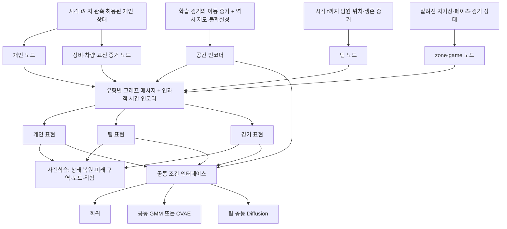

# PUBG 공간·경기 구조 사전학습 모델 설계

> **범위 개정:** 이후 사용자 지시에 따라 [전체 코퍼스·순위 학습 V2](PUBG_WORLD_MODEL_FULL_CORPUS_V2_2026-10-20.md)가 현재 기준이다. 아래의 Erangel 고정 차원, 657경기 중심 설계, P6 후순위 배치는 초기 설계 기록이며 V2로 대체한다. 개인·팀 분리와 관측 경계 원칙은 유지한다.

작성: 2026-10-20. **설계 제안이며 학습하지 않았다.** 기존 V4 학습 결과와 데이터는 변경하지 않았다. 이 문서의 신규 차원·손실·표집·평가 계획은 구현 및 실험 전 제안값이다.

연결 문서: [선행 연구 검토](../../reports/world_model_pretraining_research_2026-10-20/RESEARCH_REVIEW_KO.md), [실제 스키마 점검](../../reports/world_model_pretraining_research_2026-10-20/data_contract_audit.json), [기계 판독 설계 계약](pubg_world_model_pretraining_contract_2026-10-20.json), [기존 V4 결과](../../reports/heterograph_diffusion_experiment_v4/REPORT_KO.md).

## 1. 무엇을 학습하는 모델인가

제안은 **공간·개인·팀·경기 맥락을 시간순으로 읽고, 이후 상태와 공동 이동을 예측하는 사전학습 인코더**다. Diffusion은 그 표현을 받아 가능한 미래 경로를 생성하는 후속 모듈이다.

관측자 o의 시각 t에서:

`h_t^o = Eθ(M_fit, O_≤t^o, masks, ages, provenance)`

`pφ(Y_t+1:t+H | h_t^o)`

- `M_fit`: 현재 학습 분할로만 만든 공간 사전 정보. 외부 역사 지도와 이동 관측의 출처를 분리한다.
- `O_≤t^o`: 그 관측자가 t까지 알 수 있다고 정의한 기록. 실제 화면을 복원한 자료가 아니라 텔레메트리 기반 관측 대리값이다.
- `Y`: 미래 구역·이동 모드·팀 분포·관측 가능한 사건·현재 생명 에피소드 위험.

이는 기록된 플레이 양식 아래의 **관측 조건부 미래 상태 모델**이다. 조작 입력 `a_t`가 없으므로 `p(S_t+1 | S_t, do(a_t))`라는 행동 개입 모델이나 게임 엔진으로 해석하지 않는다. 미래 변위는 예측 대상이며 키 입력을 대신하는 원인 변수가 아니다.

“게임을 이해한다”는 표현을 다음과 같이 측정 가능한 주장으로 제한한다.

| 능력 | 검증 가능한 과제 | 아직 할 수 없는 주장 |
|---|---|---|
| 공간 이해 | 관측되지 않은 경기의 이동 목적 구역·소요 시간 분포 예측 | 건물 내부·교량·충돌·실제 통행 가능성의 정밀 복원 |
| 개인 상태 이해 | 무장·차량·체력·과거 피해가 주어졌을 때 미래 상태 변화 예측 | 피해가 없으면 적을 못 봤다는 판단 |
| 팀 관계 이해 | 개인별 경로와 팀 점유 구역·거리의 공동 예측 | 팀을 중심점 하나로 대표하거나 모일수록 좋은 전략이라는 판단 |
| 경기 구조 이해 | 현재 자기장·페이즈·생존 인원과 위험·이동의 관계 예측 | 실제 행동을 바꾸면 승률이 오른다는 인과적 결론 |
| 성공 조건 이해 | 검증된 결과 라벨이 추가된 뒤 승리·순위·종료 예측 | 현재 bank만으로 우승 전략 학습 완료 |

## 2. 현재 자료와 추가 준비를 구분

### 현재 파일에서 확인한 내용

`data/processed/heterograph_diffusion_v3`의 manifest에는 학습 657경기, 개발 검증 188경기, 잠긴 94경기가 있다. 학습 인덱스는 1,356,854행, 검증 인덱스는 385,414행이다. 서로 겹치는 시간 창이므로 독립 표본 수로 해석하지 않는다.

한 학습 bank의 구조를 직접 읽었다. 해당 경기에서는 `T=157, P=100`이었다. 이는 예시이며 전체 경기의 고정 차원이 아니다.

| 현재 저장 배열/구조 | 실제 형태 또는 의미 |
|---|---|
| `x`, `mask` | `[T,P,22]`: 위치·속도·체력·관측 나이·생존 증거·피해 집계 등 |
| `items` | `[T,P,12]`: 장비 코드와 별도의 관측/모호성 정보 |
| `team`, `kind` | `[P]`: 팀과 인간·봇 구분. `kind`는 주 분석에서 입력 제외 |
| `game`, `game_mask` | `[T,9]`: 페이즈, 생존 인원/팀, safe·poison 원의 위치와 반경 |
| `source_time`, `game_time` | 값이 어느 시점의 기록에서 왔는지 확인 |
| `episode`, `mobility`, `mobility_known`, `reentry_confidence`, `z`, `vz` | 생명 에피소드·이동 상태 및 추정 근거 |
| `target*` | 미래 좌표·모드·에피소드·보간 상태. 인코더 입력 금지 |
| `damage` | 피해 기록 배열. 현재 bank의 개별 피해 행만으로 모든 원인 분류를 복원할 수는 없음 |
| 공간 prior | 6,724개 100m cell의 5열 terrain 배열, 99,078행의 이동 edge 배열 |
| 그래프 | 9종 노드, 14종 기본 관계와 역관계, 수치 폭 32, edge 폭 5 |

9종 노드는 `cell, region, player, team, vehicle_evidence, contact_evidence, zone, game, equipment`다. 기존 V3 입력은 과거 30초의 4시점이고 출력은 10–60초의 6시점이다.

**terrain 높이 열은 `historical_height_proxy_m`이다.** 40.2에서 측량한 고도나 텔레메트리로 복원 완료한 지형이 아니다. 기존 공간 prior의 이동 edge는 fit 경기로 재구성됐지만 terrain 배열은 이전 자료에서 가져왔다. 출처와 정확도를 함께 써야 한다.

### 학습 전 추가 구현이 필요한 것

1. 120초 이력, 관측 출처·나이·추정 여부를 명시하는 새 window builder.
2. 비차량·육상 차량·수상 차량·항공/수송을 구분하는 이동 관계. 기존 prior의 차량 관계에는 이 구분이 충분하지 않다.
3. 마스킹한 특징에서 파생된 edge·팀 집계까지 함께 가리는 복원 데이터 변환.
4. 미래 피해·현재 생명 사망 라벨의 원시 사건 기반 생성과 검열 마스크.
5. 승패를 쓸 경우 종료·순위 등 권위 있는 결과 자료의 별도 join과 감사.

현재 bank와 추출기의 9개 테이블만으로 최종 승리·순위 정답이 준비돼 있다고 할 수 없다. 이번에 DB를 조회하거나 결과 라벨을 새로 생성하지 않았다.

## 3. 전체 구조

### 공간 인코더

전체 맵은 기존 82×82 cell과 21×21 coarse region으로 유지한다. 400m region 441개를 전역 맥락으로 제공하고 현재 아군 위치 주변 5×5 cell의 합집합을 세밀하게 읽는다. 서버/관측자 두 모델의 crop은 동일하며 미래 경로로 crop하지 않는다. 목표 팀이 4명이면 fine cell의 단순 상한은 100개다.

지역 입력은 위치, 역사 높이 대리값, 육지 비율, 알려진 변경 구역, 관측 경기 수, 모드별 이동 증거, 관측 부족 표시를 구분한다. 정적 공간 표현은 cache할 수 있지만 현재 관측·학습 fold에 종속된 통계와 섞지 않는다.

공간 관계는 다음처럼 나눈다.

- **관측 이동**: 실제 두 관측 사이 이동이 있었다는 증거. 세부 선분 전체가 걷기 가능한 길이라는 뜻은 아니다.
- **추정 인접 연결**: 역사 지도·인접성 휴리스틱으로 만든 후보. 별도 relation과 근거 필드를 사용한다.
- **미관측 지역**: 정보가 없다는 상태. 벽이나 통행 불가로 바꾸지 않는다.

메시지 가중은 relation별 parameter와 관측 support·나이·출처를 사용하는 gate로 조절한다. 이 gate는 학습된 영향도이지 물리적 통행 확률의 정답이 아니다. 외부 지형 proxy를 제거한 실험과 연결 근거를 제거한 실험을 둔다.

### 개인 노드

개인은 자기 위치·이동 이력·체력·무기/장비 증거·차량 증거·피해 이력·생명 에피소드를 갖는다. 모르는 값을 0 또는 “없음”으로 해석하지 않도록 값과 관측 mask를 분리한다.

`vehicle_evidence`는 현재 자료상 “이 개인의 차량 이용 증거”다. 실제 차량 객체의 고유 ID가 검증되지 않았으므로 두 개인이 같은 종류 차량에 탔다고 같은 차량 노드로 합치지 않는다.

`contact_evidence`는 피해·교전 압력의 증거다. 공격자를 보았는지, 다른 적이 시야에 있었는지, 정확한 조준 방향은 관측됐다고 간주하지 않는다.

### 팀 노드

팀은 별도 잠재 상태를 갖는다. 팀원 표현의 순서 불변 attention/set pooling, 팀원 간 상대 위치·관측 나이, 알려진 생존 상태, 여러 cell의 점유, 거리 분포를 받는다. 중심·medoid는 보조 특징일 뿐 팀의 정의가 아니다.

`player → team`으로 개인들의 상태가 팀 표현을 만들고, `team → player`로 공동 상황이 개인 표현에 돌아간다. 팀원마다 서로 다른 위치와 무장 조건을 유지한다. 학습 라벨은 실제 분산·합류를 반영하며 “항상 가까이 모여라”라는 손실은 사용하지 않는다.

관측자 모델에서는 **마스킹 후** 팀 집계를 계산한다. 서버 전용 개인 특징을 먼저 pooling하고 결과만 관측자 팀 노드에 복사하는 방식은 금지한다. 팀 장비 공유가 입증되지 않으면 타 팀원의 무기·탄약을 공유하지 않는다.

### 경기 노드와 시간 인코더

경기 노드는 현재 알려진 페이즈, 시간, 공개된 생존 인원, 현재 알려진 자기장을 표현한다. zone은 원의 위치·반경뿐 아니라 각 개인의 경계까지 거리와 접근 방향을 제공한다. “안전구역 중심에 가까울수록 좋은 경로”로 목표를 단순화하지 않는다.

새 제안은 10초 간격 `L=13`, 즉 `t−120,…,t`의 이력이다. 기존 `L=4`와 비교해 긴 이력 효과를 분리한다. 초반 경기는 왼쪽 padding으로 포함하고, episode가 바뀌면 위치 차분·속도 attention을 끊는다.

시점별 유형 관계 메시지 2층과 entity별 causal temporal block 2층을 초기 후보로 둔다. 잠재 폭 `d=128`, attention head 4개를 제안한다. 이 값은 성능이나 메모리 적합성을 확인한 수치가 아니다. 범용 HGT를 그대로 추가하는 것과 기능·비용이 같다는 뜻도 아니다.

현재 원형 adapter의 숫자 폭은 32를 재사용할 수 있다. 신규 출처/나이 정보는 별도 embedding으로 결합하며, 실제 구현 때 schema version을 올린다. 관측된 현재 특징의 shape와 제안 latent shape를 혼동하지 않는다.

## 4. 입력·출력 계약

`B`: batch, `L`: 과거 시점 수, `P`: 해당 view에서 허용된 개인 수, `Q`: 허용된 팀 수, `d=128`, `H=6`, `R=441`, `M=4`(예측 대상 팀의 최대 slot).

| 구분 | 제안 형태 | 설명 |
|---|---|---|
| 숫자 node 입력 | packed `[N_total,32]` + 동일 mask | 시점/유형 offset을 별도 저장. 현재 존재하는 숫자 adapter를 재사용 |
| 관계 입력 | `[2,E]`, relation `[E]`, edge 특징·mask | 관계 종류를 명시. 신규 모드 구분은 별도 schema 변경 |
| categorical 입력 | node별 장비/상태 코드 | fit에서 구축한 vocabulary와 UNK, PAD 분리 |
| 출처 정보 | 값/그룹별 source time, age, evidence type | observed / inferred / unavailable을 구분. confidence 코드와 확률을 혼동하지 않음 |
| 개인 이력 표현 | 논리적으로 `[B,L,P,d]` | 실제 구현은 ragged/packed 가능 |
| 팀 이력 표현 | `[B,L,Q,d]` | 개인과 별도 노드 및 시간 상태 |
| 경기 표현 | `[B,L,d]` | view별 경기 조건 |
| 미래 구역 분포 | `[B,M,H,R]` | 각 시점의 위치가 유효하고 같은 episode일 때 CE |
| 미래 이동 모드 | `[B,M,H,C_mode]` | 명확한 모드 정답만 학습. 미확정 코드는 별도 mask |
| 미래 팀 점유 분포 | `[B,H,R]` | 목표 팀 구성원의 구역 점유를 합산한 분포 |
| 미래 팀원 거리 | `[B,H,6]` | 4명 중 2명 조합. 실제 유효 pair만 계산 |
| 현재 생명 사망 hazard | `[B,M,H]` | 10초 bin별 조건부 위험. 사망 이후 현재 episode의 at-risk 종료 |
| downstream 경로 | `[B,K,M,H,2]` | 동일 미래 표본 k 안에 모든 팀원이 함께 존재 |

미래 구역 분포의 대상은 전체 coarse grid라서 local crop 밖으로 이동할 수 있다. 미관측·수역 구역을 학습 관측 빈도가 낮다는 이유로 제거하지 않는다. 실제 grid 밖 좌표는 QA 항목으로 분리하고 조용히 clipping하지 않는다.

패딩 slot은 미래 생존 여부로 정하지 않는다. 기준 시각에 확인된 팀원과 상태로 고정하고, 이후 사망·결측·재진입 여부는 라벨 mask와 사건 헤드에서 처리한다. 현재 유효 위치가 없는 알려진 팀원은 팀 상태 표현에 남길 수 있지만 좌표 예측 slot의 사용 가능 여부를 따로 표시한다.

## 5. 사전학습 목표와 준비 수준

초기 실험은 P1–P3으로 시작하고 P4를 별도 추가한다. P5와 P6는 필수 구성에 섞지 않는다.

| 목표 | 입력 → 정답 | 손실·mask | 이 목표가 배우게 할 내용 |
|---|---|---|---|
| P1 과거 관측 복원 | t까지 허용된 관측의 일부를 숨김 → 실제 관측된 값 | 연속값 standardized Huber, 범주 CE. 원래 모르는 값 제외 | 특징 간 관계와 불완전한 기록 처리 |
| P2 공간·이동 전이 | 과거 이력·현재 위치·모드·공간 → 미래 구역/모드 | 구역 CE, 모드 CE. same-episode/정답 유효 mask | 상태에 따른 이동 선택의 분포 |
| P3 팀 공동 변화 | 개인·팀 이력 → 미래 팀 점유와 pair 거리 | 점유 cross-entropy, 거리 Huber | 팀의 분산·합류와 개인 간 관계 |
| P4 사건·위험 | 현재까지의 이력 → 이후 피해 사건, 현재 생명의 사망 | BCE / discrete-time survival NLL. 관측·검열 mask | 교전과 경기 조건에 따른 위험 |
| P5 잠재 미래 예측 | 현재 인코더 → 미래 관측을 읽은 EMA teacher 표현 | stop-gradient target, collapse 진단 필요 | 직접 정의하지 않은 상태 변화; 선택적 확장 |
| P6 경기 결과 | 현재 상태 → 검증된 최종 승패·순위·팀 종료 | 결과 라벨 QA 후 정의 | 결과와 상황의 통계적 관계; 현재 비활성 |

### P1: 복원이 정답 유출 게임이 되지 않게

관측된 특징 그룹 중 15/30/50%를 가리는 세 후보를 내부 tuning에서 비교한다. 위치를 가릴 때는 위치에서 파생한 `located_in`, 속도, 팀 중심·medoid·거리·점유 특징도 함께 제거하거나 남은 관측만으로 재계산한다. 양방향 edge를 가릴 때 역방향과 support/degree 집계도 함께 처리한다.

위치를 숨겼는데 동일 개인의 cell ID가 남아 있다면 위치 추론 실험으로 인정하지 않는다. 에피소드 ID·계정 ID·경기 ID를 임베딩해 정답을 외우게 하지 않는다. 공간 좌표/region ID는 실제 정적 맵 정보로 허용하되 ID-only와 좌표-only 기준 모델로 이득을 분리한다.

### P2: 이동 선택과 물리적 가능성을 구분

미래 구역을 예측하는 CE의 다른 구역은 “그 시점에 실제로 선택되지 않은 목적지”다. 물리적으로 불가능하다는 negative label이 아니다.

100m 연결의 별도 probe는 실제 다음 이동 연결을 held-out 경기에서 얼마나 설명하는지 평가한다. 학습에 없던 edge를 hard negative로 주지 않는다. 시간 간격·episode·이동 모드가 맞는 이동만 집계하고, 장거리 항공 이동을 지상 edge로 투영하지 않는다.

현재 `mobility=1`은 확정 도보가 아니라 비차량 후보이며 수영 등이 섞일 수 있다. 미해결 항공 종료와 heuristic reentry는 직접 관측 모드와 분리한다. 확신도 숫자는 근거 등급이지 보정된 확률이 아니다.

### P3: 팀 분포

현재 예측 대상 M명의 구역 one-hot을 유효 미래 시점에 합산해 점유 분포를 만든다. 팀 전체 target에는 필요한 구성원의 정답이 모두 있는 시점만 사용하고, partial 팀 target을 별도 보조 실험으로 보고한다. pair 손실은 해당 두 명의 정답만 요구한다.

팀 중심 좌표는 개인 경로에서 계산하는 평가 지표로 유지한다. 팀 node의 유일한 목표로 두지 않는다. 위치·점유·거리 라벨의 중복이 있으므로 P3 제거 실험을 통해 추가 효과를 확인한다.

### P4: 미래 사건의 정확한 정의

피해 사건은 반드시 `(t,t+h]`의 원시 사건에서 정의한다. 미래 시점의 rolling damage 합계를 그대로 가져오면 t 이전의 피해가 섞일 수 있다. combat 피해와 환경 피해를 분리하려면 원시 damage type을 사용한다. 현재 환경 피해 집계가 자기장 피해만을 뜻한다고 가정하지 않는다.

현재 생명 사망은 kill/death 기록으로 정하고, 기록 종료까지 사건이 없으면 관측 길이에 맞춰 우측 검열한다. “마지막 위치 이후 사라짐”을 사망 정답으로 만들지 않는다. 재진입은 새 생명 episode이며, 팀원이 모두 현재 죽었다고 최종 팀 탈락으로 판정하지 않는다.

사망 예측에는 기준 시각에서 살아 있고 관측 조건을 충족하는 anchor를 사용한다. “60초 뒤까지 살아 있거나 경로가 완전한 사람”만 골라 hazard를 학습하면 안 된다. same-episode 위치 손실의 조건부 표본과 위험 예측의 at-risk 표본을 구분한다.

### P5–P6: 후속 확장

미래 teacher는 훈련 경기의 정답 생성에만 접근하며 student 조건에 직접 전달하지 않는다. 관측자 teacher도 같은 view의 허용 정보로 구성한다. server teacher를 활용하면 privileged-information 학습이라는 별도 실험으로 분리한다. 잠재 분산·유효 rank·단순 persistence 대비 예측력을 확인해 collapse를 점검한다.

승패 head는 최종 결과 출처, 경기 완료 상태, 팀 join, 재진입 후 최종 탈락의 의미를 검증한 뒤 활성화한다. 관측자 own-team 승리 예측과 서버 전체 팀의 승리 분포는 출력 공간도 다르므로 같은 단일 metric으로 직접 합치지 않는다. 이 모델을 승률 최적 정책이라고 부르지 않는다.

### 손실과 표집의 초기 후보

각 손실을 유효 요소 수로 먼저 평균하고 단위를 fit 통계로 정규화한다. 단계별 기본값:

`L = 1.0 L_mask + 1.0 L_region + 0.5 L_mode + 0.5 L_team_occ + 0.5 L_pair`

P4 추가 시 `+0.25 L_damage +0.25 L_death`. 가중치는 미검증 출발값이다. 내부 tuning에서 제한된 가중치 후보와 gradient 크기를 비교하고 개발 검증을 보며 계속 바꾸지 않는다. 유효 라벨이 0개인 과제는 그 batch의 손실에서 제외한다.

주 표집은 경기→팀→기준 시각 순으로 균등 표집한다. 같은 팀·시각을 ego 4명으로 복제해 팀 손실을 네 번 세지 않는다. 개인 관측자 view를 만들 때 ego 선택 확률을 기록한다. 희소 수송을 더 자주 제시하는 실험은 별도 sampler로 분리하고 제시 횟수와 고유 사건·경기 수를 함께 보고한다. 확률 head는 자연 빈도 평가와 별도 내부 보정을 유지한다.

## 6. 관측자와 서버 모델의 경계

| 정보 | 관측자 기본 모델 | 서버 모델 |
|---|---|---|
| 자기 위치·상태·장비 | 기록된 자기 상태를 대리 관측으로 사용; age/mask 유지 | 사용 |
| 팀원 위치·생존 | HUD/공유 정보의 대리값이라는 가정 명시 | 사용 |
| 팀원 사적 장비·상세 이동 상태 | 공유가 검증되지 않으면 가림 | 기록이 있으면 사용 |
| 적 위치·체력·장비 | 현재 데이터로 시야 가시성을 복원할 수 없어 제외 | 시각 t까지의 기록만 사용 |
| 피해를 통한 접촉 | 자기에게 허용된 사건 증거; 적의 정확한 위치로 변환하지 않음 | 당시 공격자·피해자 관계 사용 가능 |
| 자기장 | t까지 플레이어에게 알려진 원만 조건으로 사용 | 같은 주 비교 조건. 미래 원도 금지 |
| 생존 팀 수 | 공개 여부가 확정되지 않으면 가림 | 사용 |
| 최종 승패·미래 사건 | 훈련 정답만 가능 | 훈련 정답만 가능 |

관측자 모델은 실제 화면 재현이 아니므로 “완전한 플레이어 시야 모델” 대신 **텔레메트리 기반 observer proxy**라고 표기한다. damage가 없다는 사실로 적 부재/비인식을 확정하지 않는다.

노드의 존재 자체도 정보다. 미래에 처음 나타난 차량·개인·접촉 노드를 과거 graph에 미리 만들지 않는다. 경기 전체 roster를 사용할 때는 경기 시작부터 그 구성이 알려졌다는 근거가 있어야 한다. 모르는 roster는 as-of 생성한다. 두 view의 target, anchor, crop, sampling seed는 같게 두고 각 view의 encoder parameter는 별도로 학습한다.

## 7. 분할과 누수 방지

1. **경기 단위 고정 분할.** 657경기 안에 내부 fit/tune fold를 만든다. 내부 tune을 평가할 때 그 경기를 공간 통계·vocab·정규화·사전학습에서도 제외한다.
2. **개발 검증 188경기.** 반복 검토한 개발 집합이다. 설정 선택은 내부 fold에서 하고, 고정 비교를 이 188경기에 보고한다. 사전학습에 validation을 넣는 transductive 실험은 주 분석에 포함하지 않는다.
3. **잠긴 94경기.** 이번에도 열지 않는다. 과거 노출 이력이 있으므로 untouched final test로 이름을 바꾸지 않는다.
4. **새 최종 테스트.** 논문 최종 주장 전에 미사용 경기를 별도 확보한다. 패치가 달라지면 동일 패치 평가와 시간/패치 외삽 평가를 구분한다.
5. **모든 학습형 자산을 fold 안에서 생성.** 공간 edge, support, mode vocabulary, 결측 대체, normalization, latent cache 포함. 공간 자기 경기 edge-count 차감만으로 전체 pretraining 누수가 해결되지는 않는다.
6. **as-of 입력.** `source_time ≤ anchor`, 미래 없는 graph topology, 허용 관측으로만 집계. 미래 좌표·생존·재진입을 보고 현재 상태를 보정하지 않는다.
7. **마스크의 역할 분리.** 미래 label validity는 loss/evaluation에만 사용한다. 그 mask로 입력 노드·현재 팀 slot을 선택하지 않는다.
8. **누수 audit는 변형 불변성 검사.** 같은 prefix 뒤의 미래 로그를 바꿔도 encoder 입력이 같아야 한다. 서버 전용 필드를 바꿔도 observer 입력·latent가 같아야 한다.
9. **위치 보간 구분.** 미래 정답 보간에는 양쪽 기록을 쓸 수 있지만 입력 상태 보간은 미래 기록을 쓰지 않는다. 직접 관측 정답과 보간 정답의 성능을 나눠 보고한다.
10. **계정 반복의 한계.** 경기 분리는 동일 플레이어의 다른 경기를 막지 않는다. stable ID를 입력하지 않고, 가능하면 계정 중복/시간별 분포를 별도 감사한다.

훈련 경기의 미래를 정답으로 사용하는 것은 정상적인 지도/자기지도 학습이다. 문제는 그 미래가 해당 샘플의 조건에 들어가거나 평가 경기의 정보가 가중치·공간 통계에 반영되는 경우다.

## 8. 검증: “표현이 나아졌는가”와 “Diffusion이 필요한가”

### 실험 표

같은 view, 동일 anchor/정답 mask, 같은 L과 모델 용량 안에서 비교한다.

| 단계 | 비교 | 분리하려는 효과 |
|---|---|---|
| E0 | persistence·등속도·이동 빈도 prior·현재 상태/집계 GBDT | 약한 기준 모델만 이기는 문제 방지 |
| E1 | scratch encoder vs P1–P3 pretrained encoder, 모두 동결 probe | 잠재 표현 자체의 정보 |
| E2 | 동일 downstream 회귀, scratch vs pretrained fine-tune | 사전학습의 실제 경로 예측 이득 |
| E3 | L4 vs L13, 각각 scratch/pretrained | 이력 길이와 pretraining 효과 분리 |
| E4 | player-only vs player+team, 용량/학습량 맞춤 | 팀 노드의 추가 효과 |
| E5 | 공간 없음 / 좌표-only / 관측 edge / 추정 edge·불확실성 추가 | 지형 proxy·관측 이동·추정의 효과 |
| E6 | P4 없음/있음 | 사건·위험 학습의 추가 효과 |
| E7 | 동일 encoder 조건의 회귀·공동 GMM·Diffusion | 확률적 공동 생성과 Diffusion의 필요성 |
| E8 | observer vs server, paired windows | 정보 접근 범위 차이. 더 많은 정보가 항상 성능을 높인다고 가정하지 않음 |

최초 최소 실험은 E0–E2 및 E7이고, 나머지는 순서대로 확장한다. 모든 조합을 처음부터 곱하지 않는다. 각 비교는 최소 3개 seed, 같은 checkpoint 선택 규칙을 사전에 고정한다. pretraining 추가 계산량은 별도 보고하고, scratch에도 같은 총 update/compute를 주는 대조를 둔다. 실제 하드웨어별 비용은 구현 후 측정한다.

V4의 기존 1,504개 고정 개발 window 결과와는 동일 10–60초 target/mask에서 별도 비교한다. 새로운 위험 과제의 전체 at-risk sample이나 L13의 새 window 결과를 그 수치에 섞지 않는다.

### 표현·상태 예측 지표

- 구역: match-macro NLL/CE, top-k 정확도, 실제 이동 거리별 오차. 빈도 prior와 비교.
- 모드: macro-F1와 클래스별 recall/precision, 사건 수·경기 수. 희소 항공/수송은 bootstrap 불확실성까지 보고.
- 팀: 점유 분포 CE/JS, pair-distance MAE. 전체 팀 라벨의 완전성·생존 조건을 표시.
- 피해: AUPRC와 base rate, Brier, calibration curve.
- 사망: 시간별 Brier와 survival NLL. 행정적 관측 종료/기록 결손에 대한 검열 가정을 명시하고 필요 시 fit에서만 추정한 검열 가중 사용.
- 잠재 표현: 동결 linear/small-MLP probe와 단순 표 기반 predictor 비교. 시각적으로 군집이 나뉜 것만으로 게임 이해를 판정하지 않음.

### 경로 생성 지표

같은 K=20 공동 표본으로 개인 평균 경로 ADE/FDE, 팀 중심 ADE, **각 생성 표본의** pair-distance MAE, joint Energy score를 보고한다. 평균 경로의 거리와 개별 표본의 거리는 구별한다. 단일 회귀는 퇴화분포로 평가한다.

minADE@K는 보조 oracle 지표다. 팀원별로 서로 다른 k의 가장 좋은 경로를 뽑아 한 팀처럼 합치지 않는다. 공동 oracle은 팀 전체 하나의 k를 고른다.

분산·포함률·밴드 폭을 같이 보고한다. 좌표별 80% 포함률은 전체 경로 80% 보장과 다르다. 무작정 분산을 키우거나 줄여 한 지표만 좋게 만드는 경우를 확인한다.

불확실한 공간 지도의 edge 위반을 실제 지형 충돌로 부르지 않는다. 보고할 수 있는 것은 “관측 이동 증거와의 불일치”, “추정 구역 의존도”, “미관측 구역 진입률”이다. 지형 정확도는 별도 ground truth 없이는 알 수 없다.

모든 평균은 먼저 경기 내에서 집계하고 경기 간 평균을 낸다. 차이는 같은 경기의 paired bootstrap으로 구간을 구하고 seed별 결과도 병기한다. 겹치는 시간 창을 독립 표본으로 bootstrap하지 않는다.

### 장기 예측과 강건성

최초는 10–60초 직접 multi-horizon 예측이다. 120초 rollout은 후속 과제다. rollout에서 실제 미래 자기장·장비·피해를 매 step 주입하면 open-loop 예측으로 평가하지 않는다. 미래 공개 이벤트를 가정한 시나리오 실험은 조건을 명시하고 별도 분리한다.

기록 누락, 오래된 위치, 장비 unknown, 희소 수송, episode 경계, 초반/중반/후반에 대한 지표를 나눈다. 지도 암기를 확인하는 spatial-block holdout에서는 해당 block의 학습 위치·연결·파생 통계까지 제거하고 buffer를 둔다. 외부 역사 지도를 제공한 경우는 알려진 지도에서 이동 관측이 없는 지역 일반화이며, 미지의 맵 일반화가 아니다.

## 9. 인간·봇 이동 비교

주 모델은 human/bot ID를 입력하지 않고 공통 표현을 학습한다. 평가에서 타입을 나눠 개인 오차, 팀 분산·합류, 이동 모드별 성능과 calibration을 본다.

페이즈, 시작 구역, 자기장 경계 거리, 이동 모드, 알려진 팀원 수, 관측 나이, horizon을 맞춘 층화/재가중 결과를 함께 제시한다. 인간·봇이 비교 가능한 공통 조건이 적으면 그 범위를 표시한다. 인간의 오차가 더 크다는 것만으로 인간이 더 전략적·복잡하다고 결론 내리지 않는다.

타입을 조건으로 넣는 모델은 별도 설명적 실험이다. 혼합 팀의 정의와 구성원 타입은 명시해야 하며, 팀 전체를 ego 타입으로 자동 분류하지 않는다.

## 10. 학습 시작 전 완료 조건과 연구 범위

다음 산출물을 준비한 뒤에만 별도 학습 단계로 넘어간다. **현재 문서는 이 목록의 실행을 요청하거나 학습을 자동 시작하지 않는다.**

1. 새 data contract와 목표별 label support, 사건/episode QA 표.
2. fold manifest와 모든 학습형 자산의 provenance/hash.
3. 미래 로그 교체·서버 정보 변형에 대한 observer/as-of 불변성 검사.
4. 마스킹 우회 경로 검사, permutation equivariance, episode boundary 및 censoring 검사.
5. 최소 batch의 CPU shape/finite-value 검사와 GPU 메모리 추정.
6. 고정 ablation 표, primary metric, checkpoint 선택·seed·compute budget.

권장 수업 논문 범위는 P1–P3의 관측자 이종 표현, 동결 probe, 회귀·공동 GMM·Diffusion 비교다. FDG 확장에는 P4, paired server 비교, 사건·모드 공동 생성, 새 미사용 테스트 경기를 추가한다.

P1–P3가 단순 표 기반/이동 빈도 기준 모델보다 나아지지 않으면 더 큰 Diffusion을 붙이기보다 표현·라벨·관측 정의를 다시 점검한다. 사전학습 후에도 회귀/GMM이 우수하면 그 결과를 받아들이고 Diffusion의 필요성을 제한해 서술한다.

후보 연구 질문:

- **RQ1:** 불확실한 공간 증거와 과거 관측의 사전학습은 미사용 경기의 공간 이동 예측을 개선하는가?
- **RQ2:** 개인·팀을 구분한 표현과 사건 목표는 이력 길이·학습량을 통제해도 팀 공동 예측에 도움이 되는가?
- **RQ3:** 같은 사전학습 표현에서 Diffusion은 회귀·공동 GMM 대비 정확도·분포 품질·팀 일관성에서 어떤 절충을 보이는가?

이는 제안된 검증 질문이며, 현재까지 확인된 긍정 결과가 아니다.
